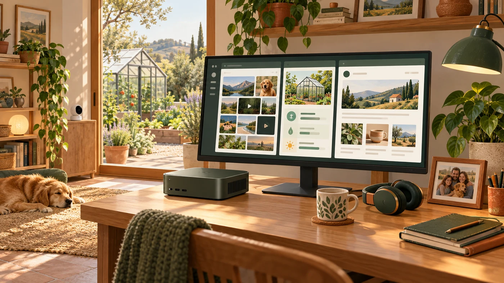
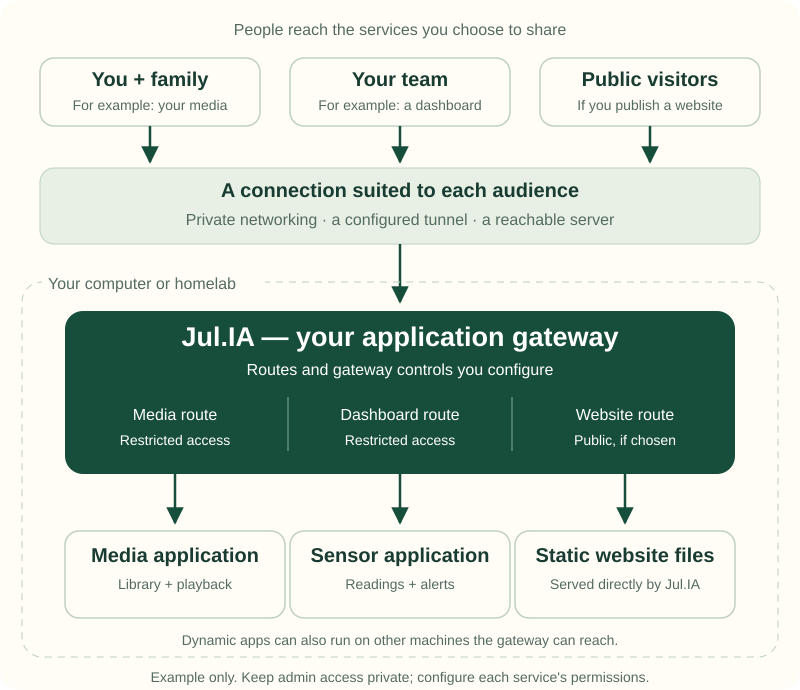
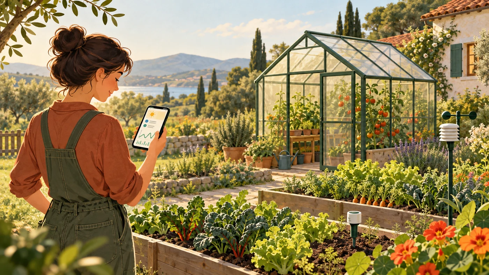
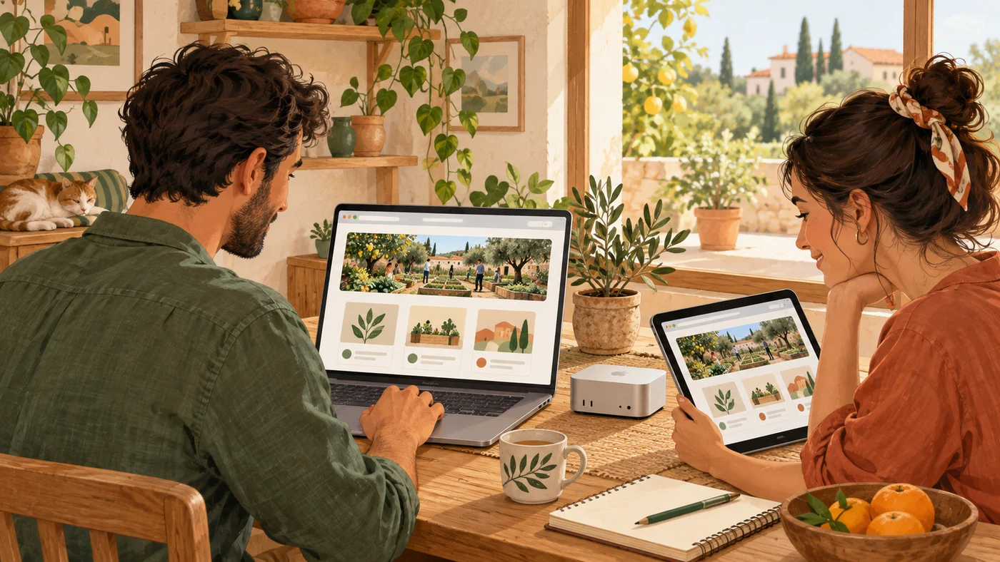
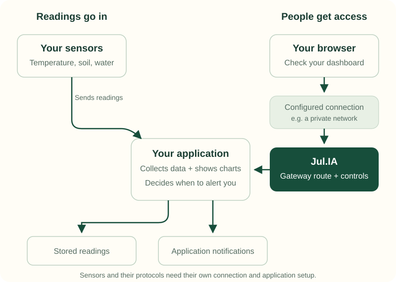

# Examples — Small computer. Big possibilities.

Your music on a journey. A view of your garden while you are away. A useful website for your family, community or small team.

You may already have the application working at home. The harder part is making it available to the right people without turning a small project into a large infrastructure job.

**Our gateway gives you a place to bring those applications together and configure how people reach them.**

*Your applications, running on hardware you choose.*

## One gateway. Several useful applications.

A single Jul.IA instance can sit in front of several applications, on the same computer or on other machines it can reach. A public website and a private dashboard can use different routes and access controls.

*You configure the audience and controls for each service. The picture shows an arrangement you can build, rather than an automatic sharing setup.*

**Use existing software, or build your own.** A media player plays your films. A sensor application collects readings. A home controller operates devices. Dynamic applications run separately; we route requests to them. We can serve a static website directly from its files.

Applications may need settings for use behind a gateway, such as their public address and trusted proxies. Their features, data and permissions still belong to the application.

## Five things you could do

### Take your music and videos with you

**The moment:** You are on a train or away for the weekend. Open your media app and enjoy the library you keep at home.

**You bring:** A running media application, your files and enough storage, processing power and upload speed.

**We provide:** A gateway to its supported web traffic, with the access controls you configure. Playback and video conversion stay in the media application.

### Keep an eye on your home, farm or greenhouse

**The moment:** Check whether the greenhouse is too hot, the soil is dry or a water tank is running low.

**You bring:** Sensors, their connection and an application that collects and stores readings. That application draws charts and sends alerts.

**We provide:** A gateway to its dashboard or HTTP data API.

### Check your cameras while you are away

**The moment:** Check the doorway, workshop, garden or animal enclosure from a private camera dashboard.

**You bring:** Cameras and software that provides a suitable web interface. That software handles recordings, motion alerts and camera-stream conversion.

**We provide:** A configured route to the web interface. Some camera software also uses separate media connections that need their own network setup. Restrict views and controls to the people who need them.

### Use your smart-home dashboard from elsewhere

**The moment:** Check heating, lights or energy use, and use the actions your home controller makes available.

**You bring:** A home-control application and connected devices. The controller communicates with them and runs automations.

**We provide:** A route to its supported web interface. Keep device permissions in the controller and choose restricted remote access for the people who should operate it.

### Publish your own website or portal

**The moment:** Give your club a website, share a portfolio or publish a small business portal.

**You bring:** Website files, or a running application for features such as accounts, forms and bookings.

**We provide:** Direct serving of static files, or a gateway to the dynamic application. Choose public access, restricted access, or a public introduction with a separately protected service.

## A sensor dashboard, explained

*The application understands your readings. Our gateway controls the configured path to its dashboard or API.*

## What do you need to start?

For a local experiment, **a compatible computer, the Jul.IA program and something to serve**: website files or a running application. Windows, Linux and macOS releases are available. The downloaded program does not require Go or Docker.

1. **Choose one useful project.** Get its application working locally, or prepare your website files.
2. **Download and verify our full release.** Follow the [practical guide](../practical-guide.md).
3. **Try our gateway locally.** Point it at the application or your website folder. Start with access from your own computer.
4. **Choose who should reach it remotely.** Configure a suitable connection, HTTPS, authentication and application permissions before sharing.

You do not need a provider account or domain for that local first step.

For remote use, the computer and connection must remain available. A sleeping laptop cannot serve your family while you are travelling.

### Choose the connection that fits

| Your aim | A possible connection | What still needs attention |
| --- | --- | --- |
| Private access from enrolled devices | Tailscale private networking | Device enrolment and network policies, plus service and application permissions |
| Browser access through a managed tunnel | Cloudflare Tunnel, with Access where appropriate | Tunnel routes, Access policies, application compatibility and current service limits |
| A public website or directly reachable service | A reachable server or suitable network setup | DNS as needed, HTTPS, firewall rules and authentication for private routes |

These connections provide the path to Jul.IA. Our gateway provides the configured application routes and gateway controls. An external platform may already cover your needs; add Jul.IA when its capabilities or local control are useful.

**Start with the [practical guide](../practical-guide.md)** for the first commands and complete deployment choices. Remote connectivity, hardware and other services can have their own costs and limits.

## More possibilities

Each idea below uses a suitable application, or static files where that is enough.

### For your family

| Idea | What you get |
| --- | --- |
| Private photo album | Relatives can browse shared pictures and videos. |
| Recipes and meal planning | Favourite recipes, shopping lists and weekly plans in one place. |
| Calendar and task board | A shared view of appointments, chores and household jobs. |
| Reading library | Your ebooks, comics or audiobooks through a suitable reader app. |
| Home inventory | Receipts, warranties and maintenance notes when you need them. |
| Family projects | Coding experiments, travel journals and family stories to share. |

### For your homelab

| Idea | What you get |
| --- | --- |
| Server dashboard | Readings and alerts from your monitoring software. |
| 3D-printer dashboard | Print progress and a compatible camera view. |
| Private AI chat | A web interface to a model service you run on suitable hardware. |
| Experiment hub | Several demos or development tools for chosen collaborators. |
| Personal Git service | A forge's web interface and compatible HTTP Git access. |
| Home-services start page | One small page linking to your apps, each with its own access policy. |

### For a small team or community

| Idea | What you get |
| --- | --- |
| Knowledge base | Procedures, project notes and onboarding information. |
| Request or booking portal | Equipment loans, room bookings or volunteer shifts. |
| Inventory dashboard | A shared view of stock, workshop parts or equipment. |
| Project board | Tasks, issues and delivery progress in an application you run. |
| Client review site | A prototype or draft website for selected reviewers. |
| File and download portal | Shared documents or releases; uploads need an application. |

These are possibilities to explore, rather than certified integrations. Check each application's installation, reverse-proxy and client requirements.

## Small audience. Serious capabilities.

A dashboard used by three people may still need strong access controls. A small API may still need limits, health checks and good diagnostics.

Our aim is to remove costs and complexity you do not need while keeping advanced capabilities available when they matter. The full build lets you configure those capabilities as your requirements grow.

| When you need to… | Capabilities to explore | The boundary |
| --- | --- | --- |
| Give services different access rules | Routing, JWT validation, forward auth or client certificates | Identity services and application permissions need their own setup. |
| Receive sensor data or stream live updates | HTTP APIs, streaming and supported WebSocket modes | Collectors, device protocols and every connection in the path must fit. |
| Deliver suitable content efficiently | Compression and caching | Private responses, large media and partial downloads need deliberate rules. |
| Use several application backends | Load balancing, health checks and resilience controls | Application state and sessions remain your responsibility; one gateway is still one point of failure. |
| Connect a specialist service | Documented gRPC, selected REST-to-gRPC, FastCGI/uWSGI and TCP/UDP capabilities | Each needs a compatible listener and connection; HTTP tunnels do not carry every protocol. |
| Diagnose problems and make changes | Console, logs, metrics, tracing and configuration validation | History and rollback depend on the deployment's configuration ownership. |

Feature maturity and limits differ. Check our [capability status](../status.md) and [known limitations](../known-limitations.md) before relying on a feature.

## Build a setup you can look after

Share the intended application endpoints. Keep our admin interface, databases and unrelated services private. Maintain the computer and applications, and back up important data.

One instance has finite capacity. Your applications, traffic, storage and connection determine what it can handle. We do not yet provide one integrated invitation or group-membership workflow across all your applications.

## Start small. Grow on your terms.

Begin with one useful application. Add others, or move them to more capable machines while our gateway can still serve them.

Some projects will stay small. Others will need greater availability, managed operation or a larger platform. Both are good outcomes. Our ambition is to support that journey and make the handover understandable; migration to another product can still require configuration changes and testing.

## Existing applications to explore

You do not have to build every application yourself. These projects show how existing software can meet an everyday need.

| Application | What it helps you do | Official guidance |
| --- | --- | --- |
| [Jellyfin](https://jellyfin.org/) | Organise and stream your own films, shows and music from a media server you run. | [Reverse-proxy setup](https://jellyfin.org/docs/general/post-install/networking/reverse-proxy/) |
| [Immich](https://docs.immich.app/) | Upload photos and videos from your phone and browse a library stored on your own server. Keep separate backups of important originals. | [Reverse-proxy setup](https://docs.immich.app/administration/reverse-proxy/) |
| [Home Assistant](https://www.home-assistant.io/) | Bring supported smart devices into one dashboard, control them and create household automations. | [HTTP and proxy settings](https://www.home-assistant.io/integrations/http/) |
| [Grafana](https://grafana.com/oss/grafana/) | Turn readings from connected data sources into dashboards and alerts for sensors, servers or a small team's services. | [Proxy setup](https://grafana.com/tutorials/run-grafana-behind-a-proxy/) |

Each application has its own installation, hardware and maintenance requirements. These links explain those projects; they do not establish tested Jul.IA integrations. Check proxy settings, uploads, streaming and client authentication for the complete setup.

## Pick something you would use tomorrow

Then use our [practical guide](../practical-guide.md) to choose your setup, or our [getting-started guide](../getting-started.md) for gateway configuration.

**One useful application today. More possibilities when you are ready.**
