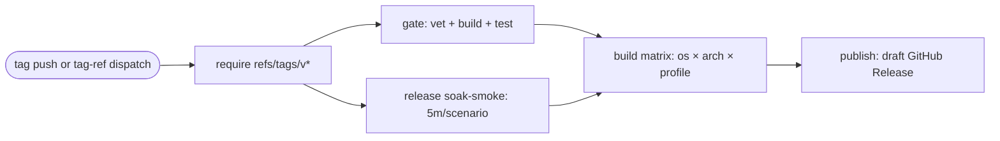

# Releases

> How Jul.IA (`jul`) is built, published, verified, and installed. Releases are
> cut by [`.github/workflows/release.yml`](../.github/workflows/release.yml) when
> a `v*` tag is pushed or the workflow is explicitly dispatched at an existing
> immutable `v*` tag. The build/test gate **and** five-minute release
> soak-smoke must both be green — a regression cannot ship under a tag. The
> smoke gate is release-blocking evidence, but it does not replace ADR 0005's
> long-running GA-soak minimums.

## Contents

- [What ships](#what-ships)
- [Variants](#variants)
- [How a release is produced](#how-a-release-is-produced)
- [Release candidates](#release-candidates)
- [Verifying a download](#verifying-a-download)
- [Installing](#installing)

## What ships

Each release attaches, for every platform × profile:

| Asset | What it is |
| --- | --- |
| `jul_<ver>_<os>_<arch>_<profile>.tar.gz` / `.zip` | The archive (binary + `server.toml` + `README` + `SECURITY` + SBOM). `.zip` for Windows, `.tar.gz` otherwise. |
| `…​.sha256` | SHA-256 of that archive. |
| `SHA256SUMS` | One file with the checksums of every archive. |

For releases built with archive attestation, each finished archive has a
keyless **build-provenance** attestation. Each binary also carries a
**build-provenance** attestation and an
**SBOM (SPDX JSON)** attestation, both keyless-signed via Sigstore and verifiable
with `gh attestation verify` (see [below](#verifying-a-download)). The SPDX SBOM
is also bundled inside each archive as `jul.spdx.json`.

## Variants

Releases are a matrix of **operating system × architecture × profile**.

**OS / arch:**

| OS | `amd64` | `arm64` |
| --- | --- | --- |
| Linux | ✅ | ✅ |
| Windows | ✅ | ✅ |
| macOS (Darwin) | ✅ | ✅ |

**Profiles** (same split as CI):

| Profile | Build tags | Use when |
| --- | --- | --- |
| `lean` | _(none)_ | You want the smallest binary and only need the default HTTP feature set. |
| `full` | `brotli zstd acme console otel grpc http3 importer wasmplugins stream consul kubernetes waf` | You want every opt-in feature (the recommended default). |

The build-tag list is kept in sync with `env.FULL_TAGS` in
[release.yml](../.github/workflows/release.yml) and
[ci.yml](../.github/workflows/ci.yml). See
[Building from source](../README.md) for
what each tag enables.

## How a release is produced



1. **`preflight`** — fails closed unless the run is bound to an existing
   immutable `refs/tags/v*` ref.
2. **`gate`** — `go vet`/`go build`/`go test` with the full tag set.
3. **`soak`** — a five-minute-per-scenario release smoke gate; a red run
   blocks the release, but the run does not satisfy ADR 0005's long-running GA
   soak minimums.
4. **`build`** (matrix) — cross-compiles a static (`CGO_ENABLED=0`),
   `-trimpath` binary per cell, stamps `main.version` from the tag, generates
   the SBOM, archives, checksums, and attests archive and binary provenance
   plus the binary's SBOM.
5. **`publish`** — collects every archive, writes `SHA256SUMS`, and opens a
   **draft** GitHub Release. A maintainer reviews the assets and publishes it.

Because the release is created as a draft, publishing is a deliberate human
step, not an automatic side effect of creating a tag. A controlled
`workflow_dispatch` at the **existing tag ref** is supported for recovery when a
tag push did not start the workflow; dispatch from a branch fails preflight and
the workflow never creates or moves tags. GitHub-generated release notes are a
starting point: before publication they must be reconciled with `CHANGELOG.md`,
the current security/status/known-limitations documents, and the actual
artifacts produced for the tagged SHA.

## Published v2.3.1 verification

Stable [v2.3.1](https://github.com/victornife/jul/releases/tag/v2.3.1) was
published **2026-11-24T00:12:45Z** from source
`ef409c0c7ea0ebabb9b6307352db8ba13e3edf95` (annotated tag object
`63936a1ef36cf6e0aa850931778f34837923e11c`). The exact-source main workflows
completed successfully, and the [tag release run](https://github.com/victornife/jul/actions/runs/45293311709)
passed all 16 jobs: preflight, full build/test, the five-minute release smoke,
all twelve platform/profile builds and draft creation.

The published release contains 25 assets: twelve lean/full archives for Linux,
macOS and Windows on amd64/arm64, twelve checksum sidecars and `SHA256SUMS`.
All actual downloaded asset digests matched GitHub's published digests; each
archive's checksums and packaged README, SECURITY and effective-version guide
matched the tagged source.

The [native actual-download run](https://github.com/victornife/jul/actions/runs/45294503446)
passed on all six platform/architecture pairs against the stable draft assets,
for both profiles. It verified archive and binary provenance, SBOM, checksums,
package identity, startup and upgrade/rollback. Actual-download negative checks
also rejected a modified archive and a genuine full-profile sibling substituted
under the lean filename; positive controls passed. These package and release
gates do not establish the longer post-GA soak minimums or promote Beta/Alpha
features to GA.

The release changed no feature maturity. Post-tag documentation records the
Beta and Alpha additions as released while preserving their open GA criteria
and soak limits. This reconciliation does not modify the immutable tag or
archives.

## Historical v2.2.0 preparation

v2.2.0 is a historical published release. Its immutable preparation
record remains preserved; see the
[release preparation record](release-candidates/v2.2.0.md) for the frozen
scope, macOS 13+/Go 1.27.2 compatibility, #569's seven exact HTTP/3 exceptions,
security-advisory coordination and actual-download/upgrade acceptance.

The historical `v2.2.0` verification used the verifier available at that tag;
its archive has no archive-level attestation. Its original evidence is not
reclassified by the current verifier.

## Published v2.2.0 verification

Stable [v2.2.0](https://github.com/victornife/jul/releases/tag/v2.2.0) was
published **2026-10-11T23:49:52Z**, from immutable source
`b12e051139f652b400cff37d9f063f5637a7d550` (annotated tag object
`9115edc5961b92526b9ec76b2c752bc146ce3523`). All fourteen applicable
merged-source workflows passed; the preparation PR's final head passed 61
checks. The [official tag release run](https://github.com/victornife/jul/actions/runs/38184479322)
passed build/test, the unchanged short smoke and all twelve package builds.

All twelve actual archives, lean/full on Linux/macOS/Windows amd64/arm64,
passed aggregate/individual SHA-256, embedded tag/source/clean/platform/profile
identity, bundled SPDX and signed provenance/SBOM bound to the release workflow
and exact source. The [native actual-download run](https://github.com/victornife/jul/actions/runs/38185464698)
executed all six native hosts: config/startup, static/proxy, authenticated admin
metrics, full Console/WAF and v2.1.0-to-v2.2.0-to-v2.1.0 upgrade/rollback using
a v2.1-compatible config. Both new Linux/arm64 packages additionally passed on
the maintainer host. No unexecuted native cell is called passed.

The [downloadable verification record](https://github.com/victornife/jul/releases/download/v2.2.0/package-verification.json)
retains every profile digest, build metadata, attestation and upgrade verdict.
The first native attempt failed before tests because its read-only token could
not see draft assets. Verification-only #573 corrected job access; definition
source `9b73d7cb` still checked out and verified package source `b12e0511`.
The tag and archives were never moved or replaced.

Both #514 advisories were published after verified fixed downloads:
[GHSA-4338-8694-mm4g](https://github.com/victornife/jul/security/advisories/GHSA-4338-8694-mm4g)
and [GHSA-376x-77gx-jmmf](https://github.com/victornife/jul/security/advisories/GHSA-376x-77gx-jmmf).
Affected releases are `>=1.32.1-rc.1, <2.2.0`; v2.2.0 is the first patched
release, with no CVE requested. Private synthetic evidence remains restricted.

macOS 13+ is required. The seven exact #569 HTTP/3 exceptions remain visible;
raw 42/49 h3spec and skipped 0-RTT limits are not full RFC conformance.
The three separately approved GA contracts were **soak pending at publication**.
Their eight-hour post-GA gate completed on 2026-10-14 under
[the source-bound #590 review](reviews/2026-10-14-ga-soak-590-results.md),
with the collector failure and authorised supplement preserved. No overall
coverage target or maturity promotion for other Beta features is claimed.
This post-tag publication-status documentation does not
change packaged READMEs or previous release/runtime evidence.

## Published v2.1.0 verification

Stable [`v2.1.0`](https://github.com/victornife/jul/releases/tag/v2.1.0)
was published **2026-09-30T16:58:24Z**, from immutable source
`0951090a6fb7703769a15b4749be9664a9842c98`.
[Final-source CI](https://github.com/victornife/jul/actions/runs/36742333911)
and the other applicable exact-main workflows completed successfully: 59
check runs across 16 workflows. The supported
[release workflow](https://github.com/victornife/jul/actions/runs/36744401880)
passed its tag preflight, build/test gate, five-minute release smoke and all
twelve OS/architecture/profile builds before creating the reviewed draft.

All twelve downloaded archives passed aggregate `SHA256SUMS`, embedded
source/platform/clean-tree metadata and bundled SPDX validation. Each binary's
keyless build-provenance and SBOM attestations were verified against this
repository, release workflow, exact source/tag and non-self-hosted runner policy
(24 checks). Individual `.sha256` files are also provided. The published
[package verification record](https://github.com/victornife/jul/releases/download/v2.1.0/package-verification.json)
records results and execution limits.

Actual downloaded-package smoke passed Linux arm64 lean/full and Windows
arm64/amd64 lean/full: version/capabilities, config check/lint, static/proxy
startup, authenticated admin health/readiness/metrics, and full WAF/Console
startup. Windows amd64 ran under Windows x64 execution support on an arm64
host, not a physical amd64 host. Downloaded macOS and Linux amd64 archives
were not executed on that host; their package identity/checksums/SBOM/signed
attestations were verified and exact-source native platform CI passed.
No unrun package execution is called a pass.

[Runtime evidence](soak-evidence.md#2026-09-30-v210-source-bound-runtime-evidence)
preserves the failed old-source log-integrity result and the corrected affected
validation under the recorded impact review. Large raw evidence archives remain
checksummed and retained locally, not attached to the release; the published
summaries and #480 retain their source identities and limitations. These web
documentation updates are post-tag commits, not changes to `0951090a` or its
packaged READMEs. Publication changes eligible delivery to `released`, not
Beta maturity or any GA criterion.

## Upgrading from v2.0.0 to v2.1.0

The candidate runtime freeze is `f036b063`, with exact-source CI and affected
logging/reload validation recorded in [soak evidence](soak-evidence.md) and
[#480](https://github.com/victornife/jul/issues/480). The earlier four-hour
measurements on `3258f1a3` retain that identity and their found log defect;
the post-fix impact review does not relabel them as another SHA's soak.
Documentation-only changes before the immutable tag require an explicit delta
review and exact-tag-source gates; package metadata/attestations bind the tag's
actual source. No tag may be moved to repair a failed candidate.

The tag's documentation-only delta from `f036b063` was reviewed before
publication; its runtime tree was unchanged and exact-tag-source gates passed.
The [published verification](#published-v210-verification) identifies the
actual tag, artifacts and native execution limits. No Beta capability becomes
GA by shipping.

Run `jul check` with the target binary before replacing a running process.
Rollback is the previous published archive, `v2.0.0`, started against a config
that `v2.0.0`'s `jul check` accepts. Do not point a v2.0.0 binary at a config
that uses keys added after that tag (`consistent_hash`, gRPC health probes,
`plugins.*.abi = "jul-abi/v2"`, plugin `sha256` pins).

Before upgrading an existing deployment:

1. If admin listens off loopback without a token or enabled RBAC, add one or
   bind loopback. TLS alone does not authenticate callers.
2. Expect canonical path matching. A location that only matched via `//`, `.`
   or `..` will not match those requests anymore; `jul lint` reports
   unreachable exact/prefix paths.
3. Cache disk entries written by v2.0.0 miss after upgrade because variant
   keys changed. That is a cold cache, not corruption. Rollback to v2.0.0
   likewise misses v2.1.0 entries.
4. CGI and uWSGI backends that emit conflicting status lines, repeated
   `Content-Length`, or hop-by-hop response fields now produce 502.
5. A plaintext remote CLI URL must still be loopback, and the client dials
   only addresses that resolve to loopback.

## Release candidates

A release-candidate tag uses the normal semantic-version pre-release form:

```text
vX.Y.Z-rc.N
```

It runs the **same** release gate, five-minute release soak-smoke,
cross-platform lean/full matrix, checksums, SBOM generation, and
archive/binary provenance and binary SBOM attestation as a stable tag. The
workflow still creates a **draft** GitHub Release. An RC draft remains
unpublished unless a maintainer explicitly decides otherwise; it is an artifact
and release-path validation point, not a claim that all selected correctness or
maturity work is complete.

The latest historical RC, [`v2.0.0-rc.1`](release-candidates/v2.0.0-rc.1.md),
is an independently verified prerelease at
`c9ab3a05af6a6088b2721de0a87995ce37d468cf`. It predates #420 and
remains immutable. Stable [`v2.0.0`](https://github.com/victornife/jul/releases/tag/v2.0.0)
was separately published 2026-09-21 from post-#420
`d56f5ceaf7ddb8a3875cbe6e27c9540db4130f75`, with exact release evidence
in [#425](https://github.com/victornife/jul/issues/425). The older
[`v1.32.1-rc.1` evidence](release-candidates/v1.32.1-rc.1.md) remains
historical. The [roadmap checkpoint](roadmap/README.md#published-stable-checkpoint)
and [status matrix](status.md) distinguish stable releases from later work on
`main`. No RC was renamed or reused as a stable tag.

Before creating any tag:

1. confirm the target commit is the intended integrated `main` SHA;
2. confirm required CI is green for that exact SHA;
3. confirm `CHANGELOG.md`, README, security, status, known-limitations and release
   notes describe both delivered fixes and unresolved limitations truthfully;
4. push the immutable tag;
5. review the resulting draft release, assets, checksums, SBOMs, attestations and
   soak artifact before any publication decision.

## Verifying a download

For releases built with this archive-attestation workflow, verify **before
extracting**. Obtain the expected immutable tag and full source commit from the
reviewed release record or another trusted tag identity, not from the archive
or checksum files. Select the exact OS, architecture and profile filename from
the release asset list. The workflow's keyless identity is trusted to produce
the claimed subject; a compromised release workflow can sign malicious bytes.
Attestations are fetched from GitHub by digest and verified with GitHub's
Sigstore trust material. Network access and GitHub CLI access to the repository
and attestations are required. The commands require `gh attestation verify`
with `--signer-workflow`, `--source-ref`, `--source-digest`,
`--deny-self-hosted-runners` and `--format json` (tested locally with gh
2.102.0), plus `jq` and Python 3 for the Bash example. A missing command,
unavailable evidence, policy mismatch or absent matching subject is a failure:
do not extract or execute.

Set the values below from the trusted release record and your selected asset.
For example, `os=linux`, `arch=amd64`, `profile=lean`, `ext=tar.gz`;
Windows assets use `os=windows` and `ext=zip`.

```bash
set -euo pipefail
tag='vX.Y.Z-rc.N'                 # replace with the trusted tag
commit='FULL_40_CHARACTER_COMMIT' # replace with the trusted source commit
os=linux arch=amd64 profile=lean ext=tar.gz
archive="jul_${tag}_${os}_${arch}_${profile}.${ext}"
digest="$(python3 -c 'import hashlib,sys; print(hashlib.sha256(open(sys.argv[1],"rb").read()).hexdigest())' "$archive")"
gh attestation verify "$archive" --repo victornife/jul \
  --signer-workflow victornife/jul/.github/workflows/release.yml \
  --source-ref "refs/tags/$tag" --source-digest "$commit" \
  --deny-self-hosted-runners --predicate-type https://slsa.dev/provenance/v1 \
  --format json |
  jq -e --arg name "$archive" --arg digest "$digest" \
    'any(.[]; .verificationResult.statement |
      .predicateType == "https://slsa.dev/provenance/v1" and
      any(.subject[]?; .name == $name and .digest.sha256 == $digest))' >/dev/null
inspection="$(mktemp -d)"
tar -xzf "$archive" -C "$inspection"
cd "$inspection/jul_${tag}_${os}_${arch}_${profile}"
for predicate in https://slsa.dev/provenance/v1 https://spdx.dev/Document/v2.3; do
  gh attestation verify ./jul --repo victornife/jul \
    --signer-workflow victornife/jul/.github/workflows/release.yml \
    --source-ref "refs/tags/$tag" --source-digest "$commit" \
    --deny-self-hosted-runners --predicate-type "$predicate"
done
```

PowerShell (Windows; replace the tag and commit with the trusted values):

```powershell
$ErrorActionPreference = 'Stop'
$tag = 'vX.Y.Z-rc.N'
$commit = 'FULL_40_CHARACTER_COMMIT'
$arch = 'amd64'
$profile = 'lean'
$archive = "jul_${tag}_windows_${arch}_${profile}.zip"
$digest = (Get-FileHash -LiteralPath $archive -Algorithm SHA256).Hash.ToLowerInvariant()
$json = gh attestation verify $archive --repo victornife/jul `
  --signer-workflow victornife/jul/.github/workflows/release.yml `
  --source-ref "refs/tags/$tag" --source-digest $commit `
  --deny-self-hosted-runners --predicate-type https://slsa.dev/provenance/v1 --format json
if ($LASTEXITCODE -ne 0) { throw 'Archive provenance verification failed' }
$verified = $json | ConvertFrom-Json
$match = @($verified | Where-Object {
  $_.verificationResult.statement.predicateType -eq 'https://slsa.dev/provenance/v1' -and
  @($_.verificationResult.statement.subject | Where-Object {
    $_.name -ceq $archive -and $_.digest.sha256 -ceq $digest
  }).Count -gt 0
})
if ($match.Count -eq 0) { throw 'Archive subject or digest mismatch' }
$inspection = Join-Path ([System.IO.Path]::GetTempPath()) ([System.IO.Path]::GetRandomFileName())
New-Item -ItemType Directory -Path $inspection | Out-Null
Expand-Archive -LiteralPath $archive -DestinationPath $inspection
Set-Location (Join-Path $inspection "jul_${tag}_windows_${arch}_${profile}")
foreach ($predicate in @('https://slsa.dev/provenance/v1', 'https://spdx.dev/Document/v2.3')) {
  gh attestation verify .\jul.exe --repo victornife/jul `
    --signer-workflow victornife/jul/.github/workflows/release.yml `
    --source-ref "refs/tags/$tag" --source-digest $commit `
    --deny-self-hosted-runners --predicate-type $predicate
  if ($LASTEXITCODE -ne 0) { throw "Binary attestation verification failed: $predicate" }
}
```

The verified JSON subject name and SHA-256 must occur together in the same
verified statement. This rejects a valid sibling asset renamed to the selected
filename. Keep downloads in a directory not writable by untrusted users while
verifying and extracting. These examples use online evidence; offline bundle
and trusted-root provisioning are not qualified here.

**Historical releases:** v2.2.0 and older immutable archives were not
archive-attested. Do not claim pre-extraction authentication for them. If
needed, check their unsigned checksums, extract only in a disposable isolated
environment as an unprivileged user, and verify binary provenance and SBOM
against the historical tag and source before executing the binary. Isolation
does not authenticate the archive. See the historical records above.

**Optional integrity checks:**

Each per-archive `.sha256` asset contains only the hash; `SHA256SUMS` has the
usual hash-plus-filename lines. Replace `<file>` with the downloaded archive:

```bash
# Linux
test "$(sha256sum "<file>" | awk '{print $1}')" = "$(cat "<file>.sha256")"
# macOS
test "$(shasum -a 256 "<file>" | awk '{print $1}')" = "$(cat "<file>.sha256")"
```

The `test` command exits nonzero on a mismatch. On Windows (PowerShell), use:

```powershell
$archive = '<file>'
$expected = (Get-Content "$archive.sha256" -Raw).Trim()
if ((Get-FileHash $archive -Algorithm SHA256).Hash -ne $expected) {
    throw 'Archive checksum mismatch'
}
```

The checksum files are unsigned. A match detects corruption but does not
independently authenticate the archive.

### First RC qualification handoff

After this verifier has merged and an authorized immutable RC tag is built, record the tag, full source
commit and release workflow run URL from the reviewed release decision. Confirm
the tag resolves to that commit from a trusted checkout. Dispatch the native
verifier from the current workflow definition:

```bash
set -euo pipefail
tag='vX.Y.Z-rc.N'                 # authorized RC
commit='FULL_40_CHARACTER_COMMIT' # reviewed tag's source
test "$(git rev-parse "refs/tags/$tag^{commit}")" = "$commit"
gh workflow run release-package-verification.yml --ref main -f tag="$tag" -f source="$commit"
gh run list --workflow release-package-verification.yml --limit 5
gh release view "$tag" --json assets --jq '.assets[] | [.name, .digest] | @tsv'
```

Record the verification run URL and all six native reports: twelve actual
draft asset names and SHA-256 digests, OS/architecture/profile, gh version,
archive pre-extraction, binary and SBOM verdicts, and upgrade/rollback results.
Perform and retain representative negative checks against actual RC evidence,
including changed bytes and a same-release sibling renamed to the selected
asset. Do not count local fixtures or workflow artifacts as downloaded draft
evidence. Review failures before publication. If a stable tag builds new
bytes, independently verify its actual downloaded draft assets against the
stable tag and source before publication.

For a reproducible Linux negative check, use gh 2.102.0, a fresh empty directory,
the same trusted `tag` and `commit` above, and actual draft assets. This checks
both a modified archive and a genuine full sibling renamed to the lean name,
with replacement unsigned checksums. Neither check extracts the archive.
Unexpected CLI diagnostics, network errors, or failed positive controls are
**inconclusive**, not negative-test passes:

```bash
set -euo pipefail
requested="jul_${tag}_linux_amd64_lean.tar.gz"
sibling="jul_${tag}_linux_amd64_full.tar.gz"
gh release download "$tag" --repo victornife/jul --pattern "$requested" --pattern "$sibling" --dir .
check_subject() {
  local file=$1 expected=$2 digest
  digest="$(sha256sum "$file" | awk '{print $1}')"
  gh attestation verify "$file" --repo victornife/jul \
    --signer-workflow victornife/jul/.github/workflows/release.yml \
    --source-ref "refs/tags/$tag" --source-digest "$commit" \
    --deny-self-hosted-runners --predicate-type https://slsa.dev/provenance/v1 --format json |
    jq -e --arg name "$expected" --arg digest "$digest" \
      'any(.[]; .verificationResult.statement |
        .predicateType == "https://slsa.dev/provenance/v1" and
        any(.subject[]?; .name == $name and .digest.sha256 == $digest))' >/dev/null
}
check_subject "$requested" "$requested"
check_subject "$sibling" "$sibling"
mkdir changed sibling
cp "$requested" "changed/$requested"
printf x >> "changed/$requested"
cp "$sibling" "sibling/$requested"
for case in changed sibling; do
  (cd "$case"; sha256sum "$requested" > SHA256SUMS; awk '{print $1}' SHA256SUMS > "$requested.sha256")
done
original_digest="$(sha256sum "$requested" | awk '{print $1}')"
changed_digest="$(sha256sum "changed/$requested" | awk '{print $1}')"
test "$changed_digest" != "$original_digest"
if gh attestation verify "changed/$requested" --repo victornife/jul \
  --signer-workflow victornife/jul/.github/workflows/release.yml \
  --source-ref "refs/tags/$tag" --source-digest "$commit" \
  --deny-self-hosted-runners --predicate-type https://slsa.dev/provenance/v1 \
  --format json >changed.json 2>changed.err; then
  echo "ERROR: changed archive was accepted" >&2
  exit 1
else
  status=$?
fi
# gh 2.102.0 reports this exact endpoint and digest when no attestation exists.
if [ "$status" -ne 1 ] || ! grep -Fq \
  "Error: HTTP 404: Not Found (https://api.github.com/repos/victornife/jul/attestations/sha256:$changed_digest?" changed.err; then
  echo "INCONCLUSIVE: unexpected verifier failure" >&2
  cat changed.err >&2
  exit 1
fi
check_subject "$requested" "$requested"
echo "PASS: changed digest has no provenance; original still verifies"

sibling_digest="$(sha256sum "sibling/$requested" | awk '{print $1}')"
gh attestation verify "sibling/$requested" --repo victornife/jul \
  --signer-workflow victornife/jul/.github/workflows/release.yml \
  --source-ref "refs/tags/$tag" --source-digest "$commit" \
  --deny-self-hosted-runners --predicate-type https://slsa.dev/provenance/v1 \
  --format json >sibling.json
jq -e --arg name "$sibling" --arg digest "$sibling_digest" \
  'any(.[]; .verificationResult.statement |
    .predicateType == "https://slsa.dev/provenance/v1" and
    any(.subject[]?; .name == $name and .digest.sha256 == $digest))' sibling.json >/dev/null
jq -r --arg name "$requested" --arg digest "$sibling_digest" \
  'any(.[]; .verificationResult.statement |
    .predicateType == "https://slsa.dev/provenance/v1" and
    any(.subject[]?; .name == $name and .digest.sha256 == $digest))' sibling.json | grep -Fx false
echo "PASS: verified sibling subject is not the selected asset"
```

Save the commands, outputs and the twelve native reports with the release
qualification record. The two positive checks above must succeed; an
unavailable verifier is not a successful qualification.

## Installing

Use the extracted directory whose binary passed verification above. Create a
page for a first run with zero-config mode; the bundled `server.toml` is a
multi-service example, not a standalone site. It expects `/srv/www/example` and two backends at
`127.0.0.1:3000` and `127.0.0.1:3001`, so adapt those dependencies before
starting it.
The published v2.0.0 `jul check` does **not** inspect static roots; create the
content directory before starting this package. Development builds with the
post-v2.0.0 root-check change open and immediately close each configured static
root, but cannot prove it will remain readable at startup or that the example
backends respond.

The published v2.2.0 binary and older releases do not have or require a private
effective-version key. The v2.3.1 binary and current `main` require one before
serving: provision it once as the serving identity with `jul version-key init`,
then preserve it across restarts and in a restricted backup. See
[effective-version provisioning and recovery](effective-versions.md); do not
initialize a replacement for an established lost key.

**Linux / macOS:**

```bash
chmod +x ./jul
mkdir -p public
printf '<h1>Hello from Jul.IA</h1>\n' > public/index.html
./jul run --serve ./public --listen 127.0.0.1:8080
```

**Windows (PowerShell):**

```powershell
New-Item -ItemType Directory -Force public | Out-Null
Set-Content public\index.html '<h1>Hello from Jul.IA</h1>'
.\jul.exe run --serve .\public --listen 127.0.0.1:8080
```

Open `http://127.0.0.1:8080/` to confirm the page. For a real config, edit the
sample's paths, backend addresses and feature prerequisites, run
`jul check -config server.toml`, then start it and exercise its routes. See
[Getting started](getting-started.md) for the step-by-step path.

To run Jul.IA as a managed, hardened service (systemd, Docker, or a Windows
service) with the right writable directories, follow
[docs/deployment.md](deployment.md).
