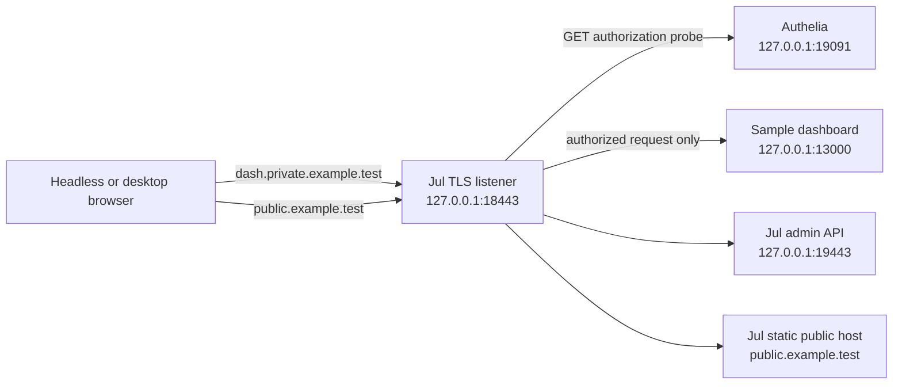

# Authelia Browser Login with Jul (#627)

> **Scope:** A reproducible, single-host composition of Jul forward-auth and
> Authelia v4.39.28 for one private browser dashboard, alongside an unrelated
> public static site on the same Jul instance. This is not native Jul
> application OIDC, a user directory service, an application permission
> system, or a production deployment template.
>
> **Implementation baseline:** Jul `main` at
> `f1a5f3a4d84c5b1d9f1c95da89bbdd841a800266`; Go 1.27.4; Python 3.14.4;
> Docker 29.6.2 / Compose 5.3.1; Linux arm64. Authelia
> `4.39.28@sha256:bd97cff4fcbf715b5ff1f9ae286afbe6033afce385302520b0368122d43a6f54`
> (Linux/arm64 manifest `sha256:36c60b9d8a070dc7cca38652177bce4d2243c0873b88f1cabd752b3e1a893a82`).
> These are the observed development/test versions, not a Jul release
> qualification. The example pins `argon2-cffi==25.1.0` and Playwright
> `1.65.2`; the installed Chromium version is written in the browser report.

## 1. What runs where



| Boundary | Enforcer and invariant | Not guaranteed |
| --- | --- | --- |
| Hostname routing | Jul's first `default-deny` virtual host returns 404 for unmatched names. `public.example.test`, `auth.private.example.test`, and `dash.private.example.test` have separate routes. | TLS SNI alone is not authorization; routing uses the HTTP Host as Jul documents. |
| Browser login and group decision | Authelia owns the file-backed users, password hashes, browser session, cookie scope, and `dashboard-users` rule. Unknown users and users without that group are denied. | Jul does not provision users, administer groups, enforce application roles, or provide a universal logout/revocation workflow. |
| Forward-auth | Jul asks Authelia for each protected request and forwards only the four configured `Remote-*` response headers after success. Jul strips client copies before applying verified values, then clears the browser `Cookie` header on the dashboard's upstream request. | The provider cookie remains available to the auth probe, but is not exposed to this sample origin. The sample has no application cookies; production apps that need their own cookies require a separately designed selective-filtering boundary. |
| Provider forwarding metadata | Jul constructs forwarding context from its request and canonical client address. Authelia is intended to receive those `X-Forwarded-*` values only from Jul. Authelia's own guidance warns that a proxy must replace client-supplied forwarding headers. | Do not put an untrusted proxy or direct client in front of this provider path. No external reverse proxy is qualified by this fixture. |
| Provider and origin network access | Compose publishes Authelia at host loopback `127.0.0.1:19091`; the sample origin binds `127.0.0.1:13000`; Jul and its admin API bind loopback. | This is not a host firewall, Docker daemon isolation, container egress policy, or defense against a hostile process already running on the host. |
| Private response caching | The protected Jul route disables Jul's response cache; the sample origin also sends `private, no-store`. | This does not control caches inside a different application, browser extensions, or other intermediaries. |
| Public/private separation | The public site is static, has no path to the origin, and uses `public.example.test`, outside the `private.example.test` cookie domain. | The fixture does not establish a general multi-tenant isolation guarantee for arbitrary applications. |
| Admin access | Jul's admin API is loopback-only and requires a generated RBAC admin token. | A loopback token is not safe to publish or reuse on a shared/untrusted host. |

Jul's route uses the existing GET-only ForwardAuth probe. The redirect to the
login portal is carried by Authelia's non-success response. Successful-probe
`Set-Cookie` is not relayed by Jul. The observed Authelia configuration does
not slide or refresh the cookie during a successful probe; the user must
authenticate again at expiry.

## 2. Why this composition

Authelia was selected for this one fixture because its documented
`/api/authz/forward-auth` endpoint uses the ForwardAuth request-metadata and
cookie-session model that Jul already supports. The fixture therefore reuses
Jul's existing GET probe, redirect handling, and allowlisted response-header
contract instead of adding a provider-specific integration. This is a fit
assessment, not a claim that Authelia is universally simpler or safer.
The pinned container follows Authelia's
[Docker deployment guidance](https://www.authelia.com/integration/deployment/docker/);
this fixture adds stricter local-only publication and disposable test secrets.

[Authentik's proxy provider](https://docs.goauthentik.io/add-secure-apps/providers/proxy/)
also supports both single-application and domain-level forward-auth. Its
documented composition uses an application/provider pair and a proxy outpost;
single-application mode also routes `/outpost.goauthentik.io` on the protected
application host. That is a viable alternative, but was not implemented or
tested here. The selected Authelia fixture has one provider container and a
small static configuration, matching the existing Jul contract with fewer
fixture-specific routing objects. Provider policy and user administration
remain external to Jul in either design.

Compared with application-native OIDC, this gateway composition can protect
an application that has no browser-login support and keep authorization checks
at the request gateway. It also adds a provider, proxy configuration, and
another recovery/upgrade responsibility; it does not give the application
user-aware permissions. A Tailscale- or Cloudflare-Access-style network or
hosted access layer answers a different access question and has its own
identity, device/network, and service dependencies. This recipe demonstrates
none of those alternatives and is not evidence that gateway login is a
replacement for them.

## 3. Prerequisites and setup

Run all commands from `examples/sharing/authelia-browser-auth/`. This path
supports a WSL/headless setup; no XFCE or other desktop session is required.

Required: Linux with Go 1.27.4 or newer for a source build, Python 3.12+,
OpenSSL, Docker Engine with Compose v2, `certutil` (`libnss3-tools` on
Debian/Ubuntu), and enough local disk for the pinned provider image. The
operator must have permission to use Docker. The browser test installs the
Playwright-pinned Chromium build in headless mode.

The domains under `.test` are test-only. Browser host-resolution rules map the
three names to loopback within the test browser; the script does not edit
`/etc/hosts` or system DNS. A real deployment must use a real domain, trusted
TLS certificates and corresponding Authelia cookie domain/URLs.

```bash
python3 -m venv .venv
. .venv/bin/activate
python -m pip install -r requirements.txt
python generate_lab_assets.py
docker compose pull
docker compose up -d
docker compose run --rm --entrypoint authelia authelia config validate \
  --config /config/configuration.yml
curl --fail http://127.0.0.1:19091/api/health
```

Generation creates a short-lived root CA and leaf certificate with the three
test hostnames, random Authelia secrets, two random synthetic passwords,
Argon2id hashes, and a random Jul admin token. Private materials and SQLite
state are under ignored `.lab/`; `.env` only contains the local UID/GID used by
Compose. The generator does not print passwords, secrets, or private-key
contents. Do not copy real accounts into this lab.

The provider container has a read-only root filesystem, drops Linux
capabilities, and mounts its generated config directory read-only while
keeping SQLite under a separate writable data mount. Its configuration sets
`server.disable_healthcheck: true` so Authelia does not try to write its
container health-check environment file into the read-only root filesystem;
this is unrelated to Jul's own auth-failure behavior.

Start the sample origin in one terminal:

```bash
python3 dashboard_backend.py
```

Build Jul and initialize the protected effective-version key in this fixture
directory, then validate and run it in another terminal:

```bash
go build -o jul ../../../cmd/jul
./jul version-key init --file .lab/effective-version.key
set -a
. .lab/jul.env
set +a
./jul check -config jul.toml
./jul -config jul.toml
```

Confirm all listeners are loopback-only before using the browser:

```bash
ss -ltn | grep -E ':(13000|18443|19091|19443)\\b'
```

The Docker-published provider port should show `127.0.0.1:19091`, not
`0.0.0.0:19091` or a LAN address. The sample origin and both Jul listeners
should also be `127.0.0.1`. Do not expose these ports with a tunnel or port
forward.

## 4. Browser checks

Use the separately pinned browser dependencies. Chromium trusts the generated
CA only in an isolated temporary NSS database; TLS verification is not
disabled and the system trust store is unchanged.

```bash
python3 -m venv .venv-browser
. .venv-browser/bin/activate
python -m pip install -r requirements-browser.txt
python -m playwright install chromium
python run_browser_checks.py | tee browser-report.json
```

The report intentionally contains no password, cookie value, token, or private
key. The deterministic browser run covers intended-user login and identity
forwarding, the exact protected return URL, forged inbound identity headers,
an excluded user's 403 with an unchanged origin request counter, public host
access and cookie separation, logout, successful-probe cookie behavior,
provider restart and session-secret rotation, idle-session expiry, group
removal/restoration, established SSE behavior, and absence of the Authelia
session cookie at the dashboard origin. It runs headlessly and
closes its isolated browser profiles afterward. Only the pinned headless
Chromium build was exercised; Firefox, Safari, mobile, and non-browser clients
are not qualified.

Expected outcomes:

| Request | Expected result |
| --- | --- |
| Unauthenticated `dash.private.example.test` | Redirect to Authelia login; after valid login, return to that dashboard URL. |
| `intended` user in `dashboard-users` | Dashboard response includes Authelia's `Remote-User` and configured `Remote-*` values; the forged client user does not arrive. |
| `excluded` user in `visitors` | 403; sample-origin request count does not increase. |
| `public.example.test` | Static marker returns 200 without an Authelia private-domain cookie. |
| Idle session after 35 seconds | Protected request returns to the login form. |
| Authelia unavailable | Jul must fail the auth dependency request closed; this fixture does not promise a friendly login page during outage. |
| Authelia restart or session-secret rotation | Existing browser session returns to login; a fresh login succeeds after a plain provider restart. |

The Authelia cookie is scoped to `private.example.test`, `Secure`,
`HttpOnly`, and `SameSite=Lax`. The provider's `inactivity` is 30 seconds and
absolute `expiration` is five minutes for this deliberately short test. This
is a fixed-session model, not sliding renewal. Production operators must choose
durations, secure cookie scope, backup policy, and a second-factor policy
appropriate to their threat model.

## 5. Operations, recovery, and known behavior

### User, group, logout, and established-connection changes

Authelia's file backend is the source of truth. Edit users through its supported
administrative process; this demo has no account-management UI. Removing a user or group can prevent a new authorization decision, but an
already-open SSE/WebSocket stream is not continuously reauthorized by Jul.
The browser harness removes the synthetic user's group: the next auth probe
and new dashboard request are denied, while the established SSE connection
remains open until the client explicitly closes it. Close streams on logout
and require the application/client to reconnect. The recipe does not establish
an immediate global revocation bound for arbitrary applications or transport
types.

The sample dashboard displays identity metadata and an event stream only. It
has no application-level role/permission layer and must not be used for
sensitive data.

### Provider or Jul restart / outage

The protected route calls Authelia on every new request. An unavailable or
malformed authorization response does not authorize the request. Restore
Authelia and then retry; do not make a provider outage fall back to a public
route. The qualification run stopped Authelia: Jul returned 503 and the
sample-origin request count remained unchanged. Restarting Authelia restored
its health endpoint.

Restarting Jul preserves the generated configuration and provider database,
but does not preserve active transport connections. The qualification run
restarted Jul with the same effective-version key, rotated the local admin
token and verified that the old token was rejected while the new token worked.
The protected unauthenticated route still redirected to login. The browser
harness also records whether a plain Authelia restart preserves the current
browser session; session behavior is provider-configuration-specific.

### Secret rotation and backup/restore

Treat `.lab/` as sensitive: it contains the CA key/certificate, TLS leaf key,
provider encryption/session/reset secrets, password hashes, synthetic
credentials, SQLite database, and Jul admin token. Keep it outside source
control, backups, logs, and evidence. To make a consistent provider backup,
stop the provider first:

```bash
docker compose stop authelia
cp -a .lab/authelia/data "/secure/offline-backup/authelia-data"
cp -a .lab/authelia/configuration.yml .lab/authelia/users_database.yml \
  .lab/tls .lab/jul.env "/secure/offline-backup/"
docker compose start authelia
```

Restore only into a stopped, isolated lab by restoring the matching files and
database together. Changing the session secret invalidates existing sessions;
changing the storage encryption key without restoring/re-encrypting compatible
data can make the database unreadable. Recreate only the disposable lab to
recover from accidental secret loss. The example has no remote backup or
production key-rotation automation.

The Jul admin API is available only on `127.0.0.1:19443`. Keep the token in
`.lab/jul.env`; source it only in the terminal that needs it. If local admin
access is lost, stop Jul, inspect and correct the local `jul.toml`, generate a
new admin token in `.lab/jul.env`, validate the config, and restart. This is
file-owned configuration; there is no remote-admin recovery path in this
recipe.

### Removal

Stop Jul and the sample backend with Ctrl-C, then stop and remove the provider
container:

```bash
docker compose down
```

After confirming `.lab/` contains only disposable test state, remove that
specific directory to delete generated credentials, certificates, and
provider data. Do not run this recipe on a host where any existing Jul
installation, provider, or listener uses the same ports.

## 6. Evidence status and limits

Qualification run: **2026-11-23**, local Linux/arm64 WSL environment;
source baseline `f1a5f3a4d84c5b1d9f1c95da89bbdd841a800266`; Go `1.27.4`,
Python `3.14.4`, Docker `29.6.2`, Compose `5.3.1`, Playwright `1.65.2`,
Chromium `159.0.8154.6`, and the pinned Authelia v4.39.28 image above. A
single `docker stats --no-stream` observation after startup showed Authelia at
`90.26 MiB` container memory and `0.03%` CPU. Immediately after the browser
run, Jul used `62.96 MiB` process RSS and the sample origin used `26.06 MiB`
process RSS. These are one idle point-in-time observation from different
measurement sources, not a comparable benchmark, aggregate memory estimate,
or capacity recommendation. Jul and the origin were bound to loopback.
Hands-on setup and maintenance time was not timed: the documented procedure
generates local TLS and credentials, starts one provider, builds/configures
Jul, starts the sample origin, and installs/runs the pinned headless browser.
Ongoing work is provider/Jul/browser version review, secret/database backup,
and revalidation after changes; no cost or effort superiority is claimed.

The following exact checks passed on the implementation:

```text
python3 scripts/test_authelia_browser_auth.py -v
  5 tests passed
python3 scripts/docs-check.py
  Results: 2741 passed, 0 failed
Jul 1.27.4: ./jul check -config jul.toml
  jul.toml is valid (structural + runtime)
Authelia v4.39.28:
  docker compose run --rm --entrypoint authelia authelia config validate --config /config/configuration.yml
  Configuration parsed and loaded successfully without errors.
curl http://127.0.0.1:19091/api/health
  {"status":"OK"}
python run_browser_checks.py
  passed; headless Chromium 159.0.8154.6; TLS verification enabled with the generated CA
Provider unavailable:
  protected route 503; origin request count 5 before and 5 after
Jul local-admin recovery:
  GET /api/v1/config: missing token 401; old token after restart 401; rotated token 200
Authelia backup/restore:
  restored generated config, users, data, TLS and Jul token; provider health passed
```

The passing browser run recorded intended/excluded users, forged-header
stripping, exact return URL, secure/private cookie scope, no public-host
cookie, successful-probe `Set-Cookie` behavior, no Authelia cookie at the
dashboard origin, logout, idle expiry after 35 seconds, provider restart and
fresh login, session-secret rotation invalidating the prior session, group
removal and restoration, a still-open established SSE stream, and explicit
client stream cancellation. The sanitized report included
`dashboard_cookie_forwarded: false` and contained no cookie values or
credentials. Group removal was checked by polling provider authorization every
100 ms for up to five seconds; the exact revocation delay was not measured.

| Evidence | Status |
| --- | --- |
| Config contract, pinned image, distinct hosts, default-deny route, restricted sharing mode, loopback upstreams/admin, disabled Jul cache | Deterministic Python test and Jul config-check; report exact CI/local results in the implementation handoff. |
| Real Authelia login, included/excluded users, forged headers, cookie scope, public-site separation, origin cookie withholding, logout and idle expiry | **Passed** in the pinned headless Chromium/provider run above. |
| Provider outage/recovery, Jul/provider restart, active-stream behavior, group removal, secret rotation, backup/restore, admin recovery | **Passed for this disposable fixture** using the commands and results above; not a production deployment qualification. |
| Off-host origin/provider/admin denial and host firewall policy | Loopback binds are verified locally; a separate host/network test is required to qualify a real deployment. |
| Resource use and setup/maintenance effort | One idle snapshot for Authelia, Jul, and the sample origin recorded above; setup/maintenance steps are described but time was not measured. No sustained load, comparable benchmark, or universal sizing/cost claim. |
| Production readiness, application-specific permissions, MFA, non-browser/API clients, high availability | Not qualified by this example. |

Revalidation owner: **@victornife**. Revalidate after changes to Jul
forward-auth/header behavior, Authelia's
authorization endpoint/session defaults, browser cookie policy, Docker port
publishing, or the route/auth configuration. The composition uses Authelia's
documented [`forward-auth` endpoint](https://www.authelia.com/reference/guides/proxy-authorization/)
and [session cookie settings](https://www.authelia.com/configuration/session/introduction/);
review the documentation for the exact provider image before changing versions.
