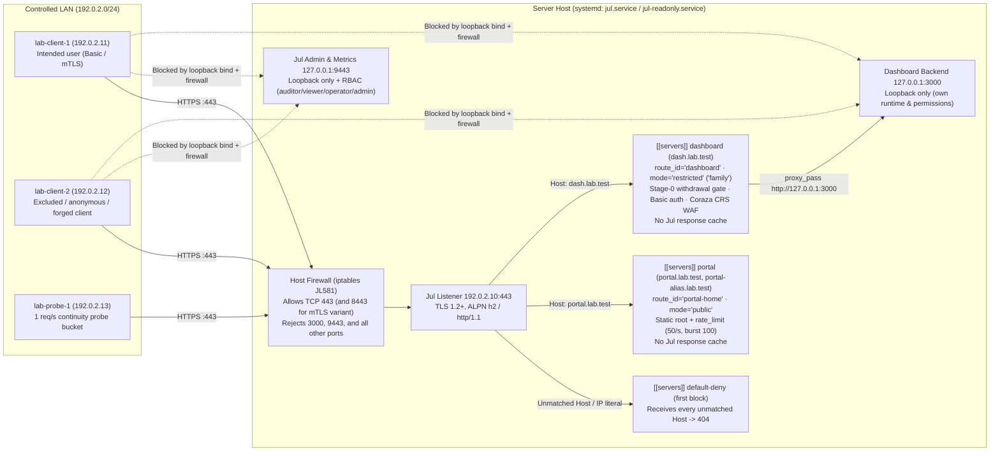

# Standalone Restricted & Public Sharing Runbook (Fixture F1, `#581`, `SHARE-02A`)

> **Status & Scope:** Executable operator runbook for **Fixture F1**
> ([`docs/specs/application-sharing.md` §10](../specs/application-sharing.md#f1--standalone-restricted-and-public-581),
> [ADR 0026](../adr/0026-application-sharing-contract.md)). This runbook walks
> an operator from a local loopback preview to a controlled-LAN deployment
> serving an anonymously readable public static portal (`portal.lab.test`) and a
> separately restricted HTTP dashboard (`dash.lab.test`) on one Jul.IA instance,
> without a Jul-hosted or external provider control plane.
>
> **Qualifying baseline decision (`#581`):** Because declared sharing intent
> (`#641`, `7280e255373a088540c9981008ab1b265ce2b4df`) and complete withdrawal
> with exact-entry stream/WebSocket retirement (`#642`/`#563`/`#562`,
> `e7e5cfbc0171de33e90a7b645ba4786370699219`) landed after published `v2.2.0`
> (`b12e051139f652b400cff37d9f063f5637a7d550`), the maintainer selected the
> merged `main` source build (`52b09adfbccfc3b14a86ce48a2de06395a7fae70`, full
> build profile) for `#581`'s qualifying run. All results in
> [f1-standalone-evidence.md](f1-standalone-evidence.md) are labelled
> **current-source development evidence**; released-product claims require
> revalidation on the first published release package containing `#641`, `#642`,
> and `#581`.

---

## 1. Topology, Trust Boundaries & Enforcement Owners



| Boundary / Component | Owner | What it enforces | What it never implies |
| --- | --- | --- | --- |
| **Network reachability & firewall** (`192.0.2.10:443`) | Host OS / network administrator | Which devices can open TCP connections to `192.0.2.10:443`; blocks off-host access to `127.0.0.1:3000` (backend) and `127.0.0.1:9443` (admin/metrics). | Never establishes user identity or authorization (`SH-3`). |
| **TLS termination** (`[servers.tls]`) | Jul listener + operator-managed certificates | Authenticates server identity to clients; negotiates HTTP/2 (`h2`) or `http/1.1`; optionally verifies client certificates (`[servers.tls.client_auth]`). | Does not bind TLS SNI to the HTTP `Host` header (`SH-11`); routing follows `Host`, and entry checks still run. |
| **Unmatched-host isolation** (`default-deny` block) | Jul router (first-declared `[[servers]]` block on listener) | Answers `404 Not Found` for any unknown `Host` header or bare IP literal (`https://192.0.2.10/`). | Must remain declared first on the listener so unknown hosts never fall through to `portal` or `dashboard`. |
| **Public portal** (`route_id = "portal-home"`) | Jul static handler + per-IP rate limiter | Serves `portal/` anonymously with `Cache-Control: public, max-age=300` and `rate = 50`, `burst = 100`. | Has no access to `dashboard` upstream or private data; Jul process-wide response cache is kept off (`SH-11`, `SD-16`). |
| **Restricted dashboard** (`route_id = "dashboard"`) | Jul location checks (`auth.basic` or mTLS + Coraza CRS WAF + stage-0 `withdrawn` gate) | Requires valid bcrypt Basic credentials (or verified client certificate) and passes CRS WAF inspection (`request_body_limit = "1m"`) before proxying to `http://dashboard`. | Does not replace the application's own post-login roles, permissions, or session store (`SH-2`, `SH-4`). |
| **Header sanitisation** (`ADR 0016 §12`, `SH-12`) | Jul reverse proxy | Overwrites `X-Forwarded-For` with the canonical transport peer; unconditionally strips `Forwarded`, `Client-Cert`, `Client-Cert-Chain`, and `X-Forwarded-Client-Cert`. | Jul does **not** strip unknown provider headers (`Tailscale-User-*`, `Cf-Access-*`); no authorization decision-maker may trust them (`SH-12`). |
| **Administration & metrics** (`127.0.0.1:9443`) | Jul admin server + RBAC | Loopback-only control plane with least-privilege RBAC roles (`auditor`, `viewer`, `operator`, `admin`). | Admin RBAC tokens never grant application access (`SH-4`). |

---

## 2. Prerequisites: Server Runtime vs Maintainer Build/Test Tools

A downloaded full-profile Jul binary is self-contained (including embedded
Console assets and embedded OWASP CRS WAF rules) and **does not require Go,
Node/pnpm, or Docker**.

| Role | Required tools | When needed |
| --- | --- | --- |
| **Operator running a downloaded archive** | Full-profile `jul` binary, existing HTTP backend (or `python3` for the sample `dashboard_backend.py`), `openssl` + `curl` for TLS/verification, `systemd` (Linux service profile) | Normal standalone operation and runbook execution |
| **Maintainer building from source / running CI harness** | Go `1.27.2` (`go.mod`), `python3` (`3.12+`), `iproute2` + `iptables` (for multi-namespace lab verification) | Building a development archive from `main` or running `scripts/sharing_f1_lab.py` |

### Stage or unpack the full-profile distribution

If using a staged development archive built from `main` (`52b09adfbccfc3b14a86ce48a2de06395a7fae70`):

```bash
# Verify archive SHA-256 and extract:
sha256sum -c jul_v2.2.0-dev+52b09adfbccf_linux_arm64_full.tar.gz.sha256
tar -xzf jul_v2.2.0-dev+52b09adfbccf_linux_arm64_full.tar.gz
./jul_v2.2.0-dev+52b09adfbccf_linux_arm64_full/jul version
./jul_v2.2.0-dev+52b09adfbccf_linux_arm64_full/jul capabilities --json
```

Confirm `"waf": true` and `"console": true` in `jul capabilities --json`. A lean
binary (`"waf": false`) rejects F1's `[servers.locations.waf]` block during
`jul check` before any configuration is persisted.

---

## 3. Collision Check & Ephemeral Asset Generation

Before installing service resources, verify that no pre-existing Jul service or
configuration exists on the host:

```bash
for p in /usr/local/bin/jul /etc/jul /var/lib/jul /var/cache/jul /var/log/jul \
         /etc/systemd/system/jul.service /etc/systemd/system/jul-readonly.service \
         /etc/systemd/system/jul-f1-dashboard.service; do
  if [ -e "$p" ]; then
    echo "STOP: existing resource $p found; do not overwrite" >&2
    exit 1
  fi
done
for u in jul.service jul-readonly.service jul-f1-dashboard.service; do
  if systemctl is-active --quiet "$u"; then
    echo "STOP: systemd unit $u is already active" >&2
    exit 1
  fi
done
getent passwd jul && { echo "STOP: user jul already exists" >&2; exit 1; } || true
```

Generate ephemeral lab certificates (Root CA → Intermediate CA → Leaf cert for
`portal.lab.test`, `portal-alias.lab.test`, `dash.lab.test`, `127.0.0.1`, and
`192.0.2.10`, plus mTLS Client CA, intended/revoked client certs, clean/revoked
CRLs, bcrypt `dashboard.htpasswd`, and static `portal/` files) in a fresh
working directory:

```bash
WORKDIR="$(mktemp -d /tmp/jul-f1-operator.XXXXXX)"
cp -r examples/sharing/f1-standalone/* "$WORKDIR/"
python3 "$WORKDIR/generate_lab_assets.py" --out "$WORKDIR" --lan-ip 192.0.2.10
```

Install the full-profile `jul` binary, create the unprivileged `jul` system
account, stage the generated TLS/htpasswd/portal assets and initial loopback
configuration (`01-loopback-preview.toml` → `/etc/jul/server.toml`), and
provision the durable private effective-version key (`#644`,
[effective-versions.md](../effective-versions.md)) before starting `jul.service`:

```bash
sudo install -m0755 ./jul_v2.2.0-dev+52b09adfbccf_linux_arm64_full/jul /usr/local/bin/jul
sudo useradd --system --no-create-home --shell /usr/sbin/nologin jul
sudo install -d -o jul -g jul -m0700 \
  /etc/jul /etc/jul/tls /etc/jul/portal /etc/jul/portal/assets \
  /var/lib/jul /var/lib/jul/private /etc/jul/private /var/lib/jul/config-history \
  /var/cache/jul /var/log/jul

# Stage TLS chains/CRLs, bcrypt htpasswd, static portal root, and initial loopback config:
sed -i 's|history_dir = "state/config-history"|history_dir = "/var/lib/jul/config-history"|g' "$WORKDIR"/*.toml
sudo install -o jul -g jul -m0600 "$WORKDIR"/tls/* /etc/jul/tls/
sudo install -o jul -g jul -m0600 "$WORKDIR/dashboard.htpasswd" /etc/jul/dashboard.htpasswd
sudo install -o jul -g jul -m0644 "$WORKDIR/portal/index.html" /etc/jul/portal/index.html
sudo install -o jul -g jul -m0644 "$WORKDIR/portal/assets/bundle.bin" /etc/jul/portal/assets/bundle.bin
sudo install -o root -g root -m0755 "$WORKDIR/dashboard_backend.py" /etc/jul/dashboard_backend.py
sudo install -o jul -g jul -m0600 "$WORKDIR/01-loopback-preview.toml" /etc/jul/server.toml

# Initialize the durable effective-version HMAC key for both managed and file_owned paths:
sudo -u jul /usr/local/bin/jul version-key init --file /var/lib/jul/private/effective-version.key
sudo install -o jul -g jul -m0400 /var/lib/jul/private/effective-version.key /etc/jul/private/effective-version.key

# Generate least-privilege admin/operator/viewer/auditor tokens and store admin.token for CLI calls:
ADMIN_TOK="$(openssl rand -hex 24)"
OPERATOR_TOK="$(openssl rand -hex 24)"
VIEWER_TOK="$(openssl rand -hex 24)"
AUDITOR_TOK="$(openssl rand -hex 24)"
printf '%s\n' "$ADMIN_TOK" > "$WORKDIR/admin.token"
chmod 0600 "$WORKDIR/admin.token"
sudo tee /etc/jul/jul.env >/dev/null <<EOF
JUL_ADMIN_TOKEN=${ADMIN_TOK}
JUL_F1_OPERATOR_TOKEN=${OPERATOR_TOK}
JUL_F1_VIEWER_TOKEN=${VIEWER_TOK}
JUL_F1_AUDITOR_TOKEN=${AUDITOR_TOK}
EOF
sudo chown root:jul /etc/jul/jul.env
sudo chmod 0640 /etc/jul/jul.env

# Validate and lint the staged configuration before starting services:
sudo -u jul bash -c 'set -a; source /etc/jul/jul.env; set +a; cd /etc/jul && /usr/local/bin/jul check -config /etc/jul/server.toml && /usr/local/bin/jul lint -config /etc/jul/server.toml'

# Install and start the loopback dashboard backend and Jul systemd units:
sudo cp deploy/systemd/jul.service deploy/systemd/jul-readonly.service /etc/systemd/system/
sudo install -d -m0755 /etc/systemd/system/jul.service.d /etc/systemd/system/jul-readonly.service.d
sudo tee /etc/systemd/system/jul.service.d/f1.conf /etc/systemd/system/jul-readonly.service.d/f1.conf >/dev/null <<'EOF'
[Service]
WorkingDirectory=/etc/jul
EnvironmentFile=/etc/jul/jul.env
EOF
sudo tee /etc/systemd/system/jul-f1-dashboard.service >/dev/null <<'EOF'
[Unit]
Description=Jul F1 Restricted Dashboard Backend (Loopback Only)
After=network.target

[Service]
Type=simple
User=jul
Group=jul
ExecStart=/usr/bin/python3 /etc/jul/dashboard_backend.py --listen 127.0.0.1:3000
Restart=on-failure
RestartSec=1s
NoNewPrivileges=yes
PrivateTmp=yes
ProtectSystem=strict
ProtectHome=yes

[Install]
WantedBy=multi-user.target
EOF

sudo systemctl daemon-reload
sudo systemctl start jul-f1-dashboard.service jul.service
curl -fsS http://127.0.0.1:3000/healthz
curl -fsS -H "Authorization: Bearer ${ADMIN_TOK}" http://127.0.0.1:9443/api/v1/status | jq '{state, authority: .config_authority, config_state}'
```

---

## 4. Safe Operator Sequence: Loopback Preview to Controlled-LAN Publication

Protection must be in place and verified on loopback **before** any listener
becomes reachable on the LAN (`SH-5`). Never bind `0.0.0.0:443` as a shortcut.

| Step | Candidate File | Listener Bind | Target Entry & Change | Audience-Delta Class (`§9.5`) | Postcondition (`§9.4`) | Required Client Verification |
| --- | --- | --- | --- | --- | --- | --- |
| **1. Start on loopback** | `01-loopback-preview.toml` (`CFG-F1-01`) | `127.0.0.1:443` | `default-deny`, `portal-home` (`preview`), `dashboard` (`preview`, WAF on, no Basic check yet) | Initial boot (`managed_unadopted`, then adopt → `managed_clean`) | — | Host loopback `200` on portal & dashboard; external LAN clients `lab-client-1` and `lab-client-2` **cannot connect** to `192.0.2.10:443` |
| **2. Restrict dashboard on loopback** | `02-loopback-dashboard-restricted.toml` (`CFG-F1-02`) | `127.0.0.1:443` | Add `auth.basic` (`dashboard.htpasswd`) + set `sharing.mode = "restricted"`, `audience_label = "family"` on `dashboard` | `dashboard`: **`narrowed`** (`triggers_retirement = true`) | `candidate_serving` (`candidate = "serving"`, `access = "matches"`) | On loopback: missing/wrong password → `401` (`origin_delta = 0`); intended password → `200` (`origin_delta = +1`) |
| **3. Declare portal public** | `03-loopback-portal-public.toml` (`CFG-F1-03`) | `127.0.0.1:443` | Set `sharing.mode = "public"`, `audience_label = "anyone"` on `portal-home` | `portal-home`: **`metadata_only`** (`declared_mode_widened = true`, `triggers_retirement = false`) | `candidate_serving` | Loopback portal `200`; dashboard still `401` without credentials |
| **4. Move all 3 blocks to LAN in one candidate** | `jul.toml` (`CFG-F1-04`) | `192.0.2.10:443` | Move `default-deny`, `portal`, and `dashboard` from `127.0.0.1:443` to `192.0.2.10:443` atomically | All 3 entries: **`uncertain`** (loopback stops answering; `requires_acknowledgement = true`) | `candidate_serving` | **Immediately verify:** `lab-client-2` gets `401` on `dash.lab.test` (`origin_delta = 0`) and `200` on `portal.lab.test`; `lab-client-1` gets `200` on `dash.lab.test` with Basic credentials |
| **5. Withdraw & recover** | `05-lan-withdrawn-gate.toml` (`CFG-F1-05`) → `jul.toml` (`CFG-F1-04`) | `192.0.2.10:443` | Set `withdrawn = true` on `dashboard` (or `location_set_withdrawn`), then restore `withdrawn = false` | Withdraw: **`narrowed`** (`2s` retirement); Restore: **`widened`** | `candidate_serving` | Withdraw: `403 Forbidden` + `Cache-Control: no-store` for all dashboard callers, open dashboard streams end `<= 2s`, portal stays `200` (`collateral_count = 0`). Restore: intended `200`, excluded `401` |

### Executing each step in `managed` mode (`jul.service`)

```bash
export JUL_ENDPOINT="http://127.0.0.1:9443"
TOKEN_FILE="$WORKDIR/admin.token"
INTENDED_USER="$(jq -r '.intended_user' "$WORKDIR/.lab-credentials.json")"
INTENDED_PASS="$(jq -r '.intended_password' "$WORKDIR/.lab-credentials.json")"
cd "$WORKDIR"

# Step 1: Adopt the initial loopback baseline
BASE_VER="$(jul status --endpoint "$JUL_ENDPOINT" --token-file "$TOKEN_FILE" --json | jq -r '.serving_version')"
jul apply --endpoint "$JUL_ENDPOINT" --token-file "$TOKEN_FILE" \
  --adopt-external --base-version "$BASE_VER" --idempotency-key f1-step1-adopt --json

# Step 2: Plan, apply, and verify postcondition for 02-loopback-dashboard-restricted.toml
BASE_VER="$(jul status --endpoint "$JUL_ENDPOINT" --token-file "$TOKEN_FILE" --json | jq -r '.persisted_version')"
jul plan --endpoint "$JUL_ENDPOINT" --token-file "$TOKEN_FILE" \
  --config 02-loopback-dashboard-restricted.toml --base-version "$BASE_VER" --json > step2-plan.json
jq '{entries: .sharing.entries, requires_ack: .sharing.requires_acknowledgement}' step2-plan.json

jul apply --endpoint "$JUL_ENDPOINT" --token-file "$TOKEN_FILE" \
  --config 02-loopback-dashboard-restricted.toml --base-version "$BASE_VER" \
  --idempotency-key f1-step2-restrict --json
jul postcondition --endpoint "$JUL_ENDPOINT" --token-file "$TOKEN_FILE" \
  --file step2-plan.json --json

# Step 3: Declare portal public on loopback (03-loopback-portal-public.toml)
BASE_VER="$(jul status --endpoint "$JUL_ENDPOINT" --token-file "$TOKEN_FILE" --json | jq -r '.persisted_version')"
jul plan --endpoint "$JUL_ENDPOINT" --token-file "$TOKEN_FILE" \
  --config 03-loopback-portal-public.toml --base-version "$BASE_VER" --json > step3-plan.json
jul apply --endpoint "$JUL_ENDPOINT" --token-file "$TOKEN_FILE" \
  --config 03-loopback-portal-public.toml --base-version "$BASE_VER" \
  --idempotency-key f1-step3-portal-public --json
jul postcondition --endpoint "$JUL_ENDPOINT" --token-file "$TOKEN_FILE" \
  --file step3-plan.json --json

# Step 4: Move all three blocks to 192.0.2.10:443 in one candidate (jul.toml)
BASE_VER="$(jul status --endpoint "$JUL_ENDPOINT" --token-file "$TOKEN_FILE" --json | jq -r '.persisted_version')"
jul plan --endpoint "$JUL_ENDPOINT" --token-file "$TOKEN_FILE" \
  --config jul.toml --base-version "$BASE_VER" --json > step4-plan.json
jul apply --endpoint "$JUL_ENDPOINT" --token-file "$TOKEN_FILE" \
  --config jul.toml --base-version "$BASE_VER" \
  --idempotency-key f1-step4-lan-move --json
jul postcondition --endpoint "$JUL_ENDPOINT" --token-file "$TOKEN_FILE" \
  --file step4-plan.json --json

# Step 5: Immediately verify from excluded and intended LAN clients
curl -s -o /dev/null -w "%{http_code}\n" --cacert tls/root-ca.pem \
  --resolve dash.lab.test:443:192.0.2.10 https://dash.lab.test/api/summary
# Expected: 401

curl -fsS --cacert tls/root-ca.pem --user "$INTENDED_USER:$INTENDED_PASS" \
  --resolve dash.lab.test:443:192.0.2.10 https://dash.lab.test/api/summary | jq .marker
# Expected: "JUL-F1-RESTRICTED-DASHBOARD-MARKER-v1"
```

---

## 5. Authority Modes (`managed` vs `file_owned`) & `§9.4` Postconditions

### `managed` mode (`config_authority = "managed"`, `deploy/systemd/jul.service`)

- **Mutations:** Performed via `POST /api/v1/config/apply` (`jul apply` / `jul stage`), `POST /api/config/patch/apply`, or `POST /api/v1/config/rollback` (`jul rollback`) with a reviewed `base_version` and `Idempotency-Key`.
- **Drift protection:** Editing `/etc/jul/server.toml` on disk outside Jul transitions `config_state` to `managed_drift`. Ordinary managed writes are refused with `409 drift_detected` while Jul continues serving the last valid generation. Resolve explicitly via `jul apply --adopt-external` or by reverting the file on disk.
- **Restart-bound staging (`stage_restart`):** Changes to restart-required fields (for example `cache.enabled`) are staged with `jul stage`. `GET /api/sharing` exposes both the `serving` layer and a separately labelled `saved` layer (`SH-13`). Evaluating the plan's postcondition before restart returns `result = "not_serving_yet"` (`candidate = "base_serving"`).
- **Post-restart postcondition recovery:** Because every digest in a postcondition is an HMAC-SHA-256 under a random key held only in the running process's memory (`AD-09`), restarting Jul rotates `boot_id` and `key_id`. Evaluating a pre-restart postcondition after restart returns `result = "unverifiable"` (`reason = "planned_by_earlier_process"`). To confirm the change after restart without re-applying it, re-run `jul plan` with the same raw candidate (requires `config:raw`) or repeatable typed operation (`location_set_withdrawn`, `location_set_sharing`) and evaluate the newly returned postcondition (`result = "candidate_serving"`). Non-repeatable operations (`location_add`, `location_remove`) set `repeatable = false` and are reconciled by inspecting `GET /api/sharing` and history by hand.

### `file_owned` mode (`config_authority = "file_owned"`, `deploy/systemd/jul-readonly.service`)

- **Read-only control plane:** `GET /api/sharing`, `POST /api/v1/config/plan` (`jul plan`), and `POST /api/sharing/postcondition/evaluate` (`jul postcondition`) work normally. Every mutating API/CLI call (`apply`, `stage`, `patch/apply`, `rollback`, `adopt-external`) is refused with `HTTP 409 config_authority_read_only` (CLI exit code `6`) before any side effect, and `/etc/jul` is mounted `ReadOnlyPaths=/etc/jul`.
- **Applying & rolling back changes:**
  1. Run `jul plan --config 11-file-owned-withdrawn-gate.toml --json > fo-plan.json` (using an account holding `config:raw`) to inspect the diff, audience delta, and `postcondition`.
  2. Replace `/etc/jul/server.toml` in the owner pipeline (`sudo install -o root -g jul -m0640 11-file-owned-withdrawn-gate.toml /etc/jul/server.toml`) and reload Jul (`sudo systemctl reload jul-readonly.service`).
  3. Run `jul postcondition --file fo-plan.json --json` and verify `result == "candidate_serving"`, `candidate == "serving"`, and `access == "matches"`.
  4. Rollback is owner-controlled: install the previous file (`10-file-owned-lan.toml`) and send `SIGHUP`. Jul never writes `route_id`s into a `file_owned` file or maintains managed history in `file_owned` mode (`SH-1`).

---

## 6. Complete Withdrawal (`#642`) vs Legacy `auth.deny` & mTLS Variants

### Complete withdrawal (`withdrawn = true` / `location_set_withdrawn`)

1. **Outermost stage-0 gate:** Setting `withdrawn = true` on `route_id = "dashboard"` (see `05-lan-withdrawn-gate.toml` or `location_set_withdrawn`) executes in the router immediately after path canonicalisation and location selection, **before** redirect rewrites, request WASM plugins, CORS preflight, client-certificate checks, Basic/JWT/forward-auth, WAF, rate limiting, and caching.
2. **Response contract:** Returns `403 Forbidden` with `Cache-Control: no-store` and `Expires` removed (even when the location configures `expires` or `response_headers` setting `Cache-Control: public, max-age=…`), while preserving `proxy_pass`, `auth.basic`, `waf`, and `sharing` in place for single-edit recovery.
3. **Exact-entry stream & WebSocket retirement (`2s` bound):** At `Publish`, Jul retires all open HTTP/1.1, HTTP/2, and HTTP/3 streams, SSE streams, and owned HTTP/1.1 `101` WebSocket sessions (`RFC 6455` Close `1008 Policy Violation`) belonging to `dashboard` within **`2s`** (`1s` graceful window + `1s` forced cutoff), without closing shared HTTP/2 connections carrying `portal-home` streams (`collateral_count = 0`, `claim = "complete_withdrawal"`).

### Legacy `auth.deny` mechanism (`06-lan-withdrawn-legacy-deny.toml`)

Retained as a separately labelled mechanism verification (`spec §9.3`): adding `deny = ["0.0.0.0/0", "::/0"]` to `[servers.locations.auth]` in a complete candidate denies requests at the CIDR stage while preserving `auth.basic` and `proxy_pass`. Never use `location_set_auth` (which replaces auth wholesale and drops `auth.basic`) or the `deny` action (which removes `proxy_pass`). Unlike `withdrawn = true`, `auth.deny` runs **after** redirect rewrites, request plugins, and CORS preflights (flagged by `intent_checks_bypassed`).

### Mutual TLS (`mTLS`) variants (`08` / `09` managed; `12` / `13` `file_owned`)

- **Shared listener (`CFG-F1-08` managed, `CFG-F1-12` `file_owned`):** Configures `[servers.tls.client_auth] mode = "request"` on `192.0.2.10:443` and `require_client_cert = true` on `dashboard`. Because `client_auth.mode` is listener-wide, TLS handshakes to `portal.lab.test` also receive a `CertificateRequest` (surfaced as `client_auth_request_mode_shared` in `GET /api/sharing` because browsers holding client certificates may prompt).
- **Dedicated listener (`CFG-F1-09` managed, `CFG-F1-13` `file_owned`):** Keeps `portal` on `192.0.2.10:443` with `client_auth` off and moves `dashboard` (plus a first-declared `default-deny-mtls` block) to `192.0.2.10:8443` with `client_auth.mode = "require"`.
- **CRL revocation on reload (`#642`, `#563`):** Updating `crl_file` on disk has no effect until Jul reloads. On explicit reload, Jul (a) classifies newly added revoked serials as `narrowed` at publish and retires active streams on `dashboard` within `<= 2s`, (b) re-evaluates `r.TLS` against the live `clientAuthBundle` on every request so the very next request to `dash.lab.test` over an already-open HTTP/1.1 or HTTP/2 connection is rejected with `403 Forbidden` on that stream without closing sibling `portal` streams on the same connection, and (c) rejects new and resumed TLS handshakes presenting the revoked certificate.

---

## 7. Real-Host Certificate Acquisition, Firewall/Router/CGNAT & Client Trust Guidance

When moving from the controlled lab (`192.0.2.0/24` + private CA) to a real LAN or Internet-reachable host:

1. **Certificate acquisition:**
   - **Public domain with inbound port 80/443 or DNS API:** Use Jul's built-in ACME support (`[acme]` + `tls.acme = true`, see [tls-acme.md](../tls-acme.md)) or an external ACME client writing full-chain PEM files (`leaf + intermediate`) to `/etc/jul/tls/` and reloading Jul on renewal.
   - **Private LAN without public DNS:** Issue a short-lived leaf + intermediate chain from an internal CA (for example `step-ca` or `mkcert` / OpenSSL CA) covering the exact `server_names` (`portal.example.lan`, `dash.example.lan`) and install only the Root CA in each intended client's trust store. Never disable TLS verification (`-k` / `InsecureSkipVerify`) on clients.
2. **Host firewall, router & CGNAT constraints:**
   - Jul binds only its configured sockets; it **never** opens router ports (no UPnP/NAT-PMP), punches holes through CGNAT, or creates overlay tunnels (`SH-8`).
   - If the ISP places the host behind Carrier-Grade NAT (`100.64.0.0/10`, reported as `bind_scope = "shared_address_space"`) or blocks inbound ports, direct Internet publishing is unavailable from that network; use local LAN access (`#581`), a private tailnet (`#582`), or an outbound tunnel with origin protection (`#583`).
   - Keep `127.0.0.1:3000` (backend) and `127.0.0.1:9443` (admin/metrics) bound to loopback and blocked at the host firewall so LAN peers cannot bypass Jul.

---

## 8. Deterministic Teardown & Cleanup

Teardown removes only task-owned resources while preserving any unrelated host or application data:

```bash
# If running the automated F1 lab harness, teardown runs automatically in a finally block.
# For manual service/network cleanup of the F1 lab:
sudo systemctl stop jul.service jul-readonly.service jul-f1-dashboard.service 2>/dev/null || true
sudo rm -rf /etc/systemd/system/jul.service /etc/systemd/system/jul-readonly.service /etc/systemd/system/jul-f1-dashboard.service \
            /etc/systemd/system/jul.service.d /etc/systemd/system/jul-readonly.service.d
sudo systemctl daemon-reload
sudo systemctl reset-failed jul.service jul-readonly.service jul-f1-dashboard.service 2>/dev/null || true
sudo rm -rf /usr/local/bin/jul /etc/jul /var/lib/jul /var/cache/jul /var/log/jul "$WORKDIR"
sudo userdel jul 2>/dev/null || true

# Verify clean post-teardown state:
for p in /usr/local/bin/jul /etc/jul /var/lib/jul /var/cache/jul /var/log/jul \
         /etc/systemd/system/jul.service /etc/systemd/system/jul-readonly.service \
         /etc/systemd/system/jul-f1-dashboard.service \
         /etc/systemd/system/jul.service.d /etc/systemd/system/jul-readonly.service.d; do
  [ ! -e "$p" ] || { echo "FAIL: leftover path $p" >&2; exit 1; }
done
! getent passwd jul >/dev/null || { echo "FAIL: leftover user jul" >&2; exit 1; }
```
