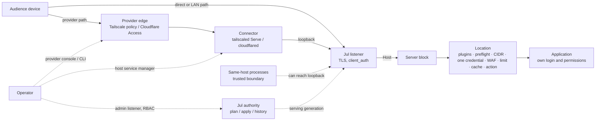

# Application sharing contract (SHARE-01)

> **Status: Proposed — design for maintainer acceptance under
> [#580](https://github.com/victornife/jul/issues/580).** Nothing here is a
> shipped capability. Decisions marked *Accepted* record a maintainer answer
> (SD-01 to SD-14, 2026-10-18); everything else is a proposal until #580 is
> accepted. Runtime work belongs to the successor owners named in §17. Source
> baseline: `main` at `64e4a8b29230134c5dee37dfd8bfa130a9580a2a`; published
> package baseline v2.2.0. Evidence, decision log, adversarial review and
> traceability live in the
> [design review packet](../reviews/2026-10-18-580-application-sharing-design.md);
> the durable decisions are in [ADR 0025](../adr/0025-application-sharing-contract.md).

## 1. Purpose, scope and classification

A running application still leaves its operator to coordinate addresses,
connectivity, audience, authentication, protection and operation. This contract
lets the sharing programme ([#579](https://github.com/victornife/jul/issues/579))
verify, explain and then guide that work: what is shared, who it is for, who
enforces that, how anyone knows, what a change will do, and how to stop new
access and recover.

**Classification.** Everything here is an *operational enhancement* composing
existing gateway capabilities, plus two bounded runtime tranches this design
selects (§17): **declared intent with intent-guarded changes** (§4.5,
[#641](https://github.com/victornife/jul/issues/641)) and **complete
withdrawal** (a withdrawal gate bundled with #563/#562 retirement, §8.4, §9.3,
[#642](https://github.com/victornife/jul/issues/642)). Neither is a category expansion. Separately gated and **not**
authorised: provider-backed audience lifecycle and invitations (#588), group
sharing (#589), native application OIDC, provider policy or membership mutation,
a hosted control plane, VPN/relay/NAT traversal, an identity directory, fleet or
distributed policy state, and Extended CONNECT.

**Vision sources.** [Brief vision](../vision/brief.md),
[longer vision](../vision/README.md), [practical guide](../practical-guide.md).

## 2. Vocabulary

Design and API terms are below. Console wording is a candidate that #585 tests
for comprehension before #587 freezes it (§14). Strings the intent tranche shows
earlier are marked provisional and carry no compatibility promise until then.

| Term | Meaning | Not to be confused with |
| --- | --- | --- |
| **Entry** (API/design term) | The unit of exposure and enforcement: one HTTP location (route) of one server block. Candidate Console wording: "web address" or "way people reach it". | Console **Apps** (upstream pools, `AppProjection`); a URL (many URLs can reach one entry). |
| **Shared service** | Display grouping of the entries of one `[[servers]]` block (its host names on one listener). Never an identity. | "The application", which may span several blocks, listeners and backends. |
| **Access mode** | Intended reach of an entry: `preview`, `private_network`, `restricted` (the programme's "restricted-browser" journey) or `public`. §5. | Reachability, a network fact. |
| **Audience** | The application users an entry is intended for. | Administrators, RBAC principals and admin OIDC subjects ([ADR 0022](../adr/0022-admin-console-oidc.md)). |
| **Enforcement point / owner** | Where an access decision is made (provider edge, connector, Jul listener, Jul location, application) and who configures it. | Who *should* decide. |
| **Declared intent** | What the operator says should be true, held in the configuration (§4.5). | Configured posture. |
| **Configured posture** | What the authoritative configuration makes Jul do, derived from it. | Observed evidence. |
| **Observed evidence** | A dated result from a stated vantage that something was checked. | Truth now. |
| **Withdraw (stop new access)** | Make Jul deny new requests to selected entries while keeping their configuration for recovery (§9.3). | Deleting a route; ending open connections; revoking provider sessions. |
| **End open connections** | Retire already-open connections and streams of a narrowed entry (§8.4). | A general session-kill API (none exists or is authorised). |

`[[stream]]` (L4) listeners are **outside** the first sharing contract: Jul does
not restrict their audience, and no sharing operation applies to them. Surfaces
show them as "reachability only — not covered by sharing" (§12).

## 3. Invariants

Normative. A successor that cannot satisfy one stops and escalates.

1. **SH-1 — One authority.** The configured authority (`file_owned` or
   `managed`, [ADR 0019](../adr/0019-configuration-authority-generated-contracts-and-resource-identity.md))
   is the only desired state, including declared intent (§4.5). No second
   desired-configuration, intent or enforcement store; no identity sidecar; Jul
   never writes identifiers into configuration it does not own (ADR 0019 §6,
   I1/I2).
2. **SH-2 — Three layers never merge.** Declared intent, configured posture and
   observed evidence are reported separately. No surface collapses them into a
   single "protected", "secure" or green status.
3. **SH-3 — Reachability is not authorization.** A private address, a loopback
   bind, a connector or a copied URL never establishes who may use an entry.
   Network membership may be the *declared coarse* audience (§5), never a named
   user's identity.
4. **SH-4 — Audiences are not administrators.** Admin RBAC, admin OIDC and
   automation tokens never describe or grant application access.
5. **SH-5 — Preview is loopback; widening is explicit.** Every change that widens
   an entry's audience, or contradicts its declared intent, is previewed as a
   plan that names each affected entry and requires an explicit operator choice.
   No change to one entry may silently widen another.
6. **SH-6 — Unknown stays unknown.** External policy Jul cannot observe is
   labelled *operator-declared* or *not declared*; stale or unavailable evidence
   is never shown as current; an ambiguous outcome is never reported as success.
7. **SH-7 — Withdraw in place.** Withdrawal never deletes a route: a deleted
   route can fall through to the first-declared server block or a broader
   prefix, and its target is needed for recovery. Every withdrawal states the
   limits of its mechanism (§9.3).
8. **SH-8 — Standalone first.** Every mode except provider compositions works
   with no Jul, Tailscale or Cloudflare account ([ADR 0012](../adr/0012-oss-open-core-boundary.md)).
9. **SH-9 — The server owns semantics.** Console and CLI consume server-owned
   decisions ([ADR 0014](../adr/0014-operability-surfaces.md)); raw TOML remains
   the complete expert path, and curated flows preserve fields they do not show.
10. **SH-10 — Bounded and private by construction.** No telemetry or phone-home;
    no new metric labels for routes, hosts, users or providers; no credentials,
    tokens, raw configuration or application bodies in summaries, logs, issues
    or browser storage; no arbitrary outbound probing.
11. **SH-11 — One listener per enforcement domain.** An entry whose audience is
    enforced outside Jul (network provider, connector or identity provider) is
    served from a Jul listener that is not reachable from outside the host
    except through that enforcement point, and that listener serves no entry of
    another enforcement domain unless that entry carries its own Jul check. Host
    selection alone never separates domains: Jul has no SNI-to-Host check, and an
    unmatched `Host` reaches the first-declared block on the listener. Processes
    on the same host can reach loopback listeners directly; they are inside the
    trusted boundary (§6), or the entry needs a Jul-side check.
12. **SH-12 — No trusted connector identity headers.** Jul forwards unknown
    request headers and can only overwrite, not remove, named headers. No
    supported journey relies on **any authorization decision-maker** — the
    application, a forward-auth service or another validator — trusting
    provider-asserted identity headers (`Tailscale-User-*`,
    `Cf-Access-Authenticated-User-Email` and similar) until every Jul path to it
    is controlled and a separate decision covers sanitisation. Provider identity
    is accepted only as a cryptographically validated token (§10, F3).
13. **SH-13 — Current access comes from what is serving.** Any statement about
    who can use an entry *now* is derived from the serving generation (the
    server's live snapshot). Saved-but-not-serving configuration is shown
    separately, labelled with its own version, and never presented as current
    access. Without a serving snapshot the current-access answer is `unknown`.

## 4. The service view

### 4.1 Decisions

*Accepted (SD-01, 2026-10-18):* the view is **derived** from the authoritative
configuration. It adds no application resource, no mapping store and no new
identifier.

*Accepted (SD-05 "B+", 2026-10-18, superseding SD-01's deferral of held
intent):* declared intent is held in the configuration through one optional,
location-scoped block, delivered as an early runtime tranche **before #581's
evidence run**, together with intent-guarded plans and lint (§4.5). *Accepted
(SD-12, reconfirmed as context only after round 5):* the block also carries an
optional declared `external_enforcer`.

*Accepted (SD-10):* current-access facts come from the serving generation
(SH-13). The view carries two clearly separated layers: `serving` (always
present when a snapshot exists) and `saved` (present only when the saved
configuration differs from what is serving, with its own `desired_version`).

- **Unit:** the entry (one HTTP location in one server block on one listener).
- **Grouping:** by server block for display, labelled by server `name`, else
  its first `server_names` value, else its listen address. Labels are not
  unique and not identities (ADR 0019 §5.3).

### 4.2 References and identity

| Referent | Reference | Stability | Consequence |
| --- | --- | --- | --- |
| Entry with `route_id` | `route_id` | Durable (ADR 0019 §4) | Deep links, diff, audit and evidence correlate. A deleted ID can later be reused for a different route (ADR 0019 §4.9). |
| Entry without `route_id` | `(listen, server_names, match_type, path, match_ordinal)` + `base_version`, with the existing resolver's semantics (§4.3); postconditions use a position in a digest-named revision (§9.4) | Revision-bound | Shown as "revision-bound reference"; never persisted or presented as a name. |
| Upstream pool | upstream `name` | Durable natural key | Rename is delete + create. |
| Listener | canonical `listen` | Composite natural key | Relocation is delete + create. |
| Shared service | none — label only | Not an identity | Two blocks may share a label. |

Edge cases:

- **Absent `route_id`.** Fully supported for viewing and withdrawal. Jul never
  requires, mints or suggests one in `file_owned` mode. The held-intent block
  requires a `route_id` on the same route (§4.5), which the operator supplies;
  Jul never adds one during an edit (ADR 0019 §6).
- **Same target in preview and apply.** In `managed` mode the `base_version`
  fence guarantees that an apply targets the previewed revision or is refused.
  In `file_owned` mode Jul has no write fence and keeps no record of previews;
  confirmation uses the stateless postcondition of §9.4, which observes the
  current serving state and never attributes a change to a writer.
- **Rename, delete, recreate.** Changing `route_id` is delete + create. Evidence
  is bound to `route_id` + `serving_version` (§7.1) and becomes stale when either
  changes; reuse of an ID is never treated as continuity.
- **One application, several entries.** An application reached through several
  routes, server blocks, listeners or backends is several entries. Host aliases
  are not: a location in a block with several `server_names` is **one** entry,
  reachable at each of those names and selected, withdrawn and checked as one,
  with its addresses listed under it. A `prefix` entry does not cover paths that
  a more specific entry of the same block answers (for example `/api` beside
  `/`); those are separate entries and stay as they are unless selected. Sharing
  operations act only on an **explicit, previewed set of entries**. As advisory
  context the view reports **backend groups**: entries that route to the same
  upstream `name`, the same normalised literal backend address or the same
  static root. A group is local to one response, is never an application
  identity, never widens an operation's scope, and is not exhaustive (an
  application can be reachable through paths Jul cannot relate, for example
  different upstream names pointing at one host).
- **Several applications on one gateway.** Each entry carries its own posture.
  Listener-scoped properties (bind, TLS, `client_auth` mode, trust policy) are
  shown on every entry they affect.
- **Host move.** A restored configuration keeps identities exactly; bind scope,
  provider paths and all evidence become stale (§7.3).

### 4.3 Field contract (proposed projection)

Server-computed (SH-9) and introduced with internal API stability (ADR 0019
§24): under the [compatibility policy](../compatibility.md) internal routes may
change in any release, so stability promises begin only if a separate decision
promotes the view to the external `/api/v1` contract. Even internally, the
envelope carries `sharing_view_version` (initially `1`) so consumers can detect
a change: fields are added rather than repurposed, a semantic replacement is
introduced under a new version alongside the old one for a stated deprecation
period, consumers ignore unknown fields and treat unknown enum values as
`unknown`, and closed-set codes (warnings, intent findings, next actions) are
never given a new meaning. Severity is a separate, evolvable field.

**Layers (SD-10, SH-13).** Every entry has a `serving` layer computed from the
serving generation's configuration (the live snapshot's pre-expansion
configuration, so secrets are never resolved into the view). When the saved
configuration differs from what is serving, a `saved` layer with the same
fields and its own `desired_version` is added and labelled "saved, not
serving". An entry that exists only in the saved configuration has only a
`saved` layer; one removed from the saved configuration but still serving has
only a `serving` layer marked "pending removal". Jul never joins facts from
different revisions into one layer. The saved layer reads the file under its
existing rules, so an unreadable or invalid file yields
`saved: unavailable` rather than an error for the whole view.

| Field | Type | Presence / absence meaning | Source | Sensitivity and bounds |
| --- | --- | --- | --- | --- |
| `sharing_view_version` | integer | always | server | — |
| `layer` | `serving` \| `saved` | per entry layer | server | — |
| `revision` | `serving_version` or `desired_version` | always for its layer | existing status | — |
| `entry.route_id` | string | absent ⇒ `entry.identity = revision_bound` | `route_id` | ADR 0019 grammar |
| `entry.selector` | `{block, match_type, path, match_ordinal}` + `base_version` | always | layer's configuration | the ADR 0018 §14 selector with exactly the existing resolver's semantics: `listen` (from `block`), `match_type` and `path` compared as raw strings, the block's raw `server_names` compared as a multiset (whitespace and duplicates significant), and `match_ordinal` counted across **every** block matching those coordinates, in declaration order — not the per-block ordinal the existing route projection publishes (E54); paths are admin-visible only |
| `entry.position` | `{block_index, location_index}` | always | layer's configuration | 0-based positions in the layer's revision; revision-bound, never an identity; what postcondition references use (§9.4) |
| `entry.identity` | `durable` \| `revision_bound` | always | derived | — |
| `service.block` | response-local key into `blocks` | always | layer's configuration | the block's label, host names, listener and unmatched-host role live in `blocks`, once per response, never repeated per entry |
| `listener.address` | string | always | canonical `listen` | bounded string (below) |
| `listener.bind_scope` | `loopback` \| `private_address` \| `shared_address_space` \| `all_interfaces` \| `public_address` \| `unknown` | `unknown` when not a literal address | derived (§4.4) | configured bind, **not** reachability |
| `listener.transport` | `{tls, client_auth: none\|request\|require, http3, h2c}` | always | layer's configuration | listener-scoped (ADR 0016 §11) |
| `urls` | `{items[], count, truncated}`; each item `{url \| template, kind: concrete\|template\|none\|truncated}` | `concrete` only for literal host names and `exact`/`prefix` paths whose complete URL fits its bound; wildcard hosts and regex paths yield a `template` that is not a usable address; no host names yields `none`; a URL whose host, path or whole text exceeds its bound is `truncated`, shown for recognition only and never offered as a usable or copyable address; `count` covers every host name of the block | derived from the block's host names and the entry's path | `items` capped (below); what Jul answers locally, never proof of outside reach |
| `jul_checks.network` | `none` \| `allow_list` \| `deny_list` \| `allow_and_deny` | always | `auth.allow/deny` | CIDR values not shown in the summary |
| `jul_checks.credential` | `none` \| `basic` \| `jwt` \| `forward_auth` | always | `auth.*` | no file paths, URLs or secrets |
| `jul_checks.client_certificate` | `not_required` \| `required_by_route` \| `required_by_listener` | always | `require_client_cert`, `client_auth.mode` | identity is fixed per TLS connection (§8.1) |
| `jul_checks.outside_auth` | `{redirect_rewrites, request_plugins, cors_preflight: bool}` | always | layer's configuration | these answer before Jul's location checks (§9.3) |
| `action`, `upstream_ref` | existing vocabulary; upstream `name` | `upstream_ref` absent for static, literal or non-proxy actions | layer's configuration | — |
| `controls` | `{cache, waf, rate_limit, cors}` | always | layer's configuration | — |
| `backend_group` | response-local group key | present when the entry shares a backend with others | derived (§4.2) | never an identity or scope |
| `warnings[]` | closed set (§4.4) | empty when none | derived | bounded |
| `declared_intent` | `{mode, audience_label?, external_enforcer?}` \| `not_declared` | from §4.5 | layer's configuration | labels only; never a user list or credential |
| `intent_findings[]` | closed set (§4.5) | empty when consistent or not declared | derived | bounded |
| `evidence[]` | §7.1 records | empty ⇒ `unverified` | Jul-local in the first release | ≤ 8 per entry |
| `authority` | `{config_authority, config_state, desired_version, serving_version}` | once per response | existing status | ADR 0019 §16 |
| `next_actions[]` | closed set (§9.7) | always | server rule table | — |

**Response size (bounded).** Data that belongs to a server block or a backend
appears once per page that needs it, never once per entry; every list has a
cap with a truthful count, and every string has a byte bound:

- `blocks`: `{key, layer, block_index, listen, display_label (fallback chain
  §4.1), names[], name_count, has_wildcard, receives_unmatched_hosts,
  truncated}`, one per server block and layer. `names[]` holds the configured
  names exactly (raw), capped (proposed 100), with the rest available through
  a paged read of that block. Display may trim whitespace; identity never does.
- `backend_groups`: `{key, kind: upstream|address|static_root, member_count,
  members[], truncated}`; `members[]` capped (proposed 50). Entries reference
  their group by `key`; groups are advisory and not exhaustive.
- `urls.items` per entry: capped (proposed 3); `count` is the total.
- **Strings.** Every string the view returns is bounded in bytes and cut at a
  UTF-8 boundary (proposed: labels, host names, listener addresses, warning
  details and evidence text 256 bytes; paths 1,024; URLs 2,048). The
  configuration accepts longer values (only the 16 MiB file cap bounds them,
  E55). A cut value is returned as `{text, truncated: true, full_bytes}`; it is
  for display only, never offered as a usable or copyable address, and never
  used to resolve or act. The full value is available through a paged read of
  its block or entry, each chunk bounded.
- **Pages.** Entries are paged by count and by bytes (proposed 200 entries and
  1 MiB, whichever comes first; a page always holds at least one entry, which
  the string caps bound). A page carries only the block and backend-group rows
  its entries reference, and its cursor is bound to the response's
  `serving_version` and `desired_version`: a cursor from another revision is
  refused with "the configuration changed; reload the view", so pages never
  join revisions (SH-13).

Every entry, block row and group row is bounded by these caps, so each page is
bounded by constants. Reading every page costs output linear in the number of
entries (each page adds at most one bounded row per referenced block or group)
and time linear in the configuration's size: the projection is derived once per
serving revision (an in-memory derivation discarded when the revision changes,
never persisted) or by equivalent means, so paging never recomputes the whole
view per page. A truncated list is labelled "and N more" and never presented as
complete. Caps never narrow what an operation acts on: operations select
entries by reference, an entry always covers every host name of its block, and
a plan states the count and offers the full list. The caps are proposals: #641
implements this shape, and #586 measures bytes per page, total traversal bytes
and time, and render time — on an all-aliases × all-routes configuration, a
32 KiB display name, a 32 KiB host string, long paths and long evidence text —
and fixes the values before the view is exposed in the Console or API (a gate
for #586 and #587).

### 4.4 Derived posture rules

- **Bind scope** from the literal listen host: `127.0.0.0/8`, `::1` ⇒
  `loopback`; RFC 1918, `fc00::/7`, link-local ⇒ `private_address`;
  `100.64.0.0/10` ⇒ `shared_address_space` (a tailnet *or* an ISP carrier-grade
  NAT range); empty host, `0.0.0.0`, `::` ⇒ `all_interfaces`; any other literal
  ⇒ `public_address`; otherwise `unknown`. Loopback is necessary for `preview`
  but not sufficient: a local connector makes a loopback listener remotely
  reachable, and Jul cannot observe it.
- **Open entry:** `network = none`, `credential = none`,
  `client_certificate = not_required` means anyone who can reach the listener.
- **Warnings** (closed set, proposed): `receives_unmatched_hosts` (this block
  answers every unknown `Host` on the listener), `shared_listener_mixed_checks`,
  `client_auth_request_mode_shared` (a `request`-mode listener also serves open
  entries; browsers may prompt), `checks_bypassed_by_outer_layers` (a
  redirect rewrite, request plugin or CORS preflight answers before Jul's
  location checks), `server_https_redirect` (plaintext requests to this block
  are redirected before any entry is selected),
  `cache_on_restricted_entry`, `cache_shared_across_entries` (another cache-enabled
  entry answers the same host name and path through a different listener or
  target), `cidr_with_trusted_proxies`, `all_interfaces_bind`,
  `admin_listener_not_loopback` (existing lint), `jwt_header_only` (a provider
  token in another header or cookie is not validated by Jul).

### 4.5 Declared intent and intent-guarded changes (accepted, SD-05)

Delivered by a bounded runtime tranche before #581's evidence run (§17). Shape:

```toml
[[servers.locations]]
route_id = "dashboard"          # required whenever the sharing block is present
match = { type = "prefix", path = "/" }
proxy_pass = "http://dashboard"

  [servers.locations.sharing]
  mode = "restricted"           # preview | private_network | restricted | public
  audience_label = "family"     # optional label, ≤ 64 bytes; never a user list
  external_enforcer = "cloudflare-access:dash-team"   # optional, declared, never verified by Jul
```

| Property | Contract |
| --- | --- |
| Presence | Optional forever. Absent ⇒ `not_declared`. Existing configurations remain valid. |
| Validation | `mode` required inside the block, closed enum; `audience_label` and `external_enforcer` optional, printable UTF-8, 1–64 bytes, no control characters; a `route_id` must be present on the same location (validation error otherwise, naming the location). |
| `external_enforcer` (SD-12) | An operator declaration of who enforces the audience outside Jul (for example a provider and policy name). Rendered only as "declared by the operator, not verified by Jul" and shown alongside findings as context. It never removes, downgrades or changes any finding, and never counts as evidence. Structured, verifiable provider references belong to #588. Reconfirmed by the maintainer after round 5 removed its warning-reduction benefit (review packet §3). |
| Runtime effect | None on routing, matching, enforcement, caching or metrics. Lifecycle `hot_reload`; generated contracts, description and lifecycle entries as for any field. |
| Authority | `file_owned`: written only by the owner. `managed`: raw apply, or a sparse typed operation that **refuses** a route without `route_id` and directs the operator to add one through raw TOML (editing never mints, ADR 0019 §6). |
| Evolution | New needs get new optional fields; existing fields are not retyped or repurposed. Under the [compatibility policy](../compatibility.md) a change is allowed with notice while the feature is Alpha or Beta, and needs a MAJOR release with a deprecation period once it is GA. |
| Budget | Three optional fields per location; no background work; no metric labels; computed findings are on request. |
| Door | **Costly once adopted**: operators' files and pipelines carry the names; a rename needs dual-read and a deprecation window. |

**Intent findings** (lint and plan, warning severity; never a validation
rejection, so file-owned pipelines never break; tightening later needs its own
decision):

| Finding | Condition |
| --- | --- |
| `intent_restricted_unenforced` | `restricted` and no Jul check. The message names the declared `external_enforcer`, if any, as unverified context, and asks for origin-protection evidence; the finding itself is unchanged by the declaration |
| `intent_private_bind_too_wide` | `private_network` on `all_interfaces` or `public_address` |
| `intent_preview_not_loopback` | `preview` on a non-loopback bind |
| `intent_public_has_checks` (info) | `public` with a Jul credential or certificate requirement |
| `intent_checks_bypassed` | `restricted` or `private_network` with a redirect rewrite, request plugin or CORS preflight outside the checks |
| `intent_restricted_cached` | `restricted` or `private_network` with Jul's response cache enabled (§11) |

**Intent-guarded plans.** A plan reports, per entry, the audience-delta class
of §9.5 and any intent finding the change creates ("this change removes the
only check on an entry declared restricted"). The Console requires an explicit
acknowledgement naming every entry classed `widened` or `uncertain`, or whose
declared `mode` becomes wider, before apply; API and CLI return the same data
with the existing plan output (the acknowledgement is a Console interaction,
not a server-side interlock on raw API use). A change to intent fields alone is
`metadata_only`: it may need acknowledgement but never triggers retirement.

**How intent maps to consumers** (no second enforcement store):

| Declared | #634 fixture assertion (test expectation) | #633 posture finding | Boundary |
| --- | --- | --- | --- |
| `public` | anonymous request succeeds **and** every sibling restricted entry still denies | deliberate public is not a defect | — |
| `restricted` with a Jul check | excluded and forged requests denied; intended succeeds | intent findings above | configured posture |
| `restricted` without a Jul check (provider path) | excluded identity denied from the provider path; off-host direct origin unreachable | `unanalysed` — Jul cannot read provider policy | external evidence |
| `private_network` | excluded device and outside path fail | bind-scope findings; membership `unanalysed` | coarse audience |
| not declared | no intent assertion | `unanalysed`, never "safe" | — |

Until the tranche lands, fixture owners keep the same statements in a
versioned test-expectation manifest bound to `route_id` + `serving_version`;
it is retired when the tranche ships.

### 4.6 Example summaries (rendering after the intent tranche)

Every statement below is from the `serving` layer unless marked "saved".

```text
Application access — portal (portal.lab.test on :443)            serving 9f1c…
  /  — Public (declared)
    Who can use this?   Anyone who can reach portal.lab.test:443. Declared public.
    Who enforces that?  No one restricts it. Jul applies rate limits.
    How do we know?     Anonymous request from lab-client-2 (LAN): 200 at 2026-11-02 14:10 UTC.

Application access — dashboard (dash.lab.test on :443)           serving 9f1c…
  /  — Restricted, audience "family" (declared)
    Who can use this?   People with a dashboard password (Jul checks it on every request).
    Who enforces that?  Jul. The dashboard's own permissions apply after login.
    How do we know?     Intended user 200; excluded user 401; forged X-Forwarded-For 401 —
                        lab-client-2, 14:12 UTC, serving version 9f1c…
    Same backend (advisory, may be incomplete): dash.example.net /, jul-host…ts.net /

Application access — dashboard via Cloudflare (dash.example.net)  serving 9f1c…
  /  — Restricted, audience "family" (declared)
    Who can use this?   Whoever the declared enforcer admits. Jul adds no check here.
    Who enforces that?  Declared by the operator: Cloudflare Access "dash-team"
                        (not verified by Jul). Finding: Jul does not enforce this entry;
                        verify origin protection.
    How do we know?     UNAVAILABLE — Access unreachable at 15:02 UTC; last check 13:40 UTC (stale).
                        A warm connector may keep accepting valid tokens meanwhile.
    Next action         Re-check from an excluded identity when Cloudflare responds.

Application access — dashboard (dash.lab.test on :443)           serving 9f1c…
  /  — Restricted, audience "family" (declared)
    How do we know?     STALE — configuration changed at 16:20 UTC after the last check at 14:12.
    Next action         Re-run the intended and excluded checks.

Application access — wiki (wiki.lab.test on :443)                serving 9f1c…
  /  — Public (declared)                     Saved, not serving (a7d0…): Restricted, Jul password
    Who can use this now?  Anyone who can reach wiki.lab.test:443.
    Pending                The saved configuration restricts it, but Jul is still serving 9f1c…
                           (restart required). Current access is unchanged until then.

Application access — dashboard (dash.lab.test on :443)           serving 2b7e…
  /  — New access stopped (before complete withdrawal is delivered)
    New requests        Denied by Jul since 16:31:07 UTC (applied_live).
    Still open          Connections and streams opened earlier may continue until they end.
                        The address, the dashboard and any connector are unchanged.
    Undo                Restore access (a widening change; you will review it again).

Application access — dashboard (dash.lab.test on :443)           serving 2b7e…
  /  — Withdrawn (complete withdrawal, #642)
    New requests        Denied by Jul since 16:31:07 UTC.
    Open connections    3 streams to this entry ended by 16:31:09 UTC (bound: tested value);
                        other entries' exchanges were not interrupted.
    Unchanged           The address, the dashboard, connectors and provider sessions.
    Undo                Restore access (a widening change; you will review it again).
```

## 5. Access modes

*Accepted (SD-03, 2026-10-18):* private-network membership may be the declared
**coarse** audience, enforced by the network provider and not verified by Jul.

| | `preview` | `private_network` | `restricted` | `public` |
| --- | --- | --- | --- | --- |
| Intended audience | the operator on this computer | devices/users the network admits (LAN, tailnet policy) | named credential holders or provider-policy members | anyone |
| Reach (precondition) | loopback bind, no connector or forward | private bind (loopback behind Serve, tailnet or LAN address); no public path (no Funnel, port forward or tunnel) | any path; a provider path must protect the origin (§10) | any path |
| Jul checks | optional | optional (defense in depth) | required unless a provider path with verified origin protection is declared | none required; limits/WAF optional |
| Who enforces the audience | the host (other local users and processes can reach loopback) | the network provider | Jul location auth or mTLS, or provider identity with an origin check | nobody |
| Never implies | privacy from local processes | a named identity; that the LAN or tailnet is trustworthy | application permissions; immediate session revocation | that other entries are public |
| Evidence to show "verified" | local fetch; no connector declared | allowed device succeeds; excluded device and outside path fail | intended success; excluded, forged-identity and off-host direct-origin denial | anonymous success **and** restricted siblings still denied |

Leaving `preview` changes a listener or adds a connector, so it is an explicit
choice with a plan (§9.1). Widening (`restricted` → `public`, removing or
relaxing a Jul check, broadening a bind, making a block first on its listener)
names each affected entry and needs explicit confirmation (SH-5).

## 6. Responsibilities and trust



| Responsibility | Jul | Host / OS | Application | Connector | Provider / IdP | Operator |
| --- | --- | --- | --- | --- | --- | --- |
| Reachability | binds configured listeners only | firewall, interfaces, NAT | keep its listener private | carries provider traffic | network or edge reach | chooses path; keeps admin and backends private |
| Client TLS | terminates on HTTP listeners | — | — | may terminate (Serve, Cloudflare edge) | edge certificates | certificates and keys |
| Audience identity | per request (Basic/JWT/forward-auth) or per connection (mTLS) | — | its own login | Serve identity headers; cloudflared token check | membership, sessions, tokens | declares intent; manages provider members |
| Authorization of an entry | location checks | — | application permissions | optional token check | Access/ACL policy | policy choice |
| Origin-bypass protection | bind scope, mTLS, token check | firewall; who may run local processes | bind to loopback/private | route only allowed origins | — | verifies no off-host direct path |
| Evidence | configured and serving facts | — | — | — | provider logs (outside Jul) | runs client-vantage checks |
| Ending sessions | §8.4 when delivered | process restart | logout, session store | stop connector | provider revocation | decides and acts |

**Deployment assumptions.** The host, its administrators, **every process
allowed to run on it**, and the Jul binary are trusted
([release verification](../release.md)). On a host that runs untrusted local
processes, loopback is not a security boundary: provider-path entries then need
a Jul-side check (for Cloudflare, token validation through `forward_auth`). The
admin listener stays on loopback or a private authenticated path. Provider
accounts are controlled by the operator. **Outside the trusted boundary:**
audience devices, the Internet, other tenants of a shared network, provider
internals (trusted only for their declared function), and any header Jul does
not itself construct or sanitise.

| Claim | Asserted by | Verifiable by Jul | Verifiable by the operator, from where |
| --- | --- | --- | --- |
| "Entry X is declared restricted" | configuration | yes | — |
| "Entry X requires a credential" | configuration | yes (configured posture) | client test against X |
| "Only the connector can reach Jul from off the host" | operator | partially (bind scope) | test from another host |
| "Provider policy admits only group G" | operator | no | provider console + excluded-identity test |
| "Excluded user is denied" | evidence | no | that user's vantage |
| "Application enforces its own roles" | operator / app | no | application test |

## 7. Evidence and observation

### 7.1 Evidence record

Fixtures record evidence in this shape; #586 reuses it for runtime evidence.

| Field | Meaning |
| --- | --- |
| `claim` | the precise statement checked |
| `entry_refs` | `route_id` (fixtures give every shared entry one) |
| `serving_version` | the configuration revision the check ran against |
| `asserted_by` / `verified_by` | `config`, `jul`, `operator`, `provider`, `harness` |
| `vantage` | `same_host_loopback`, `same_host_namespace`, `lan_client`, `tailnet_client`, `internet_client`, `provider_console` |
| `method` | command or tool and version |
| `observed_at` | UTC timestamp |
| `identities` | Jul package/profile/checksum, connector and provider versions |
| `result` | `pass` \| `fail` \| `inconclusive` |
| `freshness` | `current` \| `stale` \| `unknown` \| `unavailable` (§7.3) |

### 7.2 What Jul can observe in the first release

Configured posture and declared intent (§4.4–§4.5) of the **serving**
generation, and separately of the saved configuration when it differs;
`config_state`, `desired_version`, `serving_version`; terminal apply outcomes;
the ADR 0018 route-test explanation of which entry a host and path select; lint
and doctor findings. These are configured facts; they never prove client-vantage
access, provider policy or application behaviour.

### 7.3 Freshness and invalidation

Evidence is `current` only while nothing it depends on has changed. It becomes
`stale` on a change to the entry's configuration or listener, the
`serving_version`, credential files (htpasswd, CA, CRL), provider policy or
connector configuration (operator-declared; Jul cannot observe it), the
application version, or host or network topology. Evidence without time or
vantage is `unknown`. A provider or connector that cannot be queried makes
dependent evidence `unavailable`, never `pass`. Elapsed time is only a display
hint; it never turns old evidence back into `current`.

### 7.4 Bounded verification

Jul performs no arbitrary outbound probing. Any future Jul-initiated check
(#586) is on demand, rate-limited, limited to configured listeners or
upstreams, subject to the [egress](../egress.md) policy, and never accepts an
operator-supplied URL as a free target. A successful local check is not an
end-user access test.

## 8. Access changes, sessions and long-lived streams

*Accepted (SD-02 "D+E" and the SD-05 bundle decision, 2026-10-18).* Today's
promise ships with its limits displayed (§8.2). **Complete withdrawal** — the
withdrawal gate of §9.3 bundled with #563/#562 retirement on narrowing (§8.4) —
is the next shared-code stream after the intent tranche. No periodic connection
age and no general session-termination API is selected.

### 8.1 Verified current behaviour

Time origin: the `applied_live` result (the new generation is published before
the result is returned). Requests whose headers arrive after that point use the
new generation.

| Change | New request, new connection | New request or new H2/H3 stream on an open connection | New full / resumed TLS or QUIC handshake | Request or stream already in flight (SSE, gRPC, download) | Open H1 WebSocket | Provider session, application session, URL, connector, application |
| --- | --- | --- | --- | --- | --- | --- |
| Withdraw (`auth.deny` in place) or tighten a Jul location check | denied, except for requests answered first by a redirect rewrite, a request plugin or CORS preflight; §9.3 refuses `auth.deny` withdrawal for such entries | same | unaffected | continues until it ends | continues until it ends or Jul exits | unchanged |
| Remove a Basic user (htpasswd + explicit reload) | denied | denied (credential checked per request) | unaffected | continues | continues | unchanged |
| JWT: change `issuer`/`audience` in Jul | non-matching tokens denied | same | unaffected | continues | continues | unchanged |
| JWT: issuer removes a signing key | denied once Jul refreshes its key set: on the first request after the cached set is 15 min old (at most one fetch per 30 s), or after a reload. If the key endpoint is unreachable, the old key stays usable for up to 1 h. Otherwise valid tokens last until `exp` + 60 s | same | unaffected | continues | continues | unchanged |
| Revoke a client certificate (CRL + explicit reload) | **denied at handshake** | **still accepted** — identity is fixed per TLS connection (probe P1) | denied (full and resumed) | continues | continues | unchanged |
| Provider removes a user or group, logout, provider token expiry | provider-dependent; Jul sees only what reaches it | provider-dependent | provider-dependent | provider-dependent | provider-dependent | provider-owned |
| Stop the connector | provider path stops | provider-path connections end | — | provider-path streams end | provider-path sockets end | URL stays registered |
| Restart or stop Jul | served again after restart | all connections end | — | cut | dropped without a WebSocket close handshake | every entry on the instance is interrupted |

There is no 0-RTT on any listener. A route deny does not terminate a transport.
A provider accepting a request is not universal revocation.

### 8.2 Current promise (normative until #642 is delivered)

*"New access to the selected entries is denied from the published generation
onward. Already-open connections and streams may continue until they end.
Revoking a client certificate alone does not affect an open connection, so a
certificate revocation is paired with a withdrawal of the affected entries.
Provider and application sessions are external."* Every surface shows this next
to a withdrawal and never displays "revoked" or "ended" for open sessions. #581
measures how long open sessions actually continue (§13, W3).

### 8.3 Cutting established connections today

There is no targeted termination API. The escapes are a Jul restart (all
entries), stopping a connector (all provider-path traffic) or stopping the
application. Each is shown with its blast radius.

### 8.4 Complete withdrawal: the gate plus retirement on narrowing (#642 with #563/#562)

*Accepted (SD-07, SD-08, SD-09, 2026-10-18).* Consumer contract the #642
design must satisfy; the design owns mechanisms, bounds and tests.

| Aspect | Requirement |
| --- | --- |
| Trigger | A published generation in which an entry's effective access inputs are classed `narrowed` or `uncertain` by §9.5, including: the withdrawal gate set; a Jul check added or tightened; `require_client_cert` set; credential-file, WAF rule-file or plugin-module content change; a CA/CRL change that invalidates certificates; host names or match narrowed; **any target change** while exchanges admitted under the old target remain. |
| Uncertain changes (SD-09) | Treated as narrowing by default. The plan offers an explicit "keep open connections" exception per entry; choosing it is recorded in the result and forfeits any complete-withdrawal claim for that entry. |
| Never triggers | `metadata_only` changes (declared intent and labels); changes to inputs that are not access inputs (§9.5: rate limits, request size limits, cache, compression, timeouts, response headers, transport failures); `widened` changes; and external events (provider policy, issuer key removal), which have no Jul event. |
| Scope (SD-08) | **Exactly the narrowed entries.** Exchanges of every other entry continue uninterrupted, including exchanges multiplexed on the same HTTP/2 or HTTP/3 connection (browsers coalesce connections when one certificate covers several hosts). |
| Mechanisms | Stream-level: end the narrowed entry's in-flight requests, SSE and gRPC streams and owned H1 WebSockets (#562), without closing connections shared with other entries. Certificate revocation and policy changes are enforced by re-checking the current client-certificate policy (mode, CA bundle, CRL and SAN allow-list) on every request to entries that require a client certificate, instead of closing the connection. Closing a whole connection is a fallback only when no stream-level mechanism exists for that protocol. |
| Collateral | If a fallback closes a connection that also carried another entry's exchange, the result discloses the count, the entry's claim is downgraded to "new access stopped; open connections ended with collateral interruption", and §13 W3 counts it as a failure. |
| Bound | Starts at publish; completes within a maximum delay chosen and *tested* by #642. Surfaces show only the tested value. |
| Closure | Graceful where the protocol and library allow (WebSocket close frame, stream reset); otherwise abrupt, reported as forced. |
| Observability | The terminal apply result and status report, per entry, a bounded count of ended exchanges, whether completion was confirmed, any collateral, and any keep-open exception. No client identities; no new metric labels. |
| Preview | The plan states, per entry, that open exchanges will be ended and shows a **snapshot** count; connection membership can change before apply, so the result reports the actual scope. |
| Not covered | Provider sessions (Jul-routed requests are still denied by the gate), application sessions, traffic reaching the application without Jul, L4 streams. |

**Delivery and earliest supported behaviour (SD-07).**

| Consumer | Before #642 is delivered | After #642 is delivered and verified with real H1/H2/H3 clients |
| --- | --- | --- |
| #581 | `auth.deny` withdrawal (§9.3) with the §8.2 promise; W3 measures continuation | W3 re-run with complete withdrawal (included from the start if delivered first) |
| #613 | recipes document the §8.2 limit; no claim that withdrawal ends access | may claim complete withdrawal for its WebSocket applications |
| #587 | summary and evidence views may ship; **guided withdrawal does not ship** | guided withdrawal ships using the gate and retirement together |

## 9. Operations

### 9.1 Contract per operation

| Operation | Authority and permission | Preconditions | Preview | Consequences shown | Recovery |
| --- | --- | --- | --- | --- | --- |
| **Inspect** | `status:read`, `config:read` | admin access | — | §4.3 view | — |
| **Preview** | `config:write`; allowed in both modes | candidate or typed ops | diff, lifecycle, `can_apply`/`can_stage`, lint, intent findings, audience delta (§9.5) | widened, narrowed and intent-contradicting entries; restart need; external handoffs | edit and re-plan |
| **Publish / change exposure** | managed: `config:apply` with `base_version` and `Idempotency-Key`; file-owned: owner's pipeline, then watcher/SIGHUP | plan reviewed; widening acknowledged | required | DNS, connector and provider steps listed, not executed | rollback or re-apply; external steps separate |
| **Withdraw (stop new access)** | as publish | explicit entry set; current `base_version` | required | §8 limits; mechanism limits (§9.3) | restore access (a widening, reviewed again) |
| **Recover** | managed: `history:rollback` or re-apply; file-owned: revert and reload | target revision known | rollback diff with its own audience delta | §15 limits | — |
| **Cut established** | host service manager | — | — | blast radius | restart |

### 9.2 Outcome language (existing vocabulary)

The reload outcome and the authority state are reported separately.

| Reload outcome | Meaning | Summary statement |
| --- | --- | --- |
| `applied_live` | committed and published | "Serving since <time> (serving version <v>)." Evidence for affected entries becomes stale. |
| `applied_degraded` | committed **and** published; a subsystem failed or timed out after publication | "Serving the new configuration; <subsystem> did not complete — see details." A withdrawal **is** effective; do not retry or roll back to "finish" it. |
| `no_change` | terminal success; candidate accepted and persisted; no serving input changed | "Accepted; nothing that Jul serves changed." |
| `not_applied` | Publish not reached; the previous runtime keeps serving | "Not applied; the previous configuration is still serving." For managed writes, the saved file's restoration is reported separately by the terminal result's `restored` / `restore_error`; file-owned files are never rewritten. |
| `saved_not_live` (non-terminal) | persisted; live result not yet known | "Saved, not confirmed live." Poll the apply until terminal; never report exposure or withdrawal as effective. |

The authority state is the closed `config_state` enum (ADR 0019 §16); every value
is rendered, `managed_inconsistent` always from its `reason`:

| `config_state` | Summary statement and next action |
| --- | --- |
| `managed_clean` | "Managed; no drift, staged change or failure recorded." Serving equality is stated only when `desired_version` equals `serving_version`; during an in-flight apply the status can still read `managed_clean`, so the summary shows "change in progress" whenever the versions differ. |
| `managed_unadopted` | "Managed, but no baseline has been adopted; changes are refused until you adopt the current file." |
| `managed_drift` | "The file was edited outside Jul; managed changes are refused until you adopt or revert it. Jul keeps serving." |
| `managed_desired_ahead` | "Saved; Jul still serves the previous configuration and nothing is staged." A withdrawal in this state is **not** effective. |
| `managed_pending_restart` | "Saved and staged; Jul serves the previous configuration until it restarts." A withdrawal needing a restart is **not** effective. |
| `managed_failed_apply` | "The last change was saved but did not go live; Jul is restoring the previous file." This is a transient state set **before** restoration runs. Restoration is complete only when the change's terminal result reports `restored: true` (the state then returns to `managed_clean`); a `restore_error` leads to `managed_inconsistent` with its reason. |
| `managed_inconsistent` + `reason` | rendered from the reason (for example "the managed baseline could not be read"); never as "the file disagrees" unless the reason says so |
| `file_owned_clean` | "Owned by a file or pipeline; no invalid file or pending restart-bound edit was detected." This state is also reported when no file is configured or the file cannot be read, and it does **not** compare the file with what is serving. Equality is stated only when a successful read's `desired_version` equals `serving_version`; otherwise the comparison is shown as "different" or "unknown". |
| `file_owned_desired_ahead` | "The file changed; Jul serves the previous configuration until it restarts." |
| `file_owned_invalid` | "The current file is invalid; Jul keeps serving the last valid configuration. Fix the file in its owner's pipeline." |

**Ambiguous outcomes.** Clients keep `apply_id` with the server's `boot_id`.
Poll `GET /api/v1/config/applies/{apply_id}` and branch on `terminal`. A retry
with the same `Idempotency-Key` is safe only within the same `boot_id` and
replay window. If the `boot_id` changed or the record is unknown or evicted,
stop: mark the outcome **unknown**, show `desired_version`, `serving_version`,
`persisted_version` and `config_state` as non-proof, and never resubmit
automatically.

### 9.3 Withdrawal mechanisms

*Accepted (SD-04, 2026-10-18).*

**First journeys (#581–#586): `auth.deny` in place.** A complete candidate
(raw TOML: managed `config/apply` with `base_version`, or the file-owned
owner's edit) adds `deny = ["0.0.0.0/0", "::/0"]` to each selected entry's
`[servers.locations.auth]`, keeping its credential method, action and target
(validated, review packet V-3). Recovery removes the deny. Limits that every
withdrawal shows:

- The typed `location_set_auth` operation replaces auth wholesale with one
  method and **must not** be used: it would drop the credential check.
- Request-phase WASM plugins and the CORS preflight terminator run **before**
  Jul's location checks: a plugin can answer by itself, and an approved preflight
  receives `204`. The first journeys therefore **do not withdraw** entries with
  request plugins or a CORS policy; the plan refuses and names the gate as the
  mechanism for them. (Detaching them would make recovery more than one
  reversal.)
- Redirect rewrites (`rewrite` rules with `redirect` or `permanent`) answer in
  the router **before** the location's checks, so a withdrawn entry with one
  would still redirect matching requests. The first journeys do not withdraw
  entries whose rewrites can produce a response; internal rewrites (no flag,
  `last`, `break`) still reach the checks and are allowed.
- A server-level `redirect_https` answers plaintext requests before any entry is
  selected. It reveals no entry content and the redirected HTTPS request meets
  the entry's checks, so it is shown, not refused.
- A deny-only CIDR gate admits a client whose address cannot be identified (not
  expected on TCP listeners; stated for completeness).
- Recovery removes exactly the deny entries the withdrawal added; any deny list
  the entry already had is preserved.
- The `deny` action is not used: it cannot coexist with `proxy_pass` and would
  remove the target needed for recovery.

**Before #587 offers guided withdrawal: a dedicated withdrawal gate,** delivered
with retirement as #642 (§8.4, §17). Requirements: per-location; placed **after**
path canonicalisation and entry selection and **before** the location's
rewrites, request plugins, CORS preflight, client-certificate handling, checks,
cache and action, so nothing inside the entry can answer first;
address-independent; preserves the route's configuration so recovery is one
reversible change; works without the intent block; a sparse typed operation with
preview and `base_version`; emits the §8.4 trigger; reported in the view. The
server-level `redirect_https` stays where it is (moving it would change routing
scope). Field name and shape are settled by #642's design as an amendment to
ADR 0025 (public schema, costly once adopted).

**Credential files** (htpasswd, CA, CRL) take effect only on an explicit reload:
SIGHUP or a configuration rewrite in `file_owned` mode; a managed Apply or
restart in `managed` mode.

### 9.4 Authority behaviour

| | `managed` | `file_owned` |
| --- | --- | --- |
| Inspect, preview | yes | yes |
| Publish, withdraw, recover through Jul | yes, under RBAC, CAS and idempotency | refused with `409 config_authority_read_only` before side effects; the view gives the exact change for the owner's pipeline and a postcondition to evaluate after the reload |
| Drift | writes refused until adopted | n/a |
| History | managed history and rollback | none (the pipeline owns it) |

**Postcondition (accepted, SD-11 and SD-13; producer and evaluator: #641).**
After any change, in either authority mode, it answers two separate questions:
*is the exact planned configuration serving?* and *do the access facts the
change should produce match what is serving?* It matters most for file-owned
pipelines, which Jul cannot fence, and it never attributes a change to a writer.

- **Producer.** Every plan (raw candidate or typed operations) returns a
  `postcondition`: `{postcondition_version: 1, base_config_digest,
  candidate_config_digest, entries: [{ref, expect, expected?}]}`. The two
  digests are full SHA-256 digests of the canonical **raw** configuration — as
  written, with secret references unresolved — and they are what the evaluator
  compares, so a fingerprint collision can never make another configuration
  pass for the candidate. The object carries **no value derived from a secret**:
  owners keep it with their change, possibly in a repository beside the
  configuration, where a digest over resolved secrets would let anyone check
  guesses of a weak secret offline. For that reason Jul's existing versions,
  which hash the effective configuration with secrets resolved (review packet
  E53, E56), are not carried. Equal digests mean the configuration as written
  is identical; a secret value rotated under an unchanged configuration is not
  compared. Neither digest covers the contents of files the configuration
  names; the access fingerprint below does.
  - `expect` is `present` or `absent`. Every entry the plan affects (including
    the §9.5 expansion) is listed: `present` when it exists in the candidate,
    `absent` when the plan removes it. A plan that affects no entry (for
    example a global log-level or timeout change) lists none.
  - `ref` is the entry's `route_id` when it has one. Otherwise it is a
    revision-bound **position** `{revision, block_index, location_index}`: the
    0-based index of the server block in the configuration named by
    `revision` (`candidate` for `present` entries, `base` for `absent` ones,
    meaning the corresponding digest above) and of the location within that
    block. It is resolved only while that configuration's digest is serving,
    where positions are exact. It uses no names, ordinals or normalisation, so
    it cannot merge two distinct entries (review packet E54) and its size is
    constant. A non-resolving `display` (listener and path, bounded as in
    §4.3) is carried for people. Jul never resolves a position in another
    revision, never mints an identifier and keeps no mapping; router host
    matching (§9.5) and reference identity are separate relations.
    **Round trip:** every emitted reference resolves, in its named revision, to
    exactly the entry it was produced from; anything else is `unverifiable`,
    never a guess.
  - `expected`, for `present` entries, holds the entry facts the change should
    produce in the `serving` layer (§4.3) — the Jul checks it actually applies,
    client-certificate requirement, bind scope, withdrawal state, declared
    intent — and an **access fingerprint**: a SHA-256 digest over the entry's
    access inputs (§9.5) as configured, so no secret value enters it, including
    content digests of the local access files they use (none holds a usable
    password oracle: Basic accepts bcrypt entries only, E56) (htpasswd, CA, CRL, WAF rule files,
    request-plugin modules) as read when the plan was computed.
  - Jul stores nothing; the owner keeps the object with the change.
- **Evaluator.** A read-only, server-owned operation requiring the same
  permissions as inspecting the configuration (`status:read` and
  `config:read`) compares the object with the **current** serving snapshot,
  whose generation records the access-file digests it actually loaded. It
  returns:
  - `candidate`: computed from the full SHA-256 digest of the serving
    snapshot's raw configuration, which the snapshot already holds (computed on
    request; nothing stored). The response also shows the current
    `serving_version` to its authorised caller. `serving`
    when it equals `candidate_config_digest` (checked first, so a plan that
    changes nothing is `serving` at once); otherwise `base_serving` when it
    equals `base_config_digest`; otherwise `other_revision`; `unknown` without
    a serving snapshot.
  - per entry: `matches` (a `present` entry's facts and fingerprint are equal,
    or an `absent` entry's `route_id` resolves to nothing); `differs` (with the
    differing field names, or `still_present` for an entry expected absent);
    `not_found` (a `present` reference resolves to nothing); `unverifiable` (a
    position whose revision is not serving, or an access file whose loaded
    digest is unavailable); or `unknown`. A revision-bound
    `absent` entry matches only while the candidate is serving, because that
    exact configuration does not contain it.
  - `access`, aggregated: `matches` (at least one entry, and all match),
    `none_expected` (no entries), `differs` (any `differs` or `not_found`),
    `unverifiable` (otherwise, any `unverifiable`), or `unknown`.
  - `result`: the first row of the table below that applies.

| `result` | Condition | What every surface says |
| --- | --- | --- |
| `unknown` | `candidate` or `access` is `unknown` | "Jul cannot tell what is serving." |
| `not_serving_yet` | `candidate` is `base_serving` | "Not serving yet: the configuration this change was planned against is still serving." Access details are shown for information only. |
| `candidate_serving` | `candidate` is `serving`; `access` is `matches` or `none_expected` | With `matches`: "The planned configuration is serving, and its expected access facts match." With `none_expected`: "The planned configuration is serving; this change expected no access facts to compare." The **only** result that may say the change is serving. |
| `diverged` | `access` is `differs` | "What is serving differs from the plan," naming the entries and fields — including an access file changed after planning while the exact candidate serves. |
| `unverifiable` | `access` is `unverifiable` | "Jul cannot compare these entries," naming each and the reason. |
| `access_matches` | `candidate` is `other_revision`; `access` is `matches` | "The expected access facts match, but a different configuration (<version>) is serving." |
| `other_revision` | `candidate` is `other_revision`; `access` is `none_expected` | "A different configuration (<version>) is serving; this change expected no access facts to compare." |

No surface shows a bare "confirmed": the exact-candidate answer and the access
answer are always shown, separately.

- **Remote authorities are not covered.** A JWT key set fetched from its URL,
  a forward-auth service's decisions and provider policy change without a Jul
  generation, so the fingerprint cannot bind them: doing so would need a
  network fetch while planning and would report routine key rotation as
  divergence. Each entry result lists them in `external_inputs` (closed set:
  `jwt_key_set`, `forward_auth`, `provider_policy`), and every surface says
  what was compared and that these were not ("The key set at <URL> is
  controlled by its issuer and was not compared"). `provider_policy` is listed
  for every entry that declares an `external_enforcer` (whose label it
  carries), declares `restricted` without a Jul check, or declares
  `private_network` (membership is enforced by the network provider). For an
  entry with no declaration Jul cannot know whether a provider sits in front:
  its facts report the Jul checks it actually applies (CIDR, Basic, JWT,
  forward-auth, client certificate, or none), and its external enforcement
  stays `unanalysed` (§4.5).
- **Limits.** Observation only: it keeps no history and survives restarts
  because it reads only the current state. A failed, staged or restart-bound
  apply yields `not_serving_yet`; a later writer yields `access_matches`,
  `other_revision`, `diverged` or `unverifiable`; a restart that loads the
  candidate yields `candidate_serving`. Access files are compared by the bytes
  Jul has **loaded**: a file edited on disk but not reloaded changes nothing
  that serves and is not a divergence by itself. When the loaded bytes differ
  from what the plan read — the file was changed and reloaded, or the plan
  expected a new file but an asset-only reload failed while the configuration
  digest stayed equal — the result is `diverged`, naming the file, even while
  the exact candidate configuration is serving. Each postcondition entry is
  bounded by the §4.3 string caps. Clients never re-implement the comparison;
  they display the server's result.

### 9.5 Audience delta (accepted semantics, SD-09)

Computed server-side per entry, between the serving configuration and the
candidate. Jul does not attempt general policy equivalence; anything it cannot
classify is `uncertain`, never "unchanged". A class is assigned only from a
rule below; a rule that does not exactly fit falls through to `uncertain`.

**Effective access inputs** are everything that decides which requests reach an
entry and whether they are admitted: listener bind and port, TLS,
`client_auth` (mode, CA bundle, CRL, SAN list), `client_address` and PROXY
settings; host names and block order; match type, path and predicates, and the
match/predicate/order of every other entry in the same block (they decide
fall-through); rewrites; request plugins and their modules (they can authorize
or answer); CORS
policy (it decides which web origins may read responses with users'
credentials); WAF policy and rule files (they can block requests before the
action, and their allow and exclusion rules can exempt requests); location
checks (CIDR, credential method and its settings), `require_client_cert`, the
credential files they name; the withdrawal gate; and, for retirement only, the
entry's target. Rate limits, request size limits, cache, compression, timeouts
and response headers are not access inputs, and neither are transport failures
(a client abort or malformed framing; AD-08): their changes are shown as plan items and intent
findings (for example `intent_restricted_cached`) but never produce an audience
class or retirement.

**Expansion.** A changed shared input affects every entry that depends on it:

- listener-level settings (bind, port, TLS, `client_auth` — whose CA bundles,
  CRLs and SAN lists are unioned across every block on the listener —
  `client_address`, PROXY) affect every entry on that listener;
- a change to any entry's match, predicates or position within its block, or
  the addition or removal of an entry, affects **every entry of that block**
  (requests can fall through to another entry);
- **host dispatch** (normative): a change to any block's host names, to the
  relative order of blocks present in both revisions, or the addition, removal
  or relocation (`listen` change) of a block can move requests between blocks
  of a listener. The router sends a request to the block with the
  best-scoring name (exact over leading wildcard), breaks ties by declaration
  order, and sends unmatched hosts to the first-declared block (review packet
  E52). Let *C* be the host patterns added to or removed from each block —
  per block, so a name that moves between blocks counts for both even when the
  listener's overall set of names is unchanged — plus every pattern of a block
  that was added, removed, relocated or reordered.
  Patterns are compared exactly as the router compares them: surrounding
  whitespace trimmed, lower-cased, one trailing dot removed (E52). An
  implementation reuses the router's normalisation rather than restating it,
  because configuration validation accepts names such as `" Victim.example."`
  that the router treats as `victim.example`. A block is
  affected when it is the listener's first-declared block in either revision,
  or when one of its patterns, in either revision, overlaps a pattern in *C*: two exact names
  overlap when equal; an exact name overlaps `*.s` when it ends in `.s` and is
  longer; `*.s1` and `*.s2` overlap when `.s1` ends with `.s2` or the reverse.
  Every entry of an affected block is affected; a relocation applies the rule
  on both listeners. The rule is sound: a host whose block changes either
  matches no pattern (so a first-declared block answers it) or matches a
  pattern in *C*, and its old and new blocks each hold a pattern matching that
  same host, which therefore overlaps it. Blocks disjoint from *C* stay
  unaffected, so renaming one site does not disturb unrelated ones. An
  implementation that cannot apply the rule treats every entry on the listener
  as affected; plans name every affected entry, so a conservative expansion is
  visible as extra acknowledgement and retirement, never hidden;
- an upstream change affects every entry that proxies to it; a credential
  file, WAF rule file or plugin module affects every entry that uses it; a
  server-level plugin affects every entry in that block; the global `[waf]` affects every entry
  without its own `waf` override (an override replaces it wholesale).

| Class | Meaning | Consequence |
| --- | --- | --- |
| `unchanged` | the admitted request space is proven identical: no effective access input of the entry changed, or a rule below proves the change has no admission effect. Admission is judged for requests that arrive intact and within Jul's size limits (AD-08), so it means access-policy equivalence, not identical outcomes for every request | none (the change is still listed as a plan item) |
| `metadata_only` | only declared intent or labels changed | acknowledgement if `mode` becomes wider; **never** retirement |
| `narrowed` | a rule below proves the admitted request space only shrank | §8.4 retirement |
| `widened` | a rule below proves it only grew | Console acknowledgement before apply |
| `uncertain` | an effective input changed and no rule proves a direction | acknowledgement **and** §8.4 retirement by default, with the explicit keep-open exception |

| Change (to an entry or an input it depends on) | Class |
| --- | --- |
| Withdrawal gate set / removed | `narrowed` / `widened` |
| A credential method added where the entry had none / all credential methods removed | `narrowed` / `widened` |
| `require_client_cert` set / cleared | `narrowed` / `widened` |
| `client_auth` mode raised to `require` / lowered from `require` | `narrowed` / `widened` |
| `client_auth` between `none` and `request` (certificates become optional or disappear) | `uncertain` |
| CIDR: the permitted address set (an empty `allow` list means every address; then `deny` removes addresses) strictly shrinks / strictly grows | `narrowed` / `widened` — computed on that set, so removing the last `allow` entry is `widened` |
| htpasswd: entries only removed, remaining entries byte-identical | `narrowed` |
| CRL: revoked `(issuer, serial)` pairs only added for the same issuers / only removed | `narrowed` / `widened` |
| CRL replaced by one for a different issuer; CA bundle, SAN allow-list or forwarded-certificate setting changed | `uncertain` |
| Bind: a specific IPv4 address → `0.0.0.0`, or a specific IPv6 address → `::` (same port) | `widened` |
| Bind: the reverse of either | `narrowed` |
| Bind between two specific addresses (including loopback ↔ another address: Jul listens on exactly one address, so a local connector that reaches the loopback address loses access), to or from an empty host, or any port change | `uncertain` |
| CORS: an origin added while credentials are allowed, credentials newly allowed, or `["*"]` introduced | `widened` |
| CORS: origins only removed or credentials disallowed | `narrowed` |
| WAF: disabled → `block` / `block` → disabled, with rules, rule files and other WAF settings unchanged (a WAF can only interrupt or fail a request, never admit one; approved CORS preflights skip Jul's credential checks but still pass through it) | `narrowed` / `widened` |
| WAF without runtime engine control (no loaded rule — inline, in a rule file or anything it includes — uses `ctl:ruleEngine`; the embedded CRS has none, E51): disabled ↔ `detect`, everything else unchanged | `unchanged`: detect mode never interrupts on a rule match and does not enforce its body limit (E49). It does read the request body before the action, so a body that cannot be read — a client abort, malformed framing, or a chunked body over `client_max_body_size` — fails where a handler that ignores the body would answer; that is a transport or size-limit effect, not an access input (above; AD-08) |
| WAF without runtime engine control: `detect` → `block` / `block` → `detect`, everything else unchanged | `narrowed` / `widened` |
| WAF with runtime engine control: disabled → `detect` / `detect` → disabled, everything else unchanged | `narrowed` / `widened` (a rule can switch blocking on per request) |
| WAF with runtime engine control: `detect` ↔ `block` | `uncertain` (detect mode ignores `allow`, so a rule that switches blocking on can deny what `block` mode allows) |
| Target (`proxy_pass`, `root`, upstream membership) changed | `uncertain` for audience; `narrowed` for retirement of exchanges admitted under the old target |
| Host names, match, predicates, rewrites, request plugins or their module content, block order, or entry addition or removal changed anywhere in the block; credential method replaced; JWT issuer, audience or key URL changed; forward-auth URL or response headers changed; htpasswd entries added or changed; any change to WAF rules, rule-file contents, the Core Rule Set, paranoia, body limit or response inspection (rule removal can remove an `allow` or exclusion); `client_address` or PROXY settings changed | `uncertain` for every affected entry |
| Any change not matched exactly above | `uncertain` |

The WAF mode rules (SD-14) depend on the pinned engine's behaviour. #641 keeps
a real-HTTP regression test of a body over the limit in `block` mode (413,
action not reached) and `detect` mode (200, whole body delivered), plus a test
that pins the read-before-action difference for an unreadable body, and
re-derives these rules whenever the WAF engine is upgraded.

External widening (provider policy, DNS, connectors) is not computable and is
shown as a checklist item on every plan that touches a provider-path entry.

### 9.6 External outcomes

After an unknown external outcome (a provider or connector change whose result
was not observed), perform **no** create, restore, rollback or widening step until
the exact external object has been rediscovered and compared with the intended
state. Create provider access protection before the route that exposes it (for
Cloudflare, the Access application before the tunnel route). Runbooks keep this
stop condition; future automation (#588) uses provider object identity,
idempotency where available, and read-after-write reconciliation.

### 9.7 Surfaces

| Operation | API | CLI | Console |
| --- | --- | --- | --- |
| Inspect configured facts | existing `/api/v1/routes`, `/upstreams`, `/listeners`, `/status`, `/config/export` | `jul status`, `jul export` | Routes, Apps, Status |
| Sharing view (§4.3) | proposed internal projection (#586/#587) | optional | proposed (#587); intent shown from the tranche |
| Declare intent | raw apply; sparse typed op (intent tranche) | `jul apply` | intent tranche: read-only display; editing in #587 |
| Preview | `/api/v1/config/plan`, `/config/patch` (+ intent findings) | `jul plan`, `jul diff` | existing diff + intent acknowledgement |
| Publish | `/config/apply`, `/config/patch/apply` | `jul apply`, `jul stage` | existing apply; guided flow (#587) |
| Check a change (postcondition) | postcondition from every plan; read-only evaluation reports whether the exact planned configuration is serving and whether the expected access facts match (#641, §9.4) | `jul plan` output; evaluation command (#641) | shown after apply with both answers; file-owned users paste or upload the postcondition (#587) |
| Withdraw | complete candidate via `/config/apply`; gate typed op (complete-withdrawal stream) | `jul apply` | guided withdraw (#587, after the gate) |
| Recover | `/config/rollback` | `jul rollback` | History |
| Cut established | — none — | — | guidance only |
| Provider steps | — none (#588 later) — | — | handoff text only |

`next_actions` (closed set, proposed): `none`, `verify_from_client`,
`review_external_policy`, `add_jul_check`, `declare_intent`, `withdraw`,
`review_cache_privacy`, `resolve_drift`, `restart_to_converge`,
`wait_for_terminal_outcome`, `outcome_unknown_inspect`. Lean builds without the
Console use API and CLI; capabilities absent from a build are shown as
unavailable and rejected before persistence (ADR 0014).

### 9.8 Presentation, accessibility and error language (for #587)

Guided withdrawal ships only with #642 (SD-07), so it always ends open
connections. It is a two-step flow with a single mutation path:

```text
┌ Stop access ────────────────────────────────────────────────────────────┐
│ Choose what to stop:                                                    │
│   [x] dash.lab.test /                   Restricted "family" · Jul: password │
│   [ ] dash.example.net /                Restricted "family" · Cloudflare (declared) │
│   [ ] jul-host.example-tailnet.ts.net / Private network · tailnet       │
│   Same backend "dashboard" (advisory; there may be other paths Jul      │
│   cannot relate). Each entry is chosen separately.                      │
│ [ Cancel ]                              [ Review plan ]                 │
└─────────────────────────────────────────────────────────────────────────┘
┌ Review: stop access to dash.lab.test / ─────────────────────────────────┐
│ Applies live (no restart).                                              │
│ New requests: denied by Jul.                                            │
│ Open connections to this address: ended within <tested bound>           │
│   (2 open right now; the result reports the actual count).              │
│ Other addresses keep working, including on shared connections.          │
│ Unchanged: the dashboard app, connectors, provider sessions.            │
│ Still reachable: dash.example.net, the tailnet address (not selected).  │
│ Undo: "Restore access" (you will review it again).                      │
│ [ Back ]                              [ Stop access ]                   │
└─────────────────────────────────────────────────────────────────────────┘
```

Requirements: the [Console accessibility](../accessibility.md) contract
(keyboard operation, dialog focus trap and restore). State is conveyed in text,
never by colour or icon alone; mode, enforcement owner and freshness have text
labels for screen readers. Outcomes are announced through a polite live region
and stay visible after the dialog closes. Each entry links to its raw route for
advanced users.

Error language says what happened, what did not change and the next step:

- "Not stopped: the configuration changed after you reviewed the plan. Nothing
  was applied. Review the plan again." (stale `base_version`)
- "Saved, not yet serving: this change needs a restart. New access is **not**
  stopped until Jul restarts." (restart-bound)
- "This configuration is owned by a file or pipeline. Make this change there:
  <the exact edit from the plan>; keep the postcondition shown below. After your
  pipeline reloads Jul, check it here: Jul shows whether this exact change is
  serving and whether access matches what it should be." (`file_owned`; once the gate ships the exact edit
  is the gate setting — #587 never recommends `auth.deny`)
- "Unknown: Jul restarted before confirming the outcome. Nothing will be retried
  automatically. Check what is serving now." (lost ledger)

Escape hatches: raw TOML, the existing route editors, and plan/apply through API
and CLI remain complete.

## 10. Reference fixtures

Executed in programme order on **one Jul instance** that accumulates listeners:
F1 (#581), F2 (#582), F3 (#583). One static portal and one existing HTTP backend
("dashboard"); Jul never installs or orchestrates the backend. Preview stays
loopback until the operator chooses a reachable listener or connector. Addresses,
names and paths are symbolic; no credential or live result is implied. The
combined configuration was checked with `jul check` and `jul lint` on a full-tag
build of the source baseline (review packet V-3). Every shared entry carries a
`route_id`; after the intent tranche each also carries its `sharing` block.
SH-11 and SH-12 shape every fixture.

### F1 — standalone restricted and public (#581)

```text
lab-client-1 (intended) ─┐                    ┌─ default-deny (first block) → 404 for unknown Host
lab-client-2 (excluded) ─┼─ LAN ─► Jul 192.0.2.10:443 (TLS) ─┼─ portal.lab.test → static root (public)
forged/bypass client  ───┘                    └─ dash.lab.test   → upstream "dashboard" (Basic + WAF)
Jul admin 127.0.0.1:9443 (loopback)           dashboard backend 127.0.0.1:3000 (loopback)
```

```toml
[[servers]]
name = "default-deny"               # declared first: receives every unmatched Host
listen = "192.0.2.10:443"           # the LAN address, not all interfaces
send_timeout = "30s"

  [servers.tls]
  enabled = true
  cert = "tls/lab.crt"
  key = "tls/lab.key"
  min_version = "1.2"

  [[servers.locations]]
  match = { type = "prefix", path = "/" }
  return = 404

[[servers]]
name = "portal"
listen = "192.0.2.10:443"
server_names = ["portal.lab.test"]
send_timeout = "30s"

  [servers.tls]
  enabled = true
  cert = "tls/lab.crt"
  key = "tls/lab.key"
  min_version = "1.2"

  [[servers.locations]]
  route_id = "portal-home"
  match = { type = "prefix", path = "/" }
  root = "portal"
  index = ["index.html"]
  cache_control = "public, max-age=300"

    [servers.locations.rate_limit]
    enabled = true
    rate = 50
    burst = 100

[[servers]]
name = "dashboard"
listen = "192.0.2.10:443"
server_names = ["dash.lab.test"]
send_timeout = "30s"

  [servers.tls]
  enabled = true
  cert = "tls/lab.crt"
  key = "tls/lab.key"
  min_version = "1.2"

  [[servers.locations]]
  route_id = "dashboard"
  match = { type = "prefix", path = "/" }
  proxy_pass = "http://dashboard"   # no Jul response cache on a restricted entry
  proxy_read_timeout = "60s"
  proxy_send_timeout = "60s"

    [servers.locations.auth.basic]
    file = "dashboard.htpasswd"
    realm = "Dashboard"

    [servers.locations.waf]          # full build; lean builds reject it before persistence
    enabled = true
    mode = "block"
    crs_enabled = true
    request_body_limit = "1m"

[[upstreams]]
name = "dashboard"
servers = [{ address = "127.0.0.1:3000" }]

[admin]
enabled = true
listen = "127.0.0.1:9443"
token = "${env:JUL_ADMIN_TOKEN}"
```

- **Variants.** Managed and file-owned runs (`config_authority`), each keeping
  its mutation and rollback boundaries. *Withdrawal*: add
  `[servers.locations.auth] deny = ["0.0.0.0/0", "::/0"]` above the Basic block
  (validated). *mTLS*: `[servers.tls.client_auth] mode = "request"` with
  `require_client_cert = true` on the dashboard (validated); client-auth mode is
  listener-wide, so portal visitors also receive a certificate request and
  browsers holding client certificates may prompt — #581 records this and may
  move the variant to its own listener.
- **Trust.** §6; no trusted proxies (forged `X-Forwarded-For` ignored); private
  lab CA in CI; real trusted certificates documented separately.
- **Environment prerequisites.** One host with a LAN address; two client devices
  (or labelled namespaces); a recorded Jul build per §18; a backend already
  listening on loopback.
- **Implementation prerequisites.** The intent tranche (§17); complete withdrawal
  if delivered in time.
- **Operator steps.** Preview on loopback → bind the LAN listener (plan names the
  new listener and both entries, classed `uncertain` because the loopback
  address stops answering) → declare and enforce the dashboard as
  restricted → declare and publish the portal (plan names only the portal as
  widened) → stop new access to the dashboard → restore it → restart.
- **Expected states.** Portal: declared `public`, no Jul checks, anonymous
  success from lab-client-2. Dashboard: declared `restricted`, Jul `basic` per
  request, intended 200 and excluded 401. After withdrawal: §8.2 wording.
- **Negative cases.** Wrong or missing password; forged `X-Forwarded-For` and
  provider identity headers (decision unchanged); `Host: portal.lab.test` with
  dashboard paths (portal content or 404); unknown `Host` and IP literal (404
  from default-deny); no or unknown SNI with `Host: dash.lab.test` (TLS
  completes with the fallback certificate, routing follows `Host`, Basic still
  applies — there is no SNI-to-Host binding); dot-segment and encoded-separator paths (canonical
  selection); direct backend and admin from a client (unreachable); WAF-blocked
  payload (403); oversized body (413); backend down (502/503, portal unaffected);
  removing the dashboard's check (intent finding and acknowledgement); stale
  `base_version` (refused); file-owned mutation (409); htpasswd change without
  reload (no effect) and with reload (effective); restart with an open long-lived
  connection (dropped).
- **Evidence obligations.** §7.1 records; §13 W0–W4; every §11 row; §12 F1
  column; both authority modes; a §14 dry run (not the independent #585 trial).

### F2 — private network through Tailscale Serve (#582)

```text
tailnet device (allowed) ─┐
tailnet device (excluded)─┼─ tailnet policy ─► tailscaled Serve :443 (TLS) ─► Jul 127.0.0.1:8082 ─► dashboard
non-tailnet client ───────┘  (Funnel off)                                        (loopback)
F1 listeners stay bound to the LAN address; nothing of Jul is bound on the tailnet interface.
```

```toml
[[servers]]
name = "dashboard-tailnet"
listen = "127.0.0.1:8082"
server_names = ["jul-host.example-tailnet.ts.net"]   # Serve forwards the original Host
send_timeout = "30s"

  [servers.client_address]            # Serve overwrites X-Forwarded-For; used for logs and limits only
  trusted_proxies = ["127.0.0.1"]
  forwarded_headers = ["x-forwarded-for"]

  [[servers.locations]]
  route_id = "dashboard-tailnet"
  match = { type = "prefix", path = "/" }
  proxy_pass = "http://dashboard"
  proxy_read_timeout = "60s"
  proxy_send_timeout = "60s"
```

```text
tailscale serve --bg --https=443 http://127.0.0.1:8082
tailscale serve status --json      # expect one handler; AllowFunnel empty
tailscale funnel status            # expect no "Funnel on" block
```

- **Mode.** `private_network` (SD-03): audience = devices the tailnet policy
  admits to this node's port, enforced by Tailscale, not verified by Jul. The
  forwarded address is asserted by Serve and by any same-host process, so it is
  never used as an access check. Defense in depth, if wanted, is a Jul
  credential check (for example Basic).
- **Trust.** Serve terminates TLS in `tailscaled`, forwards the original `Host`,
  overwrites `X-Forwarded-For`, strips client-supplied `Tailscale-User-*`
  headers and sets them only for user-owned devices (source facts, review packet
  X08–X10; the Tailscale knowledge base was unreachable during design and #582
  re-checks it). Jul ignores those headers (SH-12).
- **Environment prerequisites.** An authorised disposable tailnet; an allowed and
  an excluded device; the `funnel` node attribute absent.
- **Value over Serve alone.** #582 runs the same tasks with Serve pointing
  straight at the backend and records what Jul adds (per-entry checks, limits,
  WAF, intent and guarded changes, evidence) and costs (process, configuration,
  duties).
- **Negative cases.** Excluded tailnet device; non-tailnet client; connections to
  the node's tailnet address on every Jul and backend port (refused); forged
  `X-Forwarded-For` through Serve (overwritten); Funnel verified off; policy
  removal while a connection is open (record: established flows continue, X06).
- **Failure and recovery.** `tailscaled` stopped (path unavailable, F1
  unaffected); coordination outage (record observed behaviour); Serve reset.

### F3 — restricted browser through Cloudflare Tunnel and Access (#583)

```text
browser ─► Cloudflare edge ─► Access (dash only) ─► cloudflared ─┬─ access.required ─► Jul 127.0.0.1:8081 ─► dashboard
                                                                  └─ (no Access) ─────► Jul 127.0.0.1:8080 ─► portal
No inbound ports; one Jul loopback listener per enforcement domain (SH-11).
```

```toml
[[servers]]
name = "portal-cloudflare"
listen = "127.0.0.1:8080"
server_names = ["portal.example.net"]
send_timeout = "30s"

  [[servers.locations]]
  route_id = "portal-cloudflare"
  match = { type = "prefix", path = "/" }
  root = "portal"
  index = ["index.html"]

[[servers]]
name = "dashboard-cloudflare"
listen = "127.0.0.1:8081"
server_names = ["dash.example.net"]
send_timeout = "30s"

  [[servers.locations]]
  route_id = "dashboard-cloudflare"
  match = { type = "prefix", path = "/" }
  proxy_pass = "http://dashboard"
  proxy_read_timeout = "60s"
  proxy_send_timeout = "60s"
```

```yaml
# cloudflared config.yml (symbolic)
tunnel: 00000000-0000-0000-0000-000000000000
credentials-file: /etc/cloudflared/tunnel-credentials.json
ingress:
  - hostname: dash.example.net
    service: http://127.0.0.1:8081
    originRequest:
      access:
        required: true
        teamName: example-team
        audTag:
          - access-application-aud-tag
  - hostname: portal.example.net
    service: http://127.0.0.1:8080
  - service: http_status:404
```

- **Origin enforcement.** `cloudflared` validates the Access token (signature,
  issuer, expiry, audience) before proxying and returns 403/502 otherwise; Jul's
  dashboard listener is not reachable from off the host. Jul cannot validate the
  token itself: Access sends it in `Cf-Access-Jwt-Assertion` and the
  `CF_Authorization` cookie, while Jul's JWT check reads only `Authorization:
  Bearer` (E07, X11–X12). A Jul `forward_auth` validator is **recommended** as
  defense in depth and **required** where untrusted local processes can run
  (§6). Any such validator must: verify the `Cf-Access-Jwt-Assertion` signature
  against the team's published keys with an algorithm allow-list (RS256);
  require the exact issuer (`https://<team>.cloudflareaccess.com`) and the
  application's audience tag; enforce `exp` and `nbf`; fail closed when keys are
  unavailable beyond a stated cache period; and ignore every identity header
  (SH-12). A Jul change to read a token from another header is not authorised
  here; if #583 shows the connector check is insufficient, it records a bounded
  proposal for #62.
- **Ordering.** Create the Access application before the tunnel route (X13);
  §9.6 applies to every provider step.
- **Client address.** Do not trust forwarded headers from `cloudflared` until
  #583 verifies it overwrites them; meanwhile the client address is the
  connector, so CIDR checks and per-client limits are not meaningful here.
- **Sessions.** Access application tokens last their session duration (default
  24 h) unless revoked; logout takes 20–30 s; per-application revocation exists
  (X05). Jul's withdrawal still denies Jul-routed requests carrying valid tokens.
- **Environment prerequisites.** Authorised Cloudflare account, zone and
  hostnames; an identity provider with an intended and an excluded identity.
- **Negative cases.** Excluded identity; no token; forged
  `Cf-Access-Jwt-Assertion` (wrong audience, expired, wrong team); forged
  identity headers; `portal.example.net` with dashboard paths or `Host:
  dash.example.net` (portal content only — separate listener); off-host direct
  origin (no inbound path); gRPC (unsupported on this path); upload above the
  plan limit.
- **Failure and recovery.** Distinguish, and record the connector version and
  cache state for each:
  - *Cloudflare edge or Access outage*: visitors may be unable to reach the
    entry at all; this is an availability failure, not a revocation.
  - *Key endpoint unreachable, warm cache*: `cloudflared` (go-oidc
    `RemoteKeySet`, review packet X15) verifies with cached keys first, so
    still-valid tokens signed by a cached key keep being accepted. An outage is
    **not** a revocation.
  - *Key endpoint unreachable, cold cache or unknown key ID*: the fetch fails and
    those requests are rejected.
  - *Token expiry*: rejected after `exp`, whatever the endpoint state.
  - *Key rotation*: a token with an unknown key ID triggers a fetch; a
    successful fetch **replaces** the cached set. A key removed from the
    published set therefore keeps validating tokens **from the cache** until a
    fetch happens — triggered only by a token with an unknown key ID, or by a
    `cloudflared` restart, since the cache is in memory — and the successful
    fetch drops it (Cloudflare keeps the previous key published for a period,
    X11). A failed fetch leaves the previous cache intact.
  - Summary state for all of these: provider evidence `unavailable` or `stale`,
    never `pass`. Jul's own withdrawal still denies Jul-routed requests.
  - Also: `cloudflared` stopped (provider path down, others unaffected); tunnel
    deleted; Access application removed (portal unchanged; the dashboard must be
    unreachable through Cloudflare — verify, do not assume).

## 11. Same-instance isolation

Acceptance matrix for #581, re-checked by #582 and #583 on their paths. "Never"
items are failures, not limitations.

| Scenario | Expected | Mechanism |
| --- | --- | --- |
| Unknown `Host`, IP literal | 404 from the default-deny block; never portal or dashboard content | first-declared block receives unmatched hosts |
| No or unknown SNI | TLS completes with the fallback certificate; routing follows `Host`; entry checks still apply | certificate selection is separate from Host routing; no SNI-to-Host binding |
| Host case, trailing dot, port, alias | normalised; selects the named block or default-deny | Host normalisation |
| Dot segments, repeated or encoded separators | canonical path selects the same location the backend sees | path canonicalisation (E37) |
| Public prefix shadowing a restricted path | never serves restricted content | separate host names; ADR 0018 precedence; route-test evidence |
| Withdrawal by deletion | forbidden (SH-7) | deny in place |
| Plugins or CORS on a restricted or withdrawn entry | flagged; not called withdrawn unless detached | §9.3 |
| Forged `X-Forwarded-For`, `Forwarded`, RFC 9440 client-certificate headers | ignored or stripped | ADR 0016 §12 |
| Forged provider identity headers | decision unchanged; header reaches backend (recorded) | SH-12 |
| Direct backend or admin access from another host | unreachable | loopback binds |
| Restricted or private content in a cache | **never**: restricted and private entries keep Jul's response cache off in the first release, so their responses are neither stored nor served from cache | cache key is method + Host + URI with no listener, entry or identity partition; reloads do not purge |
| Public entries sharing cache entries | the process-wide cache is keyed by method + Host + URI, so cache-enabled entries on different listeners that answer the same host name and path share cache entries; correct only when they serve the same content. Plans and lint warn (`cache_shared_across_entries`). The fixtures enable no Jul response cache | partitioning by listener or entry is a cache-owner decision (#620/#623) |
| Route or backend change of the portal | dashboard audience unchanged (plan shows no dashboard delta) | per-entry checks; §9.5 |
| Intentional dashboard → public | only via a plan naming it and acknowledging the intent change | SH-5, §4.5 |
| Provider-restricted and public entries on one Jul | different listeners | SH-11 |

**Cache rule.** Jul's authenticated-reuse rule covers `Authorization`, not
cookies, mTLS identity or CIDR-restricted traffic, and cached entries survive
reloads. Any later exception for a restricted entry needs a decision by the cache
owner (#620/#623) with a partitioned key, proof of non-personalised responses and
purge on route, backend or audience change.

## 12. Protocol matrix

**T** tested (named evidence at the source baseline), **R** supported with
documented restrictions, **U** unverified (provider-documented or inferred, not
tested here), **N** unsupported. Provider columns stay U until #582/#583 record
versioned evidence. A working browser URL certifies none of the other rows.

| Protocol | Client → Jul (F1) | Jul → origin | Client → Serve → Jul (F2) | Client → Cloudflare → cloudflared → Jul (F3) |
| --- | --- | --- | --- | --- |
| HTTP/1.1 | T | T | U | U |
| HTTP/2 | T (TLS ALPN; h2c only when configured) | R: negotiated by ALPN to HTTPS origins, else HTTP/1.1; plaintext origins use HTTP/1.1 except native gRPC over h2c ([core HTTP](../core-http.md)) | U (Serve terminates TLS; to Jul HTTP/1.1, or h2c for gRPC) | U (`http2Origin` needs an HTTPS origin; default HTTP/1.1) |
| H1 WebSocket | T (`TestLongLivedWebSocketReloadAndShutdown`); R: none over H2/H3 | T | U (Go reverse-proxy upgrade) | U (supported; may drop on edge restarts) |
| SSE | T (`TestLongLivedSSEReloadAndShutdown`); R: never cached | T | U | U (flushed by cloudflared) |
| Native gRPC | T (`TestLongLivedNativeGRPCReloadAndShutdown`) | T | U (h2c to Jul for gRPC content type) | **N** on public hostnames; Access ignores gRPC |
| HTTP/3 | T to Jul with the `http3` build (real QUIC client tests; 0-RTT disabled); not in fixtures | **N** | U (no QUIC in Serve found) | client ↔ edge only; edge → origin **N** |
| L4 TCP/UDP | outside the sharing contract (`stream` build; Jul enforces no audience) | — | U (`--tcp`, separate from HTTP Serve) | N for browser paths |

**Revalidation.** Re-run affected rows on a Jul release touching protocol,
authentication, trust or lifecycle code; on a connector or provider version
change; and before any release note claims support. Owners: #581 for F1 and Jul
hops; #582 and #583 for their columns, each naming a maintenance owner at
closure; #634 consumes the rows as regression cases.

## 13. Resource and continuity measurement

#581 implements this method; #582, #583 and #613 reuse it, changing only their
vantage and connector rows. Tools: `scripts/soak-scrape.go` for Jul metrics
(`go_goroutines`, `process_open_fds`, `process_resident_memory_bytes`, heap,
`jul_listener_conns`, `jul_http_requests_in_flight`, `jul_http_request_duration_seconds`,
`jul_upstream_*`); `/proc` and cgroup sampling in the style of
`scripts/fault-evidence.sh` for every process; `scripts/burn-in-load.go` for
load. Required harness extension, specified here so it is not invented later: a
fixture route-mix mode; a loopback SSE or WebSocket endpoint (the dashboard's
own, or a labelled minimal test endpoint); and a client **event log** with
timestamps for connection established, request headers sent, response status,
connection closed, and the apply's terminal result with `apply_id` and
`boot_id`. No new framework, telemetry or phone-home.

**Declare before the run:** host CPU, memory, OS, kernel, virtualisation and
limits; Jul package version, checksum, profile and `jul capabilities --json`;
`serving_version`; enabled controls; backend and connector versions; client
vantage and network path; cgroup or container layout; and the bounds below.

| Profile | Workload (proposed defaults — #581 may adjust before the run, with rationale) | Observations |
| --- | --- | --- |
| **W0 idle** | everything running, no traffic; 5 min settle, then 10 min | CPU, RSS, heap, goroutines, FDs, `jul_listener_conns` per component |
| **W1 representative** | 16 closed-loop clients, 10 min after a 2 min warm-up; 70 % portal HTML (≈ 4 KiB), 10 % portal asset (≈ 256 KiB), 20 % dashboard JSON (≈ 2 KiB) with valid credentials | W0 plus request counts by class, latency p50/p95/p99, in-flight, upstream connections, error ratio |
| **W2 mixed + long-lived** | W1 plus 10 % excluded-identity requests and 20 held long-lived connections (SSE or H1 WebSocket) to the dashboard — required by SD-02 | W1 plus denial ratio and long-lived connection count from the event log |
| **W3 access change** | during W2: stop new access to the dashboard, hold 2 min, restore; a fixed-cadence portal probe (1 request/s) throughout | portal probe results; first denied dashboard request relative to the terminal result; long-lived connections that continue, from the event log |
| **W4 outage and drain** | during W1: stop the backend 60 s, restart it; a fixed-cadence dashboard probe (1 request/s, valid credentials) throughout; then stop load and wait at least the longest configured upstream idle timeout | portal continuity; dashboard 502/503, then recovery time from backend readiness; return to the W0 reference |

**Predeclared bounds.** Hardware-independent, fixed by this design: zero failed
portal probes during W3 and W4; zero excluded or forged requests succeeding;
every dashboard request whose headers are sent after the withdrawal's terminal
`applied_live` result is denied; no Jul restart; no scrape gap longer than two
intervals; configured cache and queue caps never exceeded; after W4 drain,
in-flight and upstream counts return to zero; goroutine growth ≤ `4×workers+32`
and heap growth ≤ 64 MiB, the existing pass criteria of
[soak procedures](../soak-procedures.md). **Comparison method:** the W0
reference is the median of each series over W0's last 5 minutes; the post-drain
value is the median over 2 minutes after the drain wait; growth is post-drain
minus reference. #581 declares before the run the FD tolerance over the
reference and the dashboard recovery deadline after backend readiness (proposed
default: first successful dashboard probe within 10 s, as F1 configures no
active health check), and attributes each failure to Jul, application,
connector or harness. Host-dependent bounds (CPU, RSS,
latency, throughput) are recorded numerically after the host inventory and before
execution. A failing run is preserved and its owner filed; bounds are not
loosened afterwards.

**Rate-limit interaction.** F1's portal limits 50 requests per second (burst
100) per client address. #581 predeclares pacing and source addresses so the
load stays inside each bucket, or runs load from several addresses, and sends
the W3/W4 probes from their own address. Which response codes count as success
and denial for each client is declared in advance; a limiter response caused by
a mis-paced harness is a harness defect to fix before rerunning, never a reason
to loosen a bound.

**Attribution.** Jul, application and connector run in separate cgroups or
containers where possible; otherwise CPU, I/O, network and kernel costs are
reported as shared. Storage I/O and upload bandwidth (interface counters) are
host-wide. Loopback or shared-host clients measure gateway overhead, not network
or provider capacity. One host's numbers are a support envelope for that fixture
and configuration, never a universal sizing, lightweight or cost claim.

**This design's own budgets.** The view adds no background work or metric labels
and is computed on request: each page is bounded in entries and bytes by the
§4.3 caps, and a full traversal costs output linear in the number of entries
and time linear in the configuration's size. Evidence is ≤ 8
records per entry. The intent block is three bounded fields per location. No new module
dependency; provider CLIs are operator tools.

## 14. Usability and value rubric

#585 runs these tasks with an independent fresh operator on F1 and at least one
recipe (#613); #587 repeats them. Tasks use the actual surfaces of the build
under test; after the intent tranche, T1 is answered from the product.

| Task | Success | Dangerous failure |
| --- | --- | --- |
| T1 Who can use the dashboard right now? | names the exact address(es) considered, the declared audience, each enforcement point (distinguishing declared from verified) and one current limit; mentions any other known path to the same backend and that the list may be incomplete | claims privacy from a private IP or loopback; calls it "protected" without an enforcer; treats a declared enforcer as verified |
| T2 Who enforces that, and what could bypass it? | distinguishes Jul, provider and application; names the direct-origin path and how it is closed | believes a provider URL or tunnel alone restricts the audience |
| T3 How do we know, and since when? | reads evidence time, vantage and freshness; recognises stale or unknown | treats stale or unknown as verified |
| T4 Make the portal public without changing the dashboard | reviews the plan; only portal entries widen; dashboard still restricted afterwards (checked) | widens the dashboard or removes its check |
| T5 Stop new access to the dashboard, keep the portal up | states which address(es) were selected and which known alternate paths remain reachable; stops them; states what continues (before #642: open streams; always: provider/app sessions, address, app, connector) | believes every path stopped when one was selected; believes everything stopped; deletes the route; breaks the portal |
| T6 Restore dashboard access for the intended users | restores; confirms intended success and excluded denial | restores a broader state |

**Protocol (predeclared by #585):** starting state, task wording, assistance
policy (what counts as a hint), end-state oracle per task, and whether #587 uses
fresh participants (default) or returning ones with learning reported
separately. A short term-comprehension check covers the candidate Console
wording (§2) before #587 freezes it.

**Measures:** completion (unaided, hinted, failed), hands-on time, elapsed
waiting (provider propagation, DNS, certificates), interventions, decisions and
handoffs, errors, dangerous failures, stated confidence, observed maintenance
duties.

**Outcome gate (accepted, SD-06).** #585 predeclares targets for decisions,
handoffs and interventions and an assistance ceiling per task. #587 claims
improvement only when every task T1–T6 is **completed** within that ceiling,
with **zero dangerous failures across T1–T6**, and the predeclared targets are
met; efficiency is compared only among successful trials. If provider handoffs
remain the dominant cost, #588 must return GO (one provider vertical slice, no
generic adapter framework), REDUCE or DEFER on that evidence. Comparisons with
simpler alternatives use equivalent audience, control, fault, withdrawal and
recovery requirements; capabilities an alternative omits are reported, not
scored as wins.

## 15. Portability, recovery and exit

Jul provides **no complete backup archive**. The redacted `/api/v1/config/export`
is a projection, not a restore source.

| Artefact | Owner | Restore notes |
| --- | --- | --- |
| Jul package | operator | the same or a compatible version, checksum and build profile; check `jul capabilities --json` before starting — a lean build rejects full-profile features (WAF, HTTP/3, streams) |
| Exact configuration file | config authority | byte-exact copy with path, digest and permissions; identities and intent travel inside it |
| `<config>.managed-baseline.json`, `<config>.managed-baseline.snapshot`, `<config>.pending-restart.json`, `<config>.pending-restart.bak` (adjacent to the file) | Jul | restore as one coherent set with the exact file, or re-adopt deliberately; a partial copy can produce `managed_inconsistent`; a restart into drift serves the file without resolving ownership |
| Managed history directory | Jul | optional for serving; required for rollback to older revisions |
| Certificates, keys, CA, CRL, htpasswd | operator | referenced by path; restore exactly with permissions; never in exported metadata or evidence |
| ACME account key and certificate cache | operator | restore to keep certificate continuity; otherwise re-enrolment, issuance delay and rate limits apply |
| WAF directives and includes, plugins, static roots | operator | referenced by path; restore exactly (#584 proves this) |
| Secrets and secret references | operator | re-provision values; only references live in configuration |
| Application data and users | application | application backup |
| Connector identity (cloudflared credentials, tailscaled node state) | operator / provider | provider-specific: credentials may move; a new node may need new identity |
| Provider policy, DNS, Access applications | provider | export with provider tooling; Jul rollback never rewinds it |

**Restore order (Jul stopped):** package and capability check → external files
and ACME state → exact configuration with its sidecar set → start → check
`config_state` → re-run evidence (all evidence is stale).
**Limits:** rolling back Jul does not rewind provider policy, sessions, caches,
DNS or disclosures already made, and can re-establish an older, broader exposure,
so every rollback plan shows its audience delta. **Break-glass:** loopback admin
with a local recovery credential; restart Jul; stop the connector. **Leaving
Jul:** export the exact configuration and external files; routes, TLS,
authentication, intent and protocol handling must be rebuilt and tested in the
next gateway; there is no automatic converter (#584 records a manual handover).

## 16. Evolution and non-commitments

**Now** — this contract; the intent tranche; complete withdrawal (gate and
retirement); the fixtures (#581–#583); the measurement and rubric contracts.

**Next** — recovery, growth and exit (#584); two recipes (#613); first-use
evidence (#585); bounded diagnostics (#586); one guided path (#587); one
audience-lifecycle decision driven by the outcome gate (#588).

**Later, gated** — provider changes, several applications and audiences, growth,
independently administered groups (#589). Stress tests, not promises.

| Stress test | Carries forward | Needs a future decision | Would break |
| --- | --- | --- | --- |
| One application → several | per-entry posture and intent; advisory same-backend lists | an explicit grouping key (re-entry: a recipe needs one name across hosts); additive field | nothing |
| Change identity or connectivity provider | entries, intent, Jul checks, evidence shape | provider-specific origin check | evidence (stale by design) |
| Mixed public and private on one listener | per-entry checks; default-deny block; warnings | — | nothing |
| Authority handoff | identities and intent exactly (ADR 0019 §17) | — | nothing |
| Host move | identities, intent | — | bind scope and evidence become stale |
| Second audience on one entry | `audience_label` unchanged | a new additive field, or #588's structured reference | nothing |
| Independently administered groups | — | #589 model | nothing |
| Leave Jul | exact config, external files | — | Jul-specific checks and intent need rebuilding elsewhere |

**Explicit non-commitments.** No application registry or first-class application
resource; no new identifier namespace; no application-to-route mapping store;
no provider adapters; no invitations or membership operations; no session store
or general session termination; no scanner; no hosted service; no automatic
migration converter.

## 17. Dependencies, consequences and ownership

### 17.1 New bounded runtime tranches (selected; registered as #641 and #642)

| Tranche | Scope | Rough effort | Sequencing | Door |
| --- | --- | --- | --- | --- |
| **Intent and guarded changes** (SD-05, SD-11 to SD-14; #641) | §4.5 block including `external_enforcer`; validation, lifecycle and generated contracts; serving-layer projection with saved-layer labelling and the bounded, paged response shape (§4.3); Routes read-only display; lint and plan intent findings; §9.5 audience-delta classes including the host-dispatch rule; Console acknowledgement; sparse typed op; §9.4 postcondition producer and evaluator; docs; tests with **more than 90 %** of added or edited Go production statements and, separately, of added or edited frontend statements covered, existing floors preserved | 6–12 focused days (author estimate, raised from 3–6 for the postcondition and delta classes, from 4–8 in r6 for the access fingerprint with per-generation access-file digests and the expanded §9.5 rules, and from 5–10 in r9 for the bounded paged projection, the host-dispatch analysis with its property test, and expected-absence postconditions; the owner re-estimates at selection) | first shared-code stream after #580 is accepted; prerequisite of #581's evidence run by product decision (SD-05) | names costly once adopted |
| **Complete withdrawal** (SD-04, SD-02 bundle, SD-07–SD-09; #642 with #563/#562) | §9.3 gate and typed op; §8.4 stream-level retirement with #562 WebSocket ownership and per-request revocation re-check; collateral disclosure; real H1/H2/H3 clients; race and leak checks; same coverage rule | design 2–4 days + implementation 10–20 days (author estimate) | next shared-code stream; #581 environment work proceeds in parallel | gate field costly once adopted; promise additive |

Together the two tranches are a nominal 18–36 focused days before waiting and
shared-work reconciliation. These are author estimates, not owner estimates;
each owner re-estimates at selection, and #581's standalone evidence work does
not wait for #642.

### 17.2 Dependency edges

Types: **H** hard technical prerequisite, **A** accepted-decision prerequisite,
**E** environmental prerequisite, **O** optional reuse, **S** scheduling (programme
order in #579).

| From → to | Type | What flows |
| --- | --- | --- |
| #580 → #581 | A | contract, F1, §13, §14 dry run |
| #641 intent tranche → #581 evidence run | A (product decision SD-05; a manifest fallback exists technically) | the product answers T1; intent findings and postconditions exist. Cost: #581's evidence run waits for #641 (6–12 days) |
| #581 → #582 → #583 → #584 → #613 → #585 → #586 → #587 → #588 | S (+ A where each issue says so) | unchanged programme order |
| tailnet / Cloudflare / independent participant → #582 / #583 / #585 | E | real environments, never simulated |
| #642 complete withdrawal → #587 guided withdrawal (whole bundle, SD-07); → #613 withdrawal claims for WebSocket apps | H | delivered, real-client-verified gate and retirement; §8.4 delivery table |
| #642 complete withdrawal → #581 | O | included if delivered before the evidence run, else W3 re-run |
| #580 → #586, #587 | A | §4 view, §7 evidence, §9 operations |
| #580 → #633 | A (input) | intent and findings; provider intent stays `unanalysed`; static review proceeds independently |
| #580 → #634 | O | §11 scenarios and intent as test expectations |
| #580 → #627 | A for verified publication only | vocabulary, SH-11/SH-12, §7, §14 |
| #585 → #587 → #588 | A (SD-06) | predeclared targets; evidence-forced #588 outcome |
| #625, #620–#624, #626, #628 | O | explanation vocabulary; §11 cache rule; bandwidth measured separately; outcomes for alerts |
| #441 / #615 | none | administrators only (SH-4) |
| #588 → #589 | A | audience-lifecycle disposition first |

### 17.3 Decisions and the successors they change

| Decision | Consumers | Effect on their acceptance |
| --- | --- | --- |
| SD-01 derived view | #586, #587, #633, #634 | no store or registry |
| SD-05 held intent + guarded changes | #581–#587, #633, #634 | T1 from the product; intent findings; manifests retired |
| SD-02 + bundle | #581, #563, #562, #587, #588, #613 | measured continuation; gated claims |
| SD-03 coarse private network | #582, #585, #587 | F2 wording and evidence |
| SD-04 withdrawal mechanism | #581, #587, #634 | `auth.deny` now; gate before guided withdrawal |
| SD-06 outcome gate | #585, #587, #588 | predeclared targets; zero dangerous failures; #588 outcome |
| SH-11 / SH-12; cache rule | #582, #583, #613, #627, #634 | listener-per-domain, host trust, forged-header and cache cases |
| SD-07 whole bundle before guided withdrawal | #587, #642 | §8.4 delivery table |
| SD-08 exact-entry scope | #642, #581 (W3), #587 | stream-level mechanisms; collateral is a disclosed downgrade and a W3 failure |
| SD-09 uncertain = narrowing; access inputs defined | #641 (classes), #642 (retirement), #587 (acknowledgement) | §9.5 decision table |
| SD-10 serving snapshot (SH-13) | #586, #587, #641 | serving and saved layers; no cross-revision joins |
| SD-11 / SD-13 postcondition | #641 (producer and evaluator), #581, #587, #642 | §9.4: exact-candidate and access answers shown separately; expected absence; revision-bound references never cross revisions |
| SD-12 declared `external_enforcer` (reconfirmed) | #641, #582, #583, #587, #633 | declared, never verified; context only, never changes a finding |
| SD-14 WAF detect-mode classes | #641, #642 | §9.5 precondition-based WAF rows; real-HTTP regression guard |

### 17.4 Vision commitments: owner and exit evidence

| Commitment | Primary owner | Observable exit evidence |
| --- | --- | --- |
| Advanced capabilities for small applications | #581, #613, #587 | F1 with Basic, WAF and per-entry limits; raw TOML preserved |
| Less unnecessary cost and complexity | #580, #581, #613, #585 | §14 measures; like-for-like comparison with Serve or Tunnel alone |
| Run where you choose | #581, #584 | F1 with no external account; fresh-host restore with external files (§15) |
| Private, restricted-browser and intentional public | #580, #581–#583, #587 | §5 modes with §11 evidence on every path |
| Choose and change external dependencies | #580, #582, #583, #584 | §6 responsibilities; outage states; provider replacement (§16) |
| Understand and change who can access | intent tranche; complete withdrawal; #587; #588 | T1–T6 with zero dangerous failures; declared intent in product; delivered §8.4 before gated claims |
| Secure, performant, understandable operation | #580, #581, #613, #585, #586 | §13 envelopes; negative and recovery cases; honest unknowns |
| Grow and retain freedom to leave | #584, #613 | §15 restore, move and manual handover |
| Recognisable, reproducible use cases | #613, #585 | two recipes with pinned versions and §14 tasks |
| Group-to-group sharing | #589 | separate model and experiment exit decision |
| Protected free and open standalone core | #580 and every child | ADR 0012 unchanged; no hosted dependency |

### 17.5 Candidate follow-ups (not filed, not authorised)

| Item | Trigger | Suggested owner |
| --- | --- | --- |
| Lint warnings from §4.4 not covered by the intent tranche | #633 catalog scope | #633 |
| Request-header removal for provider identity headers | a recipe needs an application to trust connector headers (#613, #627) | bounded proposal through #62 |
| JWT from a configured header or cookie | #583 shows connector validation insufficient | bounded proposal through #62 |
| Stale `TLSConfig.ClientAuth` code comment (says restart; lifecycle and #486 tests say hot reload) | documentation hygiene | maintainer |

## 18. #581 handoff

**Entry gates.** (1) Maintainer acceptance of this contract and ADR 0025, and the
design change merged; (2) #581 selected in #62; (3) **for the evidence run**, the
intent tranche (#641) merged; (4) environment: one host with a LAN address and two
clients (or labelled namespaces), a pinned harness, an existing dashboard backend
on loopback, and a recorded Jul build. Because the intent tranche is not in
v2.2.0, #581's evidence uses either the first release containing it or a
recorded full-profile build of the merged source with its checksum; that choice
is the maintainer's, and it changes #581's "published v2.2.0" baseline
assumption explicitly. A merged-source run is labelled **development evidence**;
any released-product claim reruns the affected cases on the first published
package containing the tranche. #581, #579 and #62 are updated to match when
this design is published. Environment preparation may start at gate (2).

**Fixture.** F1 exactly, including both authority modes, the withdrawal and mTLS
variants, the default-deny block and declared intent on every shared entry;
evidence per §7.1; examples and runbook in the proposed `examples/sharing/` and
`docs/sharing/`, validated by `scripts/config-check.sh`.

**Expected contracts.** §4.6 renderings from the serving layer, and the saved
layer for a restart-bound change; §8.2 (or §8.4 if delivered); §9.2 statements
for `applied_live`, `applied_degraded` where reproducible, `no_change`,
`not_applied` and a restart-bound change; every §11 row; the intent findings and
§9.5 classes for the "remove the dashboard's check" case; the §9.4 postcondition
evaluated after each change in both authority modes (`candidate_serving`;
`not_serving_yet` for the restart-bound change; after a deliberate second edit,
`access_matches` when it leaves the dashboard's access unchanged and `diverged`
when it changes it).

**Negative, failure and recovery cases.** As listed for F1 (§10).

**Resource plan.** §13 W0–W4 with the harness extension, design-fixed continuity
bounds, and host-dependent bounds declared before the run.

**Protocol limits.** §12 F1 column: HTTP/1.1, HTTP/2, and the selected long-lived
protocol (SSE or H1 WebSocket). Native gRPC and HTTP/3 are not in F1 and are
recorded as not exercised.

**Outputs.** Versioned evidence; measured support envelope; §14 dry-run notes for
#585; #634 baseline cases; defects filed with their exact owners.

## 19. NGINX migration disposition

**Not applicable to this design**: it changes no runtime behaviour or directive
mapping. NGINX has no construct for declared sharing intent or audience
evidence; `allow`/`deny`, `auth_basic`, `auth_request` and client-certificate
directives already map to existing Jul features whose importer assessments are
unchanged. The intent tranche (no runtime effect) and the withdrawal gate
(closest analogue: an outer `deny all`/`return` that NGINX would express by
editing the location) each record their own disposition under
[CONTRIBUTING.md](../../CONTRIBUTING.md#nginx-migration-impact-definition-of-done).
