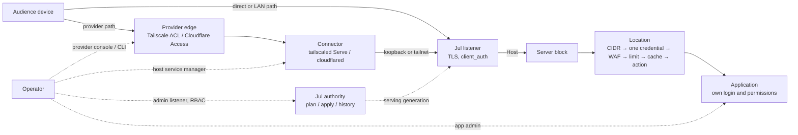

# Application sharing contract (SHARE-01)

> **Status: Proposed — design draft for maintainer acceptance under
> [#580](https://github.com/victornife/jul/issues/580).** Nothing here is a
> shipped capability. Decisions marked *Accepted* record a maintainer answer;
> everything else is a proposal until #580 is accepted. Runtime work belongs to
> the successor owners named in §17. Source baseline: `main` at
> `64e4a8b29230134c5dee37dfd8bfa130a9580a2a` (2026-10-18); published package
> baseline v2.2.0. Evidence, decision log, adversarial review and traceability
> live in the [design review packet](../reviews/2026-10-18-580-application-sharing-design.md);
> the durable decisions are in [ADR 0025](../adr/0025-application-sharing-contract.md).

## 1. Purpose, scope and classification

A running application still leaves its operator to coordinate addresses,
connectivity, audience, authentication, protection and operation. This
specification defines the smallest contract that lets the sharing programme
([#579](https://github.com/victornife/jul/issues/579)) verify, explain and later
guide that work without architectural guessing: what is being shared, who it is
intended for, who enforces that, how anyone knows, what a change does, and how
to stop new access and recover.

**Classification.** Everything here is an *operational enhancement* that
composes existing gateway capabilities — listeners, virtual hosts, routes,
location authentication, mTLS, trust policy, configuration authority and the
transactional apply path. It is not a category expansion. The following remain
separately gated and are **not** authorised by this design: provider-backed
audience lifecycle and invitations (#588, GO-gated), group-to-group sharing
(#589), native application OIDC/login, provider policy or membership mutation,
a hosted control plane, VPN/relay/NAT traversal, an identity directory, fleet or
distributed policy state, and Extended CONNECT.

**Vision sources.** [Brief vision](../vision/brief.md),
[longer vision](../vision/README.md), [practical guide](../practical-guide.md).

## 2. Vocabulary

| Term | Meaning | Not to be confused with |
| --- | --- | --- |
| **Shared service** | What an operator thinks of as "the thing I share": the entries served by one `[[servers]]` block (its host names on one listener). A display grouping only. | Console **Apps**, which are upstream pools (`AppProjection`). A shared service is never an identity. |
| **Entry** | The unit of exposure and enforcement: one HTTP location (route) of one server block, or one `[[stream]]` listener. | A URL. Many URLs can reach one entry; one URL reaches exactly one entry per request. |
| **Access mode** | The operator's intended reach for an entry: `preview`, `private_network`, `restricted` (the programme's "restricted-browser" journey), `public`. §5. | Reachability, which is a network fact. |
| **Audience** | The application users an entry is intended for. | Administrators, RBAC principals and admin OIDC subjects ([ADR 0022](../adr/0022-admin-console-oidc.md)). |
| **Enforcement point / owner** | Where an access decision is made (provider edge, connector, Jul listener, Jul location, application) and who configures it. | Who *should* decide. |
| **Declared intent** | What the operator says should be true. | Configured posture. |
| **Configured posture** | What the authoritative configuration makes Jul do, derived from it. | Observed evidence. |
| **Observed evidence** | A dated result from a stated vantage that something was checked. | Truth now. |
| **Withdraw (deny new access)** | Make Jul deny new requests to an entry by an in-place deny that keeps the route and its target (§9.4). | Deleting the route; terminating connections; revoking provider sessions. |
| **Cut established** | End already-open connections and streams. A separate, disruptive operator action (§8.3). | Withdrawal. |

## 3. Invariants

These are normative. A successor that cannot satisfy one stops and escalates.

1. **SH-1 — One authority.** The configured authority (`file_owned` or
   `managed`, [ADR 0019](../adr/0019-configuration-authority-generated-contracts-and-resource-identity.md))
   is the only desired state. No second desired-configuration store, no
   enforcement store, no identity sidecar, and Jul never writes identifiers into
   configuration it does not own (ADR 0019 §6, I1/I2).
2. **SH-2 — Three layers never merge.** Declared intent, configured posture and
   observed evidence are reported separately. No surface collapses them into a
   single "protected", "secure" or green status.
3. **SH-3 — Reachability is not authorization.** A private address, a loopback
   bind, a connector or a copied URL never establishes who may use an entry.
   Network membership may be the *declared coarse* audience boundary (§5), never
   a named user's identity.
4. **SH-4 — Audiences are not administrators.** Admin RBAC, admin OIDC and
   automation tokens never describe or grant application access.
5. **SH-5 — Preview is loopback; widening is explicit.** Every change that widens
   any entry's audience is previewed as a plan that names each widened entry and
   requires an explicit operator choice. No change to one entry may silently
   widen another.
6. **SH-6 — Unknown stays unknown.** External policy Jul cannot observe is
   labelled *operator-declared* or *not declared*; stale or unavailable evidence
   is never shown as current.
7. **SH-7 — Withdraw in place.** Withdrawal never deletes a route, because a
   deleted route can fall through to a default host or broader prefix (§11).
8. **SH-8 — Standalone first.** Every mode except provider compositions works
   with no Jul, Tailscale or Cloudflare account ([ADR 0012](../adr/0012-oss-open-core-boundary.md)).
9. **SH-9 — The server owns semantics.** Console and CLI consume server-owned
   decisions ([ADR 0014](../adr/0014-operability-surfaces.md)); raw TOML remains
   the complete expert path, and curated flows preserve fields they do not show.
10. **SH-10 — Bounded and private by construction.** No telemetry or phone-home;
    no new metric labels for routes, hosts, users or providers; no credentials,
    tokens, raw configuration or application bodies in summaries, logs, issues
    or browser storage; no arbitrary outbound probing.
11. **SH-11 — One listener per enforcement domain.** An entry whose audience is
    enforced outside Jul (network provider, connector or identity provider) is
    served from a Jul listener reachable only through that enforcement point,
    and that listener serves no entry of another enforcement domain unless that
    entry carries its own Jul check. Host selection alone never separates a
    provider-restricted entry from a public one: Jul has no SNI-to-Host check,
    and an unmatched `Host` reaches a nameless default block.
12. **SH-12 — No trusted connector identity headers.** Jul forwards unknown
    request headers and can only overwrite, not remove, named headers. No
    supported journey relies on an application trusting provider-asserted
    identity headers (`Tailscale-User-*`, `Cf-Access-Authenticated-User-Email`
    and similar) until every Jul path to that application is controlled and a
    separate decision covers sanitisation.

## 4. The service view

### 4.1 Decision and unit

*Accepted (SD-01, option A, 2026-10-18):* the first contract is a **derived
view** over the existing authoritative configuration. It introduces no new
persisted metadata, no new identifier and no new desired-state store.

- **Unit:** one *entry* — an HTTP location within a server block on a listener,
  or one `[[stream]]` listener.
- **Grouping:** entries are grouped by server block for display ("shared
  service"). Its label is descriptive: server `name`, else its first
  `server_names` value, else its listen address. Labels are not unique and not
  identities (ADR 0019 §5.3).
- **Declared intent** is not held by Jul in the first release. It lives in the
  versioned fixture and runbook manifests owned by #581–#585 (§4.5), which are
  test expectations, not deployed policy.

### 4.2 References and identity

| Referent | Reference used by the view | Stability | Consequence |
| --- | --- | --- | --- |
| HTTP entry with `route_id` | `route_id` | Durable (ADR 0019 §4) | Deep links, diff and audit correlate; deletion then reuse may name a different route later (§4.9 of ADR 0019). |
| HTTP entry without `route_id` | `(listen, server_names, match_type, path, match_ordinal)` + `base_version` | Revision-bound | Shown as "revision-bound reference". Never persisted, never presented as a name. A stale `base_version` is rejected, never silently retargeted. |
| Upstream pool | upstream `name` | Durable natural key | Rename is delete + create. |
| Listener | canonical `listen` | Composite natural key | Relocation is delete + create. |
| L4 entry | `(protocol, listen)` | Composite natural key | — |
| Shared service (server block) | none — label only | Not an identity | Two blocks may share a label; disambiguate by listener and hosts. |

Rules for edge cases:

- **Absent `route_id`.** Fully supported. The view never requires, mints or
  suggests one in `file_owned` mode. In `managed` mode the existing informational
  lint may suggest one (ADR 0019 §4.13). Sharing operations target such entries
  through the selector plus `base_version`; preview and apply therefore address
  the same revision or the apply is refused.
- **Rename, delete, recreate.** Follow ADR 0019: changing `route_id` is delete +
  create. Fixture manifests that reference entries by `route_id` must re-check
  the referenced entry's content after any configuration change and treat a
  missing or changed entry as *stale evidence*, never as continuity.
- **One application, several entries.** An application reached through several
  routes, upstreams, host names or listeners is several entries. The view
  groups them by server block for display and, separately, lists every entry
  that reaches the same upstream `name` (or the same static root) as that
  application's **reach set**. Withdrawal of "the application" must cover every
  entry in its reach set; a literal `proxy_pass` address is matched by its
  normalised address. Cross-block naming is a later decision (§16).
- **Several applications on one gateway.** Each entry carries its own posture.
  Shared listener-scoped properties (bind, TLS, `client_auth` mode, trust
  policy) are shown on every entry they affect.
- **Host move.** A configuration restored on another host keeps entry
  identities exactly; bind scope, provider paths and all evidence become stale
  (§7.3).

### 4.3 Field contract (proposed projection)

This is the contract the first runtime implementer (#586 for evidence states,
#587 for the Console view) must use. It is **proposed**, not implemented. It is
server-computed (SH-9), introduced with internal API stability (ADR 0019 §24)
and promoted to an external `/api/v1` contract only by a separate decision.

| Field | Type | Presence / absence meaning | Source | Sensitivity and bounds |
| --- | --- | --- | --- | --- |
| `entry.kind` | `http_route` \| `stream` | always | config | — |
| `entry.route_id` | string | absent ⇒ `entry.identity = revision_bound` | `route_id` | ADR 0019 grammar |
| `entry.selector` | object + `base_version` | always for `http_route` | config | paths are admin-visible only |
| `entry.identity` | `durable` \| `revision_bound` \| `natural_key` | always | derived | — |
| `service.label` | string | always (fallback chain §4.1) | config | display-truncated; not an identity |
| `service.hosts` | string[] | empty ⇒ `service.default_host = true` | `server_names` | — |
| `service.default_host` | bool | true when the block has no names and therefore receives unmatched `Host` values on its listener | config | — |
| `listener.address` | string | always | canonical `listen` | — |
| `urls[]` | `{url, source}` | `source = derived` (scheme from listener TLS, host from `server_names`, port, location path) or `declared` (external URL from intent, absent in the first release) | config / intent | a derived URL is what Jul answers locally, not proof that anyone outside can reach it |
| `listener.bind_scope` | `loopback` \| `private_address` \| `shared_address_space` \| `all_interfaces` \| `public_address` \| `unknown` | `unknown` when not a literal address | derived (§4.4) | configured bind, **not** reachability |
| `listener.transport` | `{tls, client_auth: none\|request\|require, http3, h2c}` | always | config | listener-scoped (ADR 0016 §11) |
| `jul_checks.network` | `none` \| `allow_list` \| `deny_list` \| `allow_and_deny` | always | `auth.allow/deny` | CIDR values are not shown in the summary |
| `jul_checks.credential` | `none` \| `basic` \| `jwt` \| `forward_auth` | always | `auth.*` | no file paths, URLs or secrets in the summary |
| `jul_checks.client_certificate` | `not_required` \| `required_per_request` \| `required_at_handshake` | always | `require_client_cert`, `client_auth.mode` | — |
| `action` | existing action vocabulary | always | config | — |
| `upstream_ref` | string | absent for static, literal backends and non-proxy actions | `proxy_pass` | — |
| `controls` | `{cache, waf, rate_limit, cors}` booleans | always | config | — |
| `warnings[]` | closed enum (§4.4) | empty when none | derived | bounded set |
| `declared_intent` | `{mode, audience, enforced_by[], provider_ref, external_urls[]}` \| `not_declared` | **always `not_declared` in the first release** | §4.5 | `provider_ref` is a label (for example `cloudflare-access:dash-team`), never a credential or account secret |
| `evidence[]` | §7 records | empty ⇒ `unverified` | Jul-local only in the first release | ≤ 8 per entry |
| `authority` | `{config_authority, config_state, desired_version, serving_version}` | always | existing status | ADR 0019 §16 |
| `next_actions[]` | closed enum (§9.6) | always | server rule table | — |

### 4.4 Derived posture rules

- **Bind scope** from the literal listen host: `127.0.0.0/8`, `::1` ⇒
  `loopback`; RFC 1918, `fc00::/7`, link-local ⇒ `private_address`;
  `100.64.0.0/10` ⇒ `shared_address_space` (a tailnet *or* an ISP carrier-grade
  NAT range — ambiguous by design); empty host, `0.0.0.0`, `::` ⇒
  `all_interfaces`; any other literal ⇒ `public_address`; otherwise `unknown`.
  A loopback bind is necessary for `preview` but not sufficient: a local
  connector (Tailscale Serve, cloudflared) makes a loopback listener remotely
  reachable, and Jul cannot observe that connector.
- **Jul checks** summarise what Jul enforces per request or per handshake. An
  entry with `network = none`, `credential = none` and
  `client_certificate = not_required` is *open to anyone who can reach the
  listener*. That is correct for `public` and wrong for `restricted`.
- **Warnings** (closed set, proposed): `default_host_catches_unmatched`,
  `shared_listener_mixed_checks` (open and restricted entries on one listener),
  `client_auth_request_mode_shared` (a `request`-mode listener also serves open
  entries), `cache_on_restricted_entry` (§11), `cidr_with_trusted_proxies`
  (CIDR decisions depend on asserted client addresses), `all_interfaces_bind`,
  `admin_listener_not_loopback` (existing lint), `jwt_header_only` (a provider
  that delivers its token in another header or cookie is not validated by Jul).

### 4.5 Declared intent: now and later

**Now.** Each fixture and recipe owner (#581–#585, #613, #627) keeps a small
versioned *intent manifest* beside its runbook. It is a test expectation that
#634 may later consume, not deployed policy:

```toml
# Intent manifest — test expectation, not Jul configuration.
schema = "jul.sharing.intent/v0"

[[entry]]
ref = { route_id = "portal-home" }
mode = "public"
audience = "anyone"
enforced_by = []

[[entry]]
ref = { route_id = "dashboard" }
mode = "restricted"
audience = "dashboard-users"
enforced_by = ["jul:basic"]

[[entry]]
ref = { route_id = "dashboard-cloudflare" }
mode = "restricted"
audience = "dash-team"
enforced_by = ["provider:cloudflare-access", "connector:cloudflared-access"]
provider_ref = "cloudflare-access:dash-team"
external_urls = ["https://dash.example.net/"]

[[entry]]
ref = { listen = "127.0.0.1:9443", kind = "admin" }
mode = "preview"
audience = "local-operator"
enforced_by = ["jul:admin-rbac"]
```

How the manifest maps to its consumers (no second enforcement store):

| Manifest statement | #634 fixture assertion (test expectation) | #633 posture finding | Boundary |
| --- | --- | --- | --- |
| `mode = "public"` | anonymous request succeeds **and** every sibling restricted entry still denies | deliberate public is not a defect | — |
| `mode = "restricted"`, `enforced_by` contains `jul:*` | excluded and forged requests denied; intended succeeds | mismatch if the entry has no Jul check | configured posture only |
| `enforced_by` contains `provider:*` or `connector:*` | excluded identity denied from the provider path; direct origin unreachable | `unanalysed` — Jul cannot read provider policy | external evidence only |
| `mode = "private_network"` | excluded device and outside path fail | bind-scope mismatch is a finding; membership is `unanalysed` | coarse audience |
| admin entry `preview` | admin unreachable from every client vantage | existing admin-exposure lint | — |
| entry absent from the manifest | no assertion | `unanalysed` (intent unknown), never "safe" | — |

#633 consumes runtime intent only from an implemented projection; until #587
(or a later decision) provides one, intent-aware checks report `unanalysed`.

**Later (pre-specified, not accepted for implementation).** If the first runtime
consumer (#587) needs Jul to hold declared intent, the candidate is a single
optional, location-scoped block owned by the existing authority:

```toml
[servers.locations.sharing]
mode = "restricted"            # preview | private_network | restricted | public
audience = "dashboard-users"   # label only, ≤ 64 bytes; never a user list
enforced_by = ["jul", "external"]
```

Constraints the candidate must keep: optional forever; no runtime routing or
enforcement effect; `hot_reload` lifecycle; no metric labels; never written by
Jul in `file_owned` mode; travels with the route, so no cross-references and no
`route_id` requirement. Committing it requires an ADR 0025 amendment with first
use evidence from #581–#585. It is a public schema one-way door once shipped.

### 4.6 Example summaries (proposed rendering)

```text
Shared service: portal (portal.lab.test on :443)
  Entry /  — public (declared in fixture manifest)
    Who can use this?   Anyone who can reach portal.lab.test:443. Intentional.
    Who enforces that?  Nobody restricts it. Jul applies rate limits.
    How do we know?     Anonymous GET from lab-client-2 (LAN) — 200, 2026-11-02 14:10 UTC.
    Next action         None.

Shared service: dashboard (dash.lab.test on :443)
  Entry /  — restricted
    Who can use this?   dashboard-users (declared). Jul requires a valid Basic credential on every request.
    Who enforces that?  Jul (location auth). The dashboard's own permissions apply after login.
    How do we know?     Intended user 200; excluded user 401; forged X-Forwarded-For 401 — lab-client-2, 14:12 UTC.
    Next action         None. Evidence becomes stale on the next configuration or credential change.

Shared service: dashboard via Cloudflare (dash.example.net)
  Entry /  — restricted
    Who can use this?   Cloudflare Access policy "dash-team" (operator-declared; Jul cannot read it).
    Who enforces that?  Cloudflare Access (provider), cloudflared token check (connector), Jul forward-auth (origin).
    How do we know?     Provider check UNKNOWN — Access API unreachable at 15:02 UTC; last success 13:40 UTC (stale).
    Next action         Re-verify from an excluded identity once the provider responds; do not treat as verified.

Shared service: dashboard (dash.lab.test on :443)
  Entry /  — restricted
    How do we know?     STALE — the configuration changed at 16:20 UTC (serving version 9f1c…) after the last check at 14:12.
    Next action         Re-run the intended/excluded checks.

Shared service: dashboard (dash.lab.test on :443)
  Entry /  — access withdrawn
    New access          Denied by Jul since 16:31:07 UTC (applied_live, serving version 2b7e…).
    Still possible      Already-open connections and streams (for example a live WebSocket) continue until they end.
                        The URL, the dashboard process and any connector are unchanged.
    Next action         To also end open connections, restart Jul (interrupts every service on this instance).
```

## 5. Access modes

*Accepted (SD-03, option A, 2026-10-18):* private-network membership may be the
declared **coarse** audience boundary of an entry, enforced by the network
provider and not verified by Jul.

| | `preview` | `private_network` | `restricted` | `public` |
| --- | --- | --- | --- | --- |
| Intended audience | the operator on this computer | devices/users the network admits (LAN, tailnet ACL) | named credential holders or provider-policy members | anyone |
| Reach (precondition) | loopback bind, no connector or forward | private bind (loopback behind Serve, tailnet or LAN address); no public path (no Funnel, port forward or tunnel) | any path; provider path must protect the origin (§10) | any path |
| Jul checks | optional | optional (defense in depth) | required unless a provider path with verified origin protection is declared | none required; limits/WAF optional |
| Who enforces the audience | the host (other local users and processes can still reach loopback) | the network provider | Jul location auth, mTLS, or provider identity + origin check | nobody |
| Never implies | privacy from other local processes | a named user's identity; that the LAN or tailnet is trustworthy | application permissions; immediate revocation of sessions | that other entries are public |
| Evidence to show "verified" | local fetch; absence of a declared connector | allowed device succeeds and excluded device or outside path fails, from stated vantages | intended success, excluded denial, forged-identity and direct-origin denial | anonymous success **and** sibling restricted entries still denied |

Transitions: leaving `preview` always changes a listener or adds a connector,
so it is an explicit operator choice with a plan (§9.3). Any transition that
widens audience (`restricted` → `public`, removing or relaxing a Jul check,
broadening a bind, adding a default host) names each widened entry in the plan
and needs explicit confirmation (SH-5). Narrowing is shown but does not need the
widening confirmation.

## 6. Responsibilities and trust



| Responsibility | Jul | Host / OS | Application | Connector | Provider / IdP | Operator |
| --- | --- | --- | --- | --- | --- | --- |
| Reachability | binds configured listeners only | firewall, interfaces, NAT, router | its own listener (keep private) | carries provider traffic | network or edge reach | chooses path; keeps admin and backends private |
| Client TLS | terminates on HTTP listeners | — | — | may terminate (Serve, Cloudflare edge) | edge certificates | certificates and keys |
| Audience identity | per request (Basic/JWT/forward-auth) or per connection (mTLS) | — | its own login | Serve identity headers; cloudflared token check (provider-specific) | membership, sessions, tokens | declares intent; manages members in the provider |
| Authorization of an entry | location checks | — | application permissions | optional token check | Access/ACL policy | policy choice |
| Origin-bypass protection | bind scope, mTLS, token check | firewall | bind to loopback/private | only route allowed origins | — | verifies no direct path |
| Evidence | local configured and serving facts | — | — | — | provider logs (outside Jul) | runs client-vantage checks |
| Ending sessions | none targeted (§8) | process restart | app logout/session store | stop connector | provider revocation | decides and acts |

**Deployment assumptions.** The host, its administrators and the Jul binary are
trusted ([release verification](../release.md)). The admin listener stays on
loopback or a private authenticated path. Provider accounts are controlled by
the operator. **Outside the trusted boundary:** audience devices, the Internet,
other tenants of a shared network, provider internals (trusted only for their
declared function), and any header Jul does not itself construct or sanitize.

**Who can assert and verify a claim.**

| Claim | Asserted by | Verifiable by Jul | Verifiable by operator, from where |
| --- | --- | --- | --- |
| "Entry X requires a credential" | configuration | yes (configured posture) | client test against X |
| "Only the connector can reach Jul" | operator | partially (bind scope) | test from a non-connector host |
| "Provider policy admits only group G" | operator | no | provider console + excluded-identity test |
| "Excluded user is denied" | evidence | no | client vantage of that user |
| "Application enforces its own roles" | operator / app | no | application test |

## 7. Evidence and observation

### 7.1 Evidence record

Runbooks and fixtures record evidence in this shape now; #586 reuses it for any
runtime evidence it introduces.

| Field | Meaning |
| --- | --- |
| `claim` | the precise statement checked ("excluded identity receives 403 on dash entry") |
| `entry_refs` | references per §4.2 |
| `asserted_by` / `verified_by` | `config`, `jul`, `operator`, `provider`, `harness` |
| `vantage` | `same_host_loopback`, `same_host_namespace`, `lan_client`, `tailnet_client`, `internet_client`, `provider_console` |
| `method` | command or tool and version |
| `observed_at` | UTC timestamp |
| `identities` | Jul package/profile/checksum, config `serving_version`, connector/provider versions where applicable |
| `result` | `pass` \| `fail` \| `inconclusive` |
| `freshness` | `current` \| `stale` \| `unknown` \| `unavailable` (§7.3) |

### 7.2 What Jul can observe in the first release

Configured posture (§4.4); `config_state`, `desired_version` and
`serving_version`; the terminal apply outcome; the ADR 0018 route-test
explanation of which entry a given host and path would select; lint and doctor
findings. These are **configured** facts. They never prove client-vantage
access, provider policy or application behaviour.

### 7.3 Freshness and invalidation

Evidence is `current` only while nothing it depends on has changed. It becomes
`stale` on any change to: the entry's configuration or its listener; the
`serving_version` after a reload or restart; credential files (htpasswd, CA,
CRL); provider policy or connector configuration (operator-declared, since Jul
cannot observe it); application version; host or network topology. Evidence
with no recorded time or vantage is `unknown`. A provider or connector that
cannot be queried makes dependent evidence `unavailable`, never `pass`. Elapsed
time alone is only a display hint; #586 may add a time hint but must not turn
old evidence back into `current`.

### 7.4 Bounded verification

Jul performs no arbitrary outbound probing. Any future Jul-initiated check
(#586) must be on demand, rate-limited, limited to configured listeners or
upstreams, subject to the [egress](../egress.md) policy, and must not accept an
operator-supplied URL as a free target. Client-vantage checks are run by the
operator from a declared vantage and recorded as evidence. A successful local
check is not an end-user access test.

## 8. Access changes, sessions and long-lived streams

*Accepted (SD-02, "D+E", 2026-10-18).* The first journeys ship today's
verified promise with its limits displayed (§8.2). In parallel, #563 is selected
with #562 as its WebSocket-ownership component, scoped to **event-driven,
entry-scoped retirement on tightening** (§8.4). No periodic maximum connection
age is selected and no general session-termination API is authorised.

### 8.1 Verified current behaviour

Time origin: the moment the reload or apply reports `applied_live` (the new
generation is published before that result is returned).

| Change | New request, new connection | New request or new H2/H3 stream on an established connection | New full / resumed TLS or QUIC handshake | Request or stream already in flight (SSE, gRPC stream, long download) | Established H1 WebSocket | Provider session, application session, URL, connector, application |
| --- | --- | --- | --- | --- | --- | --- |
| Withdraw (deny-in-place) or tighten a Jul location check | denied | denied | unaffected (not a handshake property) | continues until it ends | continues until it ends or Jul exits | unchanged |
| Remove a Basic user (htpasswd + explicit reload) | denied | denied (credential checked per request) | unaffected | continues | continues | unchanged |
| JWT: change `issuer`/`audience` in Jul | non-matching tokens denied | same | unaffected | continues | continues | unchanged |
| JWT: issuer rotates or withdraws a signing key | denied after Jul's next key-set fetch (scheduled refresh ≤ 15 min, or the next reload, which rebuilds the authenticator); an otherwise valid token remains accepted until `exp` + 60 s leeway | same | unaffected | continues | continues | unchanged |
| Revoke a client certificate (CRL + explicit reload) | **denied at handshake** | **still accepted** — identity is fixed per TLS connection (probe P1) | denied (full and resumed) | continues | continues | unchanged |
| Provider removes a user or group, user logs out, provider token expires | provider-dependent; Jul sees only what reaches it | provider-dependent | provider-dependent | provider-dependent | provider-dependent | provider-owned |
| Stop the connector | provider path stops for new requests | provider-path connections end | — | provider-path streams end | provider-path sockets end | URL remains registered |
| Restart or stop Jul | served again only after restart | all connections end | — | cut | socket dropped without a WebSocket close handshake | every entry on the instance is interrupted |

There is no 0-RTT on any listener. A route deny does not terminate a transport.
A provider accepting a request is not universal revocation.

### 8.2 Current promise (normative for #581–#586)

*"New access to the entry is denied from the published generation onward.
Already-open connections and streams may continue until they end. Revoking a
client certificate alone does not affect an open connection, so a certificate
revocation is paired with a deny-in-place of the affected entries. Provider and
application sessions are external."* Every surface shows this next to a
withdrawal and never displays "revoked" or "ended" for open sessions. #581
measures how long established sessions actually continue in its fixture (§13,
W3).

### 8.3 Cutting established connections today

Jul has no targeted termination API. The available escapes are a Jul restart
(all entries on the instance), stopping a connector (all provider-path traffic),
or stopping the application. Each is an operator action outside the sharing
operations, shown with its blast radius.

### 8.4 Selected upgrade: retirement on tightening (#563 with #562)

Consumer contract the #563 design must satisfy (the design owns mechanisms,
bounds and tests; this section owns what consumers may rely on):

| Aspect | Requirement |
| --- | --- |
| Trigger | A published generation that **narrows** an entry (§9.5 narrowing set: deny-in-place, a Jul check added or tightened, `require_client_cert` set) or a client CA/CRL change that invalidates certificates. Nothing else; no timers. |
| Scope | Connections and streams admitted to that entry under an earlier generation; for certificate changes, TLS and QUIC connections whose verified certificate is no longer acceptable. Other entries are untouched. |
| Protocols | H1 keep-alive and in-flight responses, H1 WebSocket (with #562 ownership), SSE and long responses, native and transcoded gRPC, H2 and H3 streams. L4 streams are out of scope (Jul does not authorize them). |
| Bound | Retirement starts at publish and completes within a maximum delay chosen and *tested* by #563. Surfaces display a bound only from that tested value. |
| Closure | Graceful where the protocol and library allow; otherwise abrupt. A forced close is reported as forced. |
| Observability | The apply result and status report a bounded count of retired connections per entry and whether completion was confirmed; no client identities, no new metric labels. |
| Preview | The plan states that open connections to narrowed entries will be ended and shows the current count. |
| Not covered | Provider sessions (Jul-routed traffic is still denied by the in-place deny), application sessions, traffic that reaches the application without Jul, other entries. |

**Gates.** #587 may offer "also end open connections" and #613 may claim that
withdrawal ends access for its WebSocket-based applications (Grafana Live,
Jellyfin) only after this upgrade is delivered and verified with real clients;
otherwise both ship with §8.2. #581 includes the upgrade in its evidence if it is
delivered before #581's evidence run starts; if delivered later, the W3 step is
re-run.

## 9. Operations

### 9.1 Contract per operation

| Operation | Authority and permission | Preconditions | Preview | Consequences shown | Failure outcomes | Recovery |
| --- | --- | --- | --- | --- | --- | --- |
| **Inspect** | read; `status:read`, `config:read` | admin access | — | §4.3 view, §4.6 summary | data unavailable ⇒ `unknown` | — |
| **Preview** | `config:write`; allowed in both modes (file-owned preview is a read) | candidate or typed ops | plan: diff, lifecycle, `can_apply`/`can_stage`, lint, proposed audience delta (§9.5) | widened and narrowed entries; restart need | validation errors; stale `base_version` | edit and re-plan |
| **Publish / change exposure** | managed: `config:apply` with `base_version` and `Idempotency-Key`; file-owned: the external pipeline, then watcher/SIGHUP | plan reviewed; widening confirmed | required | external handoffs listed (DNS, connector, provider policy) | §9.2 | rollback or re-apply; external steps are separate |
| **Withdraw (deny new access)** | same as publish | entry identified with `route_id` or selector + current `base_version` | required | §8 limits | §9.2 | remove the in-place deny (a widening change, confirmed again) |
| **Recover** | managed: `history:rollback` or re-apply; file-owned: revert and reload | target revision known | rollback diff | audience delta of the rollback itself | §9.2 | — |
| **Cut established** | host service manager | — | — | blast radius | — | restart |
| **External handoff** | provider console/CLI | — | — | listed, not executed | unknown until verified | provider-side |

### 9.2 Outcome language (existing vocabulary only)

| Existing outcome | Summary statement |
| --- | --- |
| `applied_live` | "Serving since <time> (serving version <v>)." Evidence for affected entries becomes stale. |
| `applied_degraded` | "Serving with a degraded subsystem; see details." Not "done". |
| `no_change` | "Nothing changed; the previous configuration is still serving." |
| `not_applied` | "Rejected; nothing changed." Reason shown. |
| `saved_not_live` | "Saved, not confirmed live." Poll `GET /api/v1/config/applies/{apply_id}` until terminal; never report exposure or withdrawal as effective. |
| staged / `managed_pending_restart` / `file_owned_desired_ahead` | "Saved; serving the previous configuration until restart." A withdrawal that needs a restart is **not** effective. |
| client timeout / unknown | Treat as unknown; poll the apply ledger or retry with the same `Idempotency-Key`; never re-submit a different candidate to "fix" an unknown outcome. |

A configuration apply is atomic for Jul. "Partial" exists only across systems:
Jul applied but the provider step not done, or the reverse. The summary then
shows each side separately.

### 9.3 Publish and withdraw details

- **Publish** changes only what the plan names. Leaving `preview` requires a
  listener change (`servers.listen` is `new_listener_only`: a new address binds
  on reload, an existing address keeps its bind until restart) or an external
  connector. The plan states which.
- **Withdraw** is deny-in-place. Preferred mechanism: add
  `deny = ["0.0.0.0/0", "::/0"]` to the entry's existing `[servers.locations.auth]`
  through the existing `location_set_auth` typed operation, preserving its
  credential method, action and target, so recovery is removing the deny.
  Acceptable alternative: the existing `deny` action, which needs history to
  restore the target. Both are `hot_reload`. Withdrawal of a whole shared
  service is withdrawal of each of its entries. Unbinding a listener is not a
  withdrawal (it can be restart-bound and affects every block on it).
- **Credential files** (htpasswd, CA, CRL) change outside the configuration.
  They take effect only on an explicit reload: SIGHUP or a configuration rewrite
  in `file_owned` mode; a managed Apply or restart in `managed` mode.

### 9.4 Authority behaviour

| | `managed` | `file_owned` |
| --- | --- | --- |
| Inspect, preview | yes | yes |
| Publish, withdraw, recover through Jul | yes, under RBAC + CAS + idempotency | refused with `409 config_authority_read_only` before side effects; the view shows the change to make in the owner's pipeline |
| Drift | writes refused until adopted | n/a |
| History | managed history and rollback | none (pipeline owns it) |

### 9.5 Audience delta (proposed, #587)

Computed server-side from the existing diff: an entry widens when a Jul check is
removed or relaxed, `require_client_cert` is cleared, the listener's bind scope
broadens, it becomes reachable through a new host name or default host, or a
match change makes it serve requests a restricted entry previously handled.
External widening is not computable and is shown as an operator checklist item.

### 9.6 Surfaces

| Operation | API | CLI | Console |
| --- | --- | --- | --- |
| Inspect configured facts | existing: `/api/v1/routes`, `/upstreams`, `/listeners`, `/status`, `/config/export` | existing: `jul status`, `jul export` | existing: Routes, Apps, Status |
| Sharing summary (§4.3) | proposed internal projection (#586/#587) | optional presentation, not required | proposed (#587) |
| Preview | existing: `/api/v1/config/plan`, `/config/patch` | existing: `jul plan`, `jul diff` | existing editor diff; audience delta proposed (#587) |
| Publish | existing: `/config/apply`, `/config/patch/apply` | existing: `jul apply`, `jul stage` | existing apply; guided flow proposed (#587) |
| Withdraw | existing typed op `location_set_auth` | via `jul apply` of an edited file | existing route auth editor; guided withdraw proposed (#587) |
| Recover | existing `/config/rollback` | existing `jul rollback` | existing History |
| Cut established | — not provided — | — | shown as guidance only |
| Provider steps | — not provided (#588 later) — | — | handoff text only |

`next_actions` (closed set, proposed): `none`, `verify_from_client`,
`review_external_policy`, `add_jul_check`, `withdraw`, `review_cache_privacy`,
`resolve_drift`, `restart_to_converge`, `wait_for_terminal_outcome`. Lean builds
without the Console use API and CLI; capabilities absent from a build are shown
as unavailable and rejected before persistence (ADR 0014).

### 9.7 Presentation, accessibility and error language (for #587)

Low-fidelity withdrawal confirmation:

```text
┌ Withdraw access to "dashboard" ──────────────────────────────────────────┐
│ Entries affected (reach set of upstream "dashboard"):                    │
│   ✔ dash.lab.test  /         (route dashboard)            Jul: Basic     │
│   ✔ dash.example.net /       (route dashboard-cloudflare) Cloudflare     │
│   ✔ jul-host.example-tailnet.ts.net / (route dashboard-tailnet) tailnet  │
│ After this change                                                        │
│   • New requests to these entries are denied by Jul.                     │
│   • Open connections and streams may continue until they end.            │
│   • The URLs, connectors, provider policies and the dashboard keep       │
│     running. Provider sessions are not revoked.                          │
│ Not affected: portal.lab.test, portal.example.net                        │
│ [ Cancel ]   [ Preview plan ]   [ Withdraw ]                              │
└──────────────────────────────────────────────────────────────────────────┘
```

Requirements: everything in the [Console accessibility](../accessibility.md)
contract (keyboard operation, dialog focus trap and restore). State is conveyed
in text, never by colour or icon alone; mode, enforcement owner and freshness
each have a text label readable by screen readers. Apply outcomes are announced
through a polite live region and remain visible after the dialog closes. Each
entry row is a link to the raw route so advanced users can open the full
configuration.

Error language states what happened, what did not change and the next step.
Examples:

- "Not withdrawn: the configuration changed after you opened this page.
  Nothing was applied. Reload the plan and try again." (stale `base_version`)
- "Saved, not yet serving: this change needs a restart. New access is **not**
  denied until Jul restarts." (restart-bound change)
- "This server's configuration is owned by a file or pipeline. Make this change
  there: add `deny = ["0.0.0.0/0", "::/0"]` to the dashboard route's
  `[servers.locations.auth]`." (`file_owned`)
- "Unknown: Jul could not confirm the outcome before your request timed out.
  Checking again…" (ambiguous outcome; polls the apply ledger).

Advanced escape hatches: raw TOML editing, the existing route auth editor, and
plan/apply through API and CLI remain available and complete.

## 10. Reference fixtures

The three fixtures are executed in programme order on **one Jul instance** that
accumulates listeners: F1 (#581), then F2 (#582), then F3 (#583). They use one
static portal and one existing HTTP backend ("dashboard"); Jul never installs or
orchestrates the backend. Preview stays loopback until the operator explicitly
chooses a reachable listener or connector. All addresses, names and paths below
are symbolic placeholders; no credential or live result is implied. The combined
configuration was checked with `jul check` and `jul lint` on a full-tag build of
the source baseline (review packet, V-3).

Two invariants from §3 shape every fixture: **SH-11** (one Jul listener per
enforcement domain) and **SH-12** (no application trusts connector identity
headers).

### F1 — standalone restricted and public (#581)

```text
lab-client-1 (intended) ─┐                    ┌─ portal.lab.test → static root (public)
lab-client-2 (excluded) ─┼─ LAN ─► Jul 192.0.2.10:443 (TLS) ─┤
forged/bypass client  ───┘                    └─ dash.lab.test   → upstream "dashboard" (Basic + WAF)
Jul admin 127.0.0.1:9443 (loopback)           dashboard backend 127.0.0.1:3000 (loopback)
```

```toml
[[servers]]
name = "portal"
listen = "192.0.2.10:443"           # the LAN address, not all interfaces
server_names = ["portal.lab.test"]
send_timeout = "30s"

  [servers.tls]
  enabled = true
  cert = "tls/lab.crt"
  key = "tls/lab.key"
  min_version = "1.2"

  [[servers.locations]]
  route_id = "portal-home"
  match = { type = "prefix", path = "/" }
  root = "portal"
  index = ["index.html"]
  cache_control = "public, max-age=300"

    [servers.locations.rate_limit]
    enabled = true
    rate = 50
    burst = 100

[[servers]]
name = "dashboard"
listen = "192.0.2.10:443"
server_names = ["dash.lab.test"]
send_timeout = "30s"

  [servers.tls]
  enabled = true
  cert = "tls/lab.crt"
  key = "tls/lab.key"
  min_version = "1.2"

  [[servers.locations]]
  route_id = "dashboard"
  match = { type = "prefix", path = "/" }
  proxy_pass = "http://dashboard"   # no Jul response cache on a restricted entry
  proxy_read_timeout = "60s"
  proxy_send_timeout = "60s"

    [servers.locations.auth.basic]
    file = "dashboard.htpasswd"
    realm = "Dashboard"

    [servers.locations.waf]          # full build; lean builds reject it before persistence
    enabled = true
    mode = "block"
    crs_enabled = true
    request_body_limit = "1m"

[[upstreams]]
name = "dashboard"
servers = [{ address = "127.0.0.1:3000" }]

[admin]
enabled = true
listen = "127.0.0.1:9443"
token = "${env:JUL_ADMIN_TOKEN}"
```

- **Variants.** *Managed and file-owned*: run both (`config_authority`), keeping
  each mode's mutation and rollback boundaries. *Withdrawal*: add
  `[servers.locations.auth] deny = ["0.0.0.0/0", "::/0"]` above the Basic block
  (validated). *mTLS*: `[servers.tls.client_auth] mode = "request"` with
  `require_client_cert = true` on the dashboard (validated); because client-auth
  mode is listener-wide, portal visitors also receive a certificate request and
  browsers holding client certificates may prompt — #581 records this and may
  move the mTLS variant to its own listener.
- **Trust assumptions.** Host and LAN segment as in §6; no trusted proxies (so
  forged `X-Forwarded-For` is ignored); private lab CA in CI, real trusted
  certificates documented separately.
- **Environment prerequisites.** One host with a LAN address; two client devices
  (or namespaces, labelled as such); the published full package with verified
  checksum; a backend already listening on loopback.
- **Implementation prerequisites.** None beyond this design.
- **Operator steps.** Preview on loopback → bind the LAN listener (plan shows the
  new listener and both entries) → restrict the dashboard (plan) → publish the
  portal intentionally (plan names the portal as widened, dashboard unchanged) →
  withdraw the dashboard (deny-in-place) → recover → restart.
- **Expected summary states.** Portal `public`, Jul checks none, verified by an
  anonymous request from lab-client-2; dashboard `restricted`, Jul `basic`
  per request, verified intended 200 and excluded 401; after withdrawal,
  "new access denied since …; open connections may continue" (§8.2).
- **Negative cases.** Wrong password; no credential; forged `X-Forwarded-For`
  and forged provider identity headers (decision unchanged); `Host:
  portal.lab.test` with dashboard paths (portal content or 404, never the
  dashboard); unknown `Host` and IP-literal requests (404 — no default block);
  direct backend `127.0.0.1:3000` from a client (unreachable); admin from a
  client (unreachable); WAF-blocked payload (403); oversized body (413);
  backend down (502/503, portal unaffected); configuration rejected and rolled
  back; restart.
- **Evidence obligations.** §7.1 records for each case with vantage; §13 W0–W3;
  §11 matrix; protocol rows marked *selected* in §12; managed and file-owned
  runs; the §14 tasks exercised by the implementer as a dry run (not the
  independent #585 trial).

### F2 — private network through Tailscale Serve (#582)

```text
tailnet device (allowed) ─┐
tailnet device (excluded)─┼─ tailnet ACL ─► tailscaled Serve :443 (TLS) ─► Jul 127.0.0.1:8082 ─► dashboard
non-tailnet client ───────┘  (Funnel off)                                     (loopback only)
F1 listeners remain bound to the LAN address only; Jul is not bound on the tailnet interface.
```

```toml
[[servers]]
name = "dashboard-tailnet"
listen = "127.0.0.1:8082"
server_names = ["jul-host.example-tailnet.ts.net"]   # Serve forwards the original Host
send_timeout = "30s"

  [servers.client_address]            # Serve overwrites X-Forwarded-For (ADR 0016 §4.3a)
  trusted_proxies = ["127.0.0.1"]
  forwarded_headers = ["x-forwarded-for"]

  [[servers.locations]]
  route_id = "dashboard-tailnet"
  match = { type = "prefix", path = "/" }
  proxy_pass = "http://dashboard"
  proxy_read_timeout = "60s"
  proxy_send_timeout = "60s"

    [servers.locations.auth]           # optional defense in depth: named tailnet devices
    allow = ["100.100.100.101/32", "100.100.100.102/32"]
```

```text
tailscale serve --bg --https=443 http://127.0.0.1:8082
tailscale serve status --json      # expect one handler; AllowFunnel empty
tailscale funnel status            # expect no "Funnel on" block
```

- **Mode.** `private_network` (SD-03): audience = devices the tailnet policy
  admits to this node's port, enforced by Tailscale, not verified by Jul. The
  device allow list is Jul defense in depth based on Serve's asserted address;
  it identifies devices, not people.
- **Trust assumptions.** Serve terminates TLS in `tailscaled`, forwards the
  original `Host`, overwrites `X-Forwarded-For`, strips client-supplied
  `Tailscale-User-*` headers and sets them only for user-owned devices (source,
  review packet X08–X10; Tailscale KB text not reachable during design and must
  be re-checked by #582). Jul ignores those headers (SH-12).
- **Environment prerequisites.** An authorised disposable tailnet; an allowed
  and an excluded device; the `funnel` node attribute absent.
- **Value over Serve alone.** #582 runs the same tasks with Serve pointing
  directly at the backend and records what Jul adds (per-entry checks, limits,
  WAF, Console, evidence) and what it costs (extra process, configuration,
  duties).
- **Negative cases.** Excluded tailnet device; non-tailnet client; direct
  connection to the node's tailnet address on every Jul and backend port
  (refused — nothing is bound there); forged `X-Forwarded-For` through Serve
  (overwritten); Funnel verified off; ACL removal while a connection is open
  (record: Tailscale keeps established TCP flows, review packet X06).
- **Failure and recovery.** `tailscaled` stopped (path unavailable, F1
  unaffected); coordination outage (record observed behaviour); Serve
  configuration reset.

### F3 — restricted browser through Cloudflare Tunnel and Access (#583)

```text
browser ─► Cloudflare edge ─► Access policy (dash only) ─► cloudflared ─┬─ access.required ─► Jul 127.0.0.1:8081 ─► dashboard
                                                                         └─ (no Access) ─────► Jul 127.0.0.1:8080 ─► portal
No inbound ports; Jul's provider listeners are loopback only; one listener per enforcement domain (SH-11).
```

```toml
[[servers]]
name = "portal-cloudflare"
listen = "127.0.0.1:8080"
server_names = ["portal.example.net"]
send_timeout = "30s"

  [[servers.locations]]
  route_id = "portal-cloudflare"
  match = { type = "prefix", path = "/" }
  root = "portal"
  index = ["index.html"]

[[servers]]
name = "dashboard-cloudflare"
listen = "127.0.0.1:8081"
server_names = ["dash.example.net"]
send_timeout = "30s"

  [[servers.locations]]
  route_id = "dashboard-cloudflare"
  match = { type = "prefix", path = "/" }
  proxy_pass = "http://dashboard"
  proxy_read_timeout = "60s"
  proxy_send_timeout = "60s"
```

```yaml
# cloudflared config.yml (symbolic)
tunnel: 00000000-0000-0000-0000-000000000000
credentials-file: /etc/cloudflared/tunnel-credentials.json
ingress:
  - hostname: dash.example.net
    service: http://127.0.0.1:8081
    originRequest:
      access:
        required: true
        teamName: example-team
        audTag:
          - access-application-aud-tag
  - hostname: portal.example.net
    service: http://127.0.0.1:8080
  - service: http_status:404
```

- **Origin enforcement (default).** `cloudflared` validates the Access token
  (signature, issuer, expiry, audience) before proxying and returns 403/502
  otherwise; Jul's dashboard listener is reachable only by that ingress rule.
  Jul cannot validate the token itself: Access delivers it in
  `Cf-Access-Jwt-Assertion` and the `CF_Authorization` cookie, while Jul's JWT
  check reads only `Authorization: Bearer` (review packet E07, X11–X12). #583 may
  add a Jul `forward_auth` validator as defense in depth. A Jul change to read a
  token from another header is **not** authorised here; if #583 shows the
  connector check is insufficient, it records a bounded proposal for #62.
- **Ordering.** Create the Access application before the tunnel route (X13).
- **Client address.** Do not trust forwarded headers from `cloudflared` until
  #583 verifies it overwrites them; until then client address is the connector
  (loopback), so CIDR checks and per-client rate limits are not meaningful on
  this path.
- **Sessions.** Access application tokens last their session duration (default
  24 h) unless revoked; logout takes 20–30 s; per-application revocation exists
  (X05). Jul's deny-in-place still denies Jul-routed requests carrying valid
  tokens.
- **Environment prerequisites.** Authorised Cloudflare account, zone and
  hostnames; identity provider with an intended and an excluded identity.
- **Negative cases.** Excluded identity; no token; forged
  `Cf-Access-Jwt-Assertion` (wrong audience, expired, wrong team); forged
  identity headers; request to `portal.example.net` with dashboard paths and
  `Host: dash.example.net` (only portal content — separate listener); direct
  origin access (no inbound path); gRPC (unsupported on this path); upload above
  the plan limit.
- **Failure and recovery.** Access or team-domain key endpoint unreachable
  (cloudflared fails closed; summary `unavailable`); `cloudflared` stopped;
  tunnel deleted; Access application removed (portal must not change; dashboard
  must be unreachable through Cloudflare — verify, do not assume).

## 11. Same-instance isolation

The acceptance matrix for #581, re-checked by #582 and #583 on their paths.
"Never" items are failures, not limitations.

| Scenario | Expected | Mechanism |
| --- | --- | --- |
| Alternate `Host`, case, trailing dot, port, IP literal | dashboard check always applies to dashboard entries; unmatched hosts 404 | Host normalisation; no default block (F1) |
| Public prefix shadowing a restricted path | never serves restricted content | separate host names; ADR 0018 precedence; route-test evidence |
| Withdrawal by deletion | forbidden (SH-7) | deny-in-place |
| Default host catch-all | not used in fixtures; warned when present | `default_host_catches_unmatched` |
| Forged `X-Forwarded-For`, `Forwarded`, RFC 9440 client-certificate headers | ignored or stripped | ADR 0016 §12 |
| Forged provider identity headers | decision unchanged; header reaches backend (recorded) | SH-12 |
| Direct backend or admin access from a client | unreachable | loopback binds |
| Cache crossing users or entries | dashboard has no Jul response cache; portal static entries are not cached by Jul | `cache` applies to proxy/FastCGI only; reload does not purge |
| Route or backend change of the portal | dashboard audience unchanged (plan shows no dashboard delta) | per-entry checks; §9.5 |
| Intentional dashboard → public | only via an explicit plan naming it | SH-5 |
| One application reachable through several entries | every entry listed; withdrawal covers each | group by `upstream_ref` (§4.3) |
| Provider-restricted and public entries on one Jul | different listeners | SH-11 |

**Cache rule.** Restricted entries keep Jul's response cache off unless a
recipe proves a safe policy for its exact application. Jul's
authenticated-reuse rule covers `Authorization`, not cookies, mTLS identity or
CIDR-restricted traffic, and cached entries survive reloads; changing a cached
route's audience therefore requires a purge.

## 12. Protocol matrix

Classifications: **T** tested (named evidence at the source baseline), **R**
supported with documented restrictions, **U** unverified (documented by the
provider or inferred, not tested here), **N** unsupported. Provider columns stay
U until #582/#583 record versioned evidence. A working browser URL certifies
none of the other rows.

| Protocol | Client → Jul (F1) | Jul → origin | Client → Serve → Jul (F2) | Client → Cloudflare → cloudflared → Jul (F3) |
| --- | --- | --- | --- | --- |
| HTTP/1.1 | T | T | U | U |
| HTTP/2 | T (TLS ALPN; h2c only when configured) | R: negotiated by ALPN to HTTPS origins, else HTTP/1.1; plaintext origins use HTTP/1.1, except native gRPC over h2c ([core HTTP](../core-http.md)) | U (Serve terminates TLS; Serve → Jul HTTP/1.1 or h2c for gRPC) | U (`http2Origin` needs an HTTPS origin; default HTTP/1.1) |
| H1 WebSocket | T (`TestLongLivedWebSocketReloadAndShutdown`); R: no WebSocket over H2/H3 | T | U (Go reverse-proxy upgrade) | U (supported by Cloudflare; may drop on edge restarts) |
| SSE | T (`TestLongLivedSSEReloadAndShutdown`); R: never cached | T | U | U (cloudflared flushes event streams) |
| Native gRPC | T (`TestLongLivedNativeGRPCReloadAndShutdown`) | T | U (h2c to Jul for gRPC content type) | **N** on public hostnames; Access ignores gRPC |
| HTTP/3 | T to Jul with the `http3` build (Alt-Svc; 0-RTT disabled); not in fixtures | **N** | U (no QUIC in Serve found) | client ↔ edge only; edge → origin **N** |
| L4 TCP/UDP | R (`stream` build; Jul enforces no audience) | — | U (`--tcp`, separate from HTTP Serve) | N for browser paths |

**Revalidation.** Re-run the affected rows on a Jul release that touches
protocol, authentication, trust or lifecycle code; on a connector or provider
version change; and before any release note claims support. Owners: #581 for
F1 and Jul hops; #582 and #583 for their columns, each naming a maintenance
owner at closure; #634 consumes the rows as regression cases.

## 13. Resource and continuity measurement

#581 implements this method; #582, #583 and #613 reuse it unchanged except for
their path-specific vantage and connector rows. It reuses existing tools and
metrics: `scripts/soak-scrape.go` for Jul's Prometheus metrics,
`/proc`-based per-process sampling in the style of `scripts/fault-evidence.sh`
for every other process, and `scripts/burn-in-load.go` for load (extended at
most with a fixture route-mix mode) or a pinned off-the-shelf generator named in
the record. No new benchmark framework, telemetry or phone-home.

**Declare before the run** (in the evidence record): host CPU model and cores,
memory, OS and kernel, virtualisation; Jul package version, checksum, build
profile and `jul capabilities --json`; configuration `serving_version`; enabled
controls (TLS, client auth, location auth method, rate limits, cache/WAF);
backend kinds and versions; connector and provider versions where applicable;
client vantage and network path; the pass/fail bounds below.

| Profile | Workload (proposed defaults — #581 may adjust before the run, with rationale) | Observations |
| --- | --- | --- |
| **W0 idle** | Jul, portal and dashboard running, no client traffic; 2 min settle, then 10 min | CPU, RSS, heap in use, goroutines, open FDs, `jul_listener_conns` |
| **W1 representative** | 16 closed-loop clients for 10 min after a 2 min warm-up; 70 % portal static (≈ 4 KiB HTML), 10 % portal static (≈ 256 KiB asset), 20 % dashboard proxied (≈ 2 KiB JSON) with valid credentials | as W0 plus `jul_http_requests_total` by class, `jul_http_request_duration_seconds` p50/p95/p99, `jul_http_requests_in_flight`, `jul_upstream_*`, error ratio |
| **W2 mixed public/private + long-lived** | W1 plus 10 % of requests from excluded identities, plus 20 held long-lived connections (H1 WebSocket or SSE) to the dashboard entry — **required** by SD-02 to measure continuation; if the dashboard offers neither, a minimal loopback test endpoint is used for this measurement only and labelled as such | as W1, plus denial ratio for excluded requests and long-lived connection count |
| **W3 access-change continuity** | during W2: withdraw the dashboard (§9.3), hold 2 min, recover | portal error ratio before, during and after; first denied dashboard request relative to the `applied_live` result; long-lived connections that continue |

**Predeclared bounds.** #581 records concrete numeric bounds before running,
derived from the declared host and prior evidence for the same profile. The
design fixes the *continuity* bounds, which do not depend on hardware: zero
portal failures attributable to dashboard changes in W3; zero excluded or
forged requests succeeding in W2; every dashboard request whose headers are sent
after the `applied_live` result is denied in W3. A failing run is preserved and
its owner filed; bounds are not loosened after the fact.

**Attribution.** Sample Jul, each application and each connector by PID
separately. Storage I/O and upload bandwidth (interface counters) are host-wide
and reported as such. A shared-host or loopback client measures gateway
overhead, not network capacity; say so. One host's numbers are a support
envelope for that fixture and configuration, never a universal sizing,
lightweight or cost claim.

**Budgets for this design's own additions.** The derived view adds no persisted
metadata, no background work and no metric labels. Its computation is on
request and linear in the number of entries. Evidence records are bounded
(≤ 8 per entry). The pre-specified intent block (§4.5) would add at most three
bounded fields per location. No new module dependency is implied; provider CLIs
are operator tools, not Jul dependencies.

## 14. Usability and value rubric

#585 runs these tasks with an independent fresh operator on F1 and at least one
recipe (#613); #587 repeats exactly the same tasks after its guided flow. Tasks
use the actual product surfaces of the build under test.

| Task | Success | Dangerous failure (counted separately) |
| --- | --- | --- |
| T1 Who can use the dashboard right now? | names the declared audience, each enforcement point and one current limit (for example "not checked from outside" or "open sessions continue") | claims privacy from a private IP or loopback bind; calls it "protected" without an enforcer |
| T2 Who enforces that, and what could bypass it? | distinguishes Jul, provider and application responsibilities; names the direct-origin path and how it is closed | believes a provider URL or tunnel alone restricts the audience |
| T3 How do we know, and since when? | reads evidence time, vantage and freshness; recognises stale or unknown | treats stale or unknown as verified |
| T4 Make the portal public without changing the dashboard | reviews the plan; only portal entries widen; dashboard still restricted afterwards (checked) | widens the dashboard or removes its check |
| T5 Stop new access to the dashboard and keep the portal up | withdraws; states what continues (open streams, provider/app sessions, URL, application, connector) | believes everything stopped; deletes the route; breaks the portal |
| T6 Restore dashboard access for intended users | removes the in-place deny; confirms intended success and excluded denial | restores a broader state |

Record per task: completion (unaided, hinted, failed), hands-on time, elapsed
waiting (provider propagation, DNS, certificates), interventions, errors,
dangerous failures, and the participant's stated confidence. List maintenance
duties observed (certificate renewal, credential rotation, connector updates).
#585 predeclares the improvement target #587 must meet; the design requires
that T1, T2 and T5 finish with **zero dangerous failures** before #587 claims
improvement. Cost comparisons with simpler alternatives (#585) use equivalent
requirements and dated price assumptions.

## 15. Portability, recovery and exit

| Artefact | Owner | In Jul backup or export? | On restore or move |
| --- | --- | --- | --- |
| Jul configuration | config authority | `managed`: history snapshots and export; `file_owned`: the pipeline | identities preserved byte-for-byte; all evidence stale |
| External files (htpasswd, certificates, keys, CA, CRL, WAF directives and includes, plugins, static roots) | operator | **no** — referenced paths only | must be restored exactly; #584 proves this on a fresh host |
| Managed state (marker, snapshot, history) | Jul | yes (local state directory) | restore with the configuration or re-adopt |
| Secrets and secret references | operator | references only | re-provision; never in exported metadata or evidence |
| Application data and its users | application | no | application backup |
| Connector state (cloudflared credentials, tailscaled node identity) | operator / provider | no | provider-specific: credentials may be moved; a new node may need new identity |
| Provider policy, DNS records, Access applications | provider | no | export with provider tooling; Jul rollback never rewinds it |

**Limits.** Rolling back Jul configuration does not rewind provider policy,
sessions, caches (the response cache survives reloads), DNS or disclosures that
already happened. A rollback can re-establish an older, broader exposure, so
every rollback plan shows its own audience delta (§9.5). **Break-glass**:
loopback admin with a local recovery credential; restart Jul; stop the connector.
**Leaving Jul**: export the configuration and external files; equivalent routes,
TLS, authentication and protocol handling must be rebuilt and tested in the
next gateway; there is no automatic converter (#584 records a manual handover).

## 16. Evolution and non-commitments

**Now** — this contract, the derived view, intent manifests, the three fixtures
(#581–#583) and the measurement and rubric contracts.

**Next** — recovery, growth and exit (#584); two recipes (#613); first-use
evidence (#585); bounded diagnostics using §7 (#586); one guided path using §4.3,
§9 and possibly the §4.5 annotation (#587); one audience-lifecycle decision
(#588).

**Later, gated** — provider changes, several applications and audiences, growth,
and independently administered groups (#589). These are stress tests, not
promises.

| Stress test | Carries forward | Needs a future decision | Would break |
| --- | --- | --- | --- |
| One application → several | per-entry posture; grouping by server block | cross-block grouping key (re-entry: a recipe needs one name across hosts) | nothing |
| Change identity or connectivity provider | entries, Jul checks, evidence shape | provider-specific origin check | evidence (becomes stale, by design) |
| Mixed public and private on one listener | listener-scoped warnings; per-entry checks | — | nothing |
| Authority handoff (`file_owned` ↔ `managed`) | identities exactly (ADR 0019 §17) | — | nothing |
| Host move | identities; manifests | — | bind scope and all evidence become stale |
| Second audience on one entry | — | the §4.5 block holds one label; several audiences need #588 | nothing shipped |
| Independently administered groups | — | #589 model | nothing shipped |
| Leave Jul | exported config, external files, manifests | — | Jul-specific checks need re-implementation elsewhere |

**Explicit non-commitments.** No application registry or first-class
application resource; no new identifier; no application-to-route mapping store;
no provider adapters; no invitations or membership operations; no session store
or targeted session termination; no scanner; no hosted service; no automatic
migration converter. Keeping these doors open requires no framework today.

## 17. Dependencies, consequences and ownership

### 17.1 Dependency edges

Edge types: **H** hard technical prerequisite, **A** accepted-decision
prerequisite, **E** environmental prerequisite, **O** optional reuse, **S**
scheduling preference (programme order in #579).

| From → to | Type | What flows |
| --- | --- | --- |
| #580 → #581 | A | this contract; F1; §13; §14 dry run |
| #581 → #582 → #583 → #584 → #613 → #585 → #586 → #587 → #588 | S (+ A where each issue says so) | fixture, method, evidence; unchanged programme order |
| tailnet / Cloudflare account / independent participant → #582 / #583 / #585 | E | real environments; never simulated |
| #580 → #563 (with #562) | A | §8.4 consumer contract (SD-02) |
| #563 (with #562) → #587 "also end open connections"; → #613 withdrawal claims for WebSocket applications | H | delivered, real-client-verified retirement; without it both ship §8.2 |
| #563 → #581 | O | included if delivered before #581's evidence run, else W3 re-run |
| #580 → #586, #587 | A | §4.3 view, §7 evidence, §9 operations and vocabulary |
| #580 → #633 | A (input only) | intent reference shape; runtime intent checks stay `unanalysed` until an implemented projection exists; static review proceeds independently |
| #580 → #634 | O | §11 scenarios and intent manifests as test expectations |
| #580 → #627 | A for verified publication only | vocabulary, SH-11/SH-12, §7, §14 |
| #625 | O | shared explanation vocabulary if delivered; not awaited |
| #620–#624 | O | §11 cache rule; #624's route/backend-change behaviour informs purge-on-audience-change; not prerequisites |
| #626 | O | upload bandwidth is measured separately (§13) |
| #628 | O | may consume apply outcomes and status; no alerting in sharing scope |
| #441 / #615 | none | administrators only (SH-4) |
| #588 → #589 | A | audience-lifecycle disposition before group research |

No new blocker is introduced for #581–#586. The only new hard edge is
#563/#562 → the two claims named above.

### 17.2 Decisions and the successors they change

| Decision | Consumers | Effect on their acceptance |
| --- | --- | --- |
| SD-01 derived view, no new store (§4) | #586, #587, #633, #634 | #587 must not add a desired-state store; any held intent goes through an ADR 0025 amendment (§4.5) |
| SD-02 promise + retirement on tightening (§8) | #581, #563, #562, #587, #588, #613 | #581 measures continuation; #587/#613 gated claims; #588 starts from §8 |
| SD-03 coarse private-network mode (§5) | #582, #585, #587 | summary wording and evidence for F2 |
| Withdraw in place (SH-7, §9.3) | #581, #587, #634 | tests deny-in-place, never deletion |
| SH-11 / SH-12 | #582, #583, #613, #627, #634 | listener-per-domain and forged-header cases |
| Measurement (§13) and rubric (§14) | #581–#585, #587, #613, #627 | same method and tasks reused |

### 17.3 Vision commitments: owner and exit evidence

This refines the #579 matrix; owners are unchanged except where marked.

| Commitment | Primary owner | Observable exit evidence |
| --- | --- | --- |
| Advanced capabilities for small applications | #581, #613, #587 | F1 uses Basic, WAF and per-entry limits; raw TOML and unknown fields preserved by guided edits |
| Less unnecessary cost and complexity | #580, #581, #613, #585 | §14 effort and duties; like-for-like comparison with Serve or Tunnel alone |
| Run where you choose | #581, #584 | F1 with no external account; fresh-host restore including external files (§15) |
| Private, restricted-browser and intentional public | #580, #581, #582, #583, #587 | §5 modes with §11 matrix evidence on every path |
| Choose and change external dependencies | #580, #582, #583, #584 | §6 responsibilities; provider outage states; provider replacement walk-through (§16) |
| Understand and change who can access | #580/#587 summary and withdrawal; **#563/#562 retirement on tightening (selected)**; #588 lifecycle | T1–T6 with zero dangerous failures; measured continuation; delivered §8.4 before the gated claims |
| Secure, performant, understandable operation | #580, #581, #613, #585, #586 | §13 envelopes; negative and recovery cases; honest unknown states |
| Grow and retain freedom to leave | #584, #613 | §15 restore, move and manual handover |
| Recognisable, reproducible use cases | #613, #585 | two recipes with pinned versions and §14 tasks |
| Group-to-group sharing | #589 | separate model and experiment exit decision |
| Protected free and open standalone core | #580 and every child | ADR 0012 unchanged; no hosted dependency |

### 17.4 Candidate follow-ups identified (not filed, not authorised)

| Item | Trigger | Suggested owner |
| --- | --- | --- |
| Lint/doctor warnings from §4.4 (`client_auth_request_mode_shared`, `default_host_catches_unmatched`, `cache_on_restricted_entry`) | #633 posture catalog scope | #633 |
| Request-header removal for provider identity headers | a recipe needs an application to trust connector headers (#613, #627) | bounded proposal through #62 |
| JWT token from a configured header or cookie | #583 shows connector validation is insufficient | bounded proposal through #62 |
| Stale code comment on `TLSConfig.ClientAuth` (says restart; lifecycle and #486 tests say hot reload) | documentation hygiene | maintainer |

## 18. #581 handoff

**Entry gates (all required).** (1) Maintainer acceptance of this contract and
ADR 0025, and the design change merged; (2) #581 selected in #62; (3)
environment: one host with a LAN address and two client devices (or labelled
namespaces), the published full package with verified checksum and recorded
profile, a pinned harness, and an existing dashboard backend on loopback.
**Implementation dependencies:** none beyond this design. #563 is optional for
#581 (§17.1).

**Fixture.** F1 exactly (§10), including the managed and file-owned runs, the
withdrawal variant and the mTLS variant; intent manifest per §4.5; evidence
records per §7.1; examples and runbook in the proposed `examples/sharing/` and
`docs/sharing/` locations, validated by `scripts/config-check.sh`.

**Expected contracts.** Summaries rendered from the runbook as in §4.6 (there is
no runtime view yet); the §8.2 promise; §9.2 outcome statements for
`applied_live`, `no_change`, `not_applied` and a restart-bound change; every
§11 row.

**Negative, failure and recovery cases.** As listed for F1 in §10, plus: apply
with a stale `base_version` (refused); file-owned mutation attempt (409
`config_authority_read_only`); htpasswd change without reload (no effect —
documented) and with reload (effective); restart with an open long-lived
connection (dropped, recorded).

**Resource plan.** §13 W0–W3 with numeric bounds declared before the run and
the continuity bounds fixed by this design.

**Protocol limits.** §12 F1 column: HTTP/1.1, HTTP/2, the selected long-lived
protocol (H1 WebSocket or SSE). Native gRPC and HTTP/3 are not in F1; record
them as not exercised.

**Outputs.** Versioned evidence; measured support envelope; §14 dry-run notes for
#585; #634 baseline cases; any defect filed with its exact owner.

## 19. NGINX migration disposition

**Not applicable.** This design adds no runtime capability, directive mapping or
behaviour change. NGINX has no construct for declared sharing intent or
audience evidence; its `allow`/`deny`, `auth_basic`, `auth_request` and client
certificate directives already map to existing Jul features whose importer
assessments are unchanged. Successors that change runtime behaviour reassess
under [CONTRIBUTING.md](../../CONTRIBUTING.md#nginx-migration-impact-definition-of-done).
